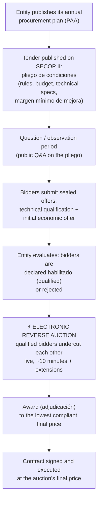
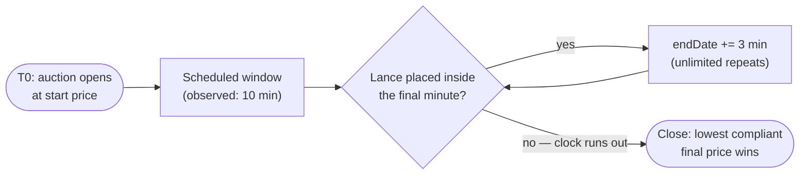

# 00 — Business Context

*This chapter explains who the client is, how Colombian public procurement works, what an electronic reverse auction is, what evidence this project is built on, and what "success" means — so that a new engineer understands the domain before touching any code.*

---

## 1. The client: COOPERATIVA DE VIGILANTES STARCOOP CTA.

**STARCOOP** is a Colombian *cooperativa de trabajo asociado* (CTA — an associated-work cooperative) that sells **private security and surveillance services** (*vigilancia y seguridad privada*): guards, monitoring, and the technological means that support them. Key identifiers:

| Attribute | Value |
|---|---|
| Legal name | COOPERATIVA DE VIGILANTES STARCOOP CTA. |
| NIT / SECOP company code | `700961121` |
| SECOP II username | `Starcoopcta2017` |
| Sector regulator | Superintendencia de Vigilancia y Seguridad Privada (*Supervigilancia*) |
| Primary customer base | Colombian public entities (municipalities, institutes, agencies) |

Two facts about this client shape everything downstream:

1. **"Sales" means winning public contracts.** STARCOOP's revenue comes overwhelmingly from Colombian state entities, which by law must buy through public procurement. Growing the business means winning more tenders, and an increasing share of those tenders are decided by **electronic reverse auction** — a ten-minute, real-time, lowest-price-wins event.

2. **The price floor is statutory, not just economic.** For security services, Supervigilancia publishes minimum tariffs (currently *Resolución 20251000059517*). Bidding below that tariff is not merely unprofitable — it is **illegal** and grounds for rejection and sanction. This is why the floor price (*precio mínimo*) is treated as law throughout this project (see [Compliance](05-compliance.md)).

Everything this project automates happens on **STARCOOP's own account, placing STARCOOP's own bids**. The bot is a power tool for a legitimate market participant, not a scraper, not a market-surveillance product, and never an instrument for coordinating with other bidders — coordination between bidders (*colusión*) is a crime under Colombian competition law (see [Compliance](05-compliance.md)).

---

## 2. Colombian public procurement in one page

A new engineer needs roughly this much civics:

- Colombian public entities must buy goods and services through regulated, transparent procedures. The framework laws are **Ley 80 de 1993** and **Ley 1150 de 2007**, implemented by **Decreto 1082 de 2015**.
- The national procurement agency, **Colombia Compra Eficiente (CCE)**, operates the mandatory electronic platform: **SECOP II** (*Sistema Electrónico de Contratación Pública*, version II). Every step of a tender — publication, questions, offers, evaluation, award, contract — happens inside SECOP II, and everything is recorded and public.
- SECOP II is not one system but (at least) three cooperating hosts, which matters a great deal to this project:

| Host | Role |
|---|---|
| `community.secop.gov.co` | Identity provider (STS). Issues the session JWT. Login is reCAPTCHA-protected. |
| `www.secop.gov.co` | The main portal: tender workspaces, documents, offers, messaging. |
| `subastas.secop.gov.co` | The **auction engine**: a REST API plus a SignalR realtime channel. This is where the ten minutes happen. |

The full reverse-engineered surface of these hosts is in the [API contract](01-api-contract.md).

### 2.1 The procedure that matters to us: *Selección Abreviada por Subasta Inversa* (SASI)

For standardized goods and services (*bienes y servicios de características técnicas uniformes* — security guarding qualifies), entities use an abbreviated procedure whose final price is set by a live reverse auction. The lifecycle:

Weeks or months of paperwork funnel into a **single ten-minute pricing event**. Qualification (the paperwork) determines *who may bid*; the auction determines *who wins and at what price*. This project automates only the auction leg — plus the upstream discovery of which auctions are worth entering ([Tender Discovery](06-tender-discovery.md)). The paperwork stays human.

> **Vocabulary you will see everywhere:** a *lance* is a single bid placed during the auction; the *pliego de condiciones* is the tender rulebook; *margen mínimo de mejora* is the minimum amount by which a new lance must improve on the previous one; *habilitado* means qualified to participate. A fuller glossary closes this chapter (§9), and the platform's own string table is in [Platform Vocabulary](09-platform-vocabulary.md).

---

## 3. The *subasta inversa electrónica* — and why it is won or lost in ten minutes

A reverse auction inverts the familiar auction: the **price only goes down**, and the **lowest** compliant price wins. On SECOP II it works like this (mechanics in full detail in [Auction Mechanics](02-auction-mechanics.md)):

- The auction opens at a scheduled instant with a **start price** (typically the best initial offer or the budget ceiling) and runs for a short scheduled window — **ten minutes** in the auction we captured.
- Qualified bidders place *lances* through the auction room in their browser. Each lance must undercut their own previous position by at least the **minimum decrement** (*margen mínimo de mejora* — the rule the platform enforces via its `ValidateBid` endpoint).
- **Auto-extension abolishes sniping.** If any qualifying lance lands inside the final minute (`extraTimeLastMinutesStartPeriod: 1`), the auction extends by three minutes (`extraTimePeriod: 3`) — and this can repeat without limit. The auction does not end at a known time; it ends **when nobody is willing to improve**. A last-second snipe simply buys every rival three more minutes.
- Visibility is deliberately partial: in our captured configuration bidders see the best bids but **not** rival identities (`showBidderNameForOtherBidders: false`), not the total participant count, and not a live ranking (`showRanking: false`).

### 3.1 Why ten minutes decides months of work

Three forces compress the outcome into the auction window:

1. **The price is set live, under a clock.** Everything before the auction only earns you a seat. The contract value is decided by who can keep placing legal bids, at the right size, until rivals give up.
2. **Reaction quality beats reaction speed.** The platform itself is slow — measured REST latency p50 ≈ 0.9 s, p90 ≈ 6.9 s, worst observed 10.1 s; a single `ValidateBid` took 4.6 s. Milliseconds are irrelevant. What matters is *never* being the bidder who is disconnected, confused about the current state, or unable to compute a legal next bid within a few seconds — indefinitely, across extension after extension.
3. **Mistakes are asymmetric and permanent.** A lance **cannot be retracted**. Bidding too high loses one contract; bidding too low **wins a contract at a loss** and legally binds the cooperative to deliver at that price. This asymmetry is the reason the floor is enforced in five independent layers ([Architecture §6](07-architecture.md)) and the bot's default posture is to do nothing.

### 3.2 What actually goes wrong in the room (observed, not hypothesized)

The screen recording and event logs of a real auction show that the decisive failures are **operational**, not strategic:

| Observed hazard | Evidence | Consequence |
|---|---|---|
| The realtime connection drops — for everyone | The room displayed **`ESTADO: DESCONECTADO`** mid-auction; 36 of 44 connected companies dropped at least once; 100 disconnect events and 199 reconnects in ~10 minutes; median 4 reconnects per company, worst 19 | ~80% of the room fought the connection instead of the auction. Staying connected — or reconnecting and reconciling correctly — is the single biggest edge |
| The platform is slow and jittery | REST p50 835–941 ms, p90 6.9 s, max 10.1 s; `ValidateBid` 4.6 s | You cannot decide at T−2 s; a timeout does not mean the bid failed; every deadline needs seconds of margin |
| The local clock lies | Operator's PC was **+13.15 s** off the auction server's clock | A human (or naive bot) using local time misjudges the final minute entirely |
| The read API goes backwards | `GetAuctionSimple` served `Started → ReadyToStart → Started` during a live auction | State handling needs regression guards; a single read is never trusted |
| Rivals post probe bids | Lances of **1,00 COP** and **0,00 COP** appeared in the capture | A naive "beat the best visible bid" strategy would chase nonsense below its own floor |
| Humans fumble validation under pressure | Both human `ValidateBid` attempts in the recording failed — and each failure is permanently written to the entity's audit log with our NIT and IP | Validation attempts are a budgeted, audited resource, not a free query |

These observations are the project's founding argument: **availability, discipline, and floor-obedience win; speed does not** ([Architecture §1](07-architecture.md)).

---

## 4. The captured auction: SASI-001-2026

Everything we know about the platform was reverse-engineered from one real auction, observed end-to-end on **2026-03-02**:

| Fact | Value |
|---|---|
| Tender | `SASI-001-2026` |
| Procuring entity | Instituto Distrital de Protección y Bienestar Animal (Bogotá district animal-welfare institute) |
| Object | Single item, "MEDIOS TECNOLÓGICOS" (technological means / security technology) |
| Auction type | `Reversed` (lower is better), evaluation `BestPrice`, currency COP |
| Start price | **115 670 523,00 COP** (≈ USD 29 000) |
| Scheduled window | 20:30 → 20:40 UTC (15:30 → 15:40 Bogotá time) — **10 minutes** |
| Extension rule | Lance in the last 1 minute → +3 minutes, automatic, unlimited |
| Observed minimum decrement | **1 156 705,23 COP** — exactly 1.00% of the start price (see caution below) |
| Room population | ~20+ companies connected simultaneously; **44 distinct companies** seen in the roster over the auction |
| Connection chaos | 100 disconnects, 199 reconnects, 36/44 companies dropped at least once |

> **⚠️ The 1% rule is a hypothesis, not a law.** The observed decrement equals 1% of the *start price* (`minimumBidType: 1`), i.e. an absolute step that never shrinks as the price falls. But a live counterexample exists — tender UNP SASI-064-2026 used **2% of the last valid lance**. The decrement must always be read from the server's own auction configuration and calibrated per auction, never assumed ([Auction Mechanics](02-auction-mechanics.md), Open Questions in [Architecture §12](07-architecture.md)).

> **Money formatting caution:** Colombian locale writes this decrement as `1.156.705,23` — dot as thousands separator, comma as decimal. Every es-CO number crossing our boundary is parsed with locale-aware code; a naive `parseFloat` would read it as ~1.16. This is a recurring theme in [Client Protocol](03-client-protocol.md).

---

## 5. The evidence bundle — what it is and how it must be handled

The knowledge in these chapters comes from an evidence bundle captured during SASI-001-2026:

| Artifact | Contents |
|---|---|
| **5 HAR captures** | Full HTTP traffic of the auction room: REST calls (`GetAuction`, `GetSupplierBids`, `ValidateBid`, audit endpoints), the SignalR long-polling exchange, the login flow |
| **65-minute screen recording** | The human operator's full session: room entry, the `DESCONECTADO` episode, two failed `ValidateBid` attempts, the live leaderboard |
| **Decoded session JWT** | The token's claims (issuer, audience, company code/name, 24 h lifetime) — how identity flows between the three hosts |

The HARs are distilled into the [API contract](01-api-contract.md) by `tools/digest_har.py`, which redacts credentials as it writes. A replayable trace and conformance vectors derived from the bundle live under `fixtures/`.

### 5.1 The security handling rule (non-negotiable)

The raw bundle contained a **live session JWT** and HAR files carrying **session cookies** for the STARCOOP SECOP II account. Handling rules, treated as standing policy:

1. **Treat every credential in the bundle as compromised.** The SECOP II password for `Starcoopcta2017` must be rotated before going live.
2. **The raw bundle never enters version control.** `*.har`, `TOKEN*.txt`, recordings and archives are gitignored; only redacted digests (like [01-api-contract.md](01-api-contract.md)) and sanitized fixtures are committed.
3. **Share the bundle only over channels appropriate for secrets** — it is credential material, not documentation.
4. **All derived documents are credential-free.** No real JWT, cookie, or password appears in any chapter, fixture, or log sample — and the runtime enforces the same rule with token-redacting log processors.

Full treatment in [Compliance](05-compliance.md).

---

## 6. Problem statement

> STARCOOP competes for public security contracts in SECOP II reverse auctions, where the contract price is decided in a ~10-minute live event with unlimited 3-minute extensions. A human bidder in a browser demonstrably (a) gets disconnected — as ~80% of the room did, (b) misjudges deadlines against a server clock their PC disagrees with by 13 seconds, (c) fumbles bid validation under pressure — leaving a permanent audit trail of failures, and (d) has no mechanical protection against bidding below the statutory and economic floor.
>
> Build a system that keeps STARCOOP **present, informed, legal, and floor-obedient** in any SECOP II auction, on their own account, for as many extension rounds as it takes — placing every lance early, validated, and above a human-approved floor — while remaining polite to the platform, fully audited, and killable by a human at any instant.

The decided solution — codename **`centinela`** — is specified in [Architecture](07-architecture.md); its delivery sequence (co-pilot first, automated submit only after the protocol unknowns are pinned) is in the [Roadmap](08-roadmap.md).

### 6.1 Goals

| # | Goal | Where specified |
|---|---|---|
| G1 | **Universal**: works for any SECOP II auction — any `auctionId`, any lot/item shape, any decrement rule, any entity. Nothing hardcoded to SASI-001-2026 or company 700961121 | [Architecture](07-architecture.md) |
| G2 | **Never bid below the floor** — enforced in multiple independent layers, with a latched kill on violation | [Architecture §6](07-architecture.md), [Strategy Engine](04-strategy-engine.md) |
| G3 | **Survive the platform**: reconnect, reconcile, and keep a disciplined server-clock estimate through disconnects, backwards reads, and 10-second latency tails | [Client Protocol](03-client-protocol.md) |
| G4 | **Validate before submitting, always** — and never blind-retry an ambiguous submit | [Architecture §4.6](07-architecture.md) |
| G5 | **Human-assisted auth**: reCAPTCHA-gated login is bootstrapped by a human in a real browser; the bot never tries to defeat it | [Client Protocol](03-client-protocol.md) |
| G6 | **Operable by a security cooperative**: one binary, one YAML per auction, a three-action web panel, one red button, Spanish runbooks | [Architecture §1.9](07-architecture.md) |
| G7 | **Audited and attributable**: hash-chained audit log; a named human arms the bot and signs every lance (credentials are an electronic signature under Ley 527/1999) | [Compliance](05-compliance.md) |
| G8 | **Choose battles**: rank upcoming tenders days ahead so humans decide which auctions to enter — including deciding *not* to enter | [Tender Discovery](06-tender-discovery.md) |

### 6.2 Explicit NON-goals

| # | Non-goal | Why |
|---|---|---|
| N1 | **Not a high-frequency trading system.** No latency arms race, no sniping | The extension rule makes sniping self-defeating; the platform's own ~7 s p90 makes milliseconds worthless |
| N2 | **No pricing intelligence.** The bot never decides what a contract is worth; a human sets the floor, the bot only obeys it | One wrong floor is a company-destroying event; cost estimation is a human, legal, and accounting problem |
| N3 | **No collusion, ever.** No coordination with, signaling to, or profiling of other bidders beyond what the API already returns to every participant | Crime under Colombian competition law; see [Compliance](05-compliance.md) |
| N4 | **No platform abuse.** No DoS, no scraping beyond the participant API, no rate-limit evasion, no CAPTCHA defeat, no multiple identities | Legitimacy is a hard constraint — and a WAF-blocked IP is legally *our* withdrawal from the auction (Decreto 1082 art. 2.2.1.2.1.2.6) |
| N5 | **No unattended fully-headless operation.** A human bootstraps every session and remains reachable during every armed auction | Auth is reCAPTCHA-gated by design; accountability requires a named human |
| N6 | **Not a multi-tenant SaaS.** One company (STARCOOP), their own account, self-hosted | Scope, safety, and the legal posture of "our own bids on our own account" |
| N7 | **No automation of the tender paperwork** (offers, qualification documents, contract execution) | Different problem, different risk profile; discovery only produces *ranked candidates for human review* |

---

## 7. How success is measured — KPIs

Every KPI below is computable from data the system already records: the hash-chained audit log, the platform's own `GetEventLogs`/`GetSupplierBids`, and the local latency/clock stats database. No KPI requires trusting the bot's opinion of itself.

### 7.1 Safety invariants (not targets — absolutes)

| Invariant | Definition | Tolerance |
|---|---|---|
| **Floor violations** | A lance submitted with total below the approved floor sheet | **Zero, ever.** Any violation trips the latched kill and is a full post-mortem |
| **Unvalidated submits** | A submit not preceded by a successful `ValidateBid` of the byte-identical body | **Zero, ever** |
| **Unauthorized arming** | Any armed state without a typed human confirmation on record | **Zero, ever** |

### 7.2 Effectiveness KPIs

| KPI | Definition | Source | Target |
|---|---|---|---|
| **Win rate** | Auctions won ÷ auctions entered *armed* (co-pilot-only auctions tracked separately). Compare against the pre-bot human baseline | Audit log + award records | Beat the human baseline; trend up quarter over quarter |
| **Margin retained vs floor** | For won auctions: `(P_final − P_floor) ÷ (P_start − P_floor)` — of the room between start price and our floor, the fraction we did **not** give away. A win exactly at floor scores 0% | Audit log (floor sheet SHA + final lance) + `GetSupplierBids` | Maximize subject to winning; review any win at <5% for whether we should have entered at all |
| **Auction selection quality** | Of auctions discovery ranked and humans entered, the share that were winnable at ≥ floor + threshold (in hindsight, from final prices) | Discovery records + public award data | Improves the denominator of win rate; "do not enter" calls are counted as successes when the final price closed below our floor |

### 7.3 Execution KPIs (the ones the bot exists for)

| KPI | Definition | Source | Target |
|---|---|---|---|
| **Bids landed within deadline** | Server-confirmed lances ÷ strategy `BID` decisions while armed. Complement: every `SKIP_NO_TIME` and every decision-to-confirmation over budget is an incident record | Audit log correlated with `GetEventLogs` | ≥ 99% per auction; any missed intended bid in the final scheduled minute or an extension = post-mortem |
| **Bid early-margin** | Seconds between server confirmation of our lance and the then-current `endDate` (design intent: land at T−45 s, never inside the extension-trigger minute unless deliberate) | Audit log + disciplined server clock | p50 ≥ 40 s; p100 > 10 s |
| **Connection uptime (state freshness)** | % of armed auction wall-time in which the newest reconciled state snapshot is within the phase's freshness bound (ARMED ≤ 10 s, ENDGAME ≤ 2.5 s). SignalR leg uptime tracked separately as a secondary metric — the REST leg alone must carry the auction | Snapshot version log | ≥ 99.5% per auction; **no freshness gap > 10 s while armed**; contrast with the field's observed ~80% drop rate |
| **Reconciliation correctness** | After every reconnect/restart: mismatches between our believed "my last lance / endDate" and the server's view | `RECONCILE` audit records | 100% converged before any new decision; zero decisions taken on stale state |
| **Clock discipline** | ε (half-width of the server-clock estimate) while armed; % of armed time in the "bidding blocked: clock unreliable" gate | Clock samples DB | ε ≤ 0.5 s p95; blocked-time < 1% per auction |
| **Auctions missed due to technical failure** | Count of auctions where STARCOOP intended to bid and could not, for any technical reason attributable to us: session expiry, dead runner, wedged browser, blocked IP, canary failure at ARM | Incident log (every occurrence is one) | **Zero per quarter.** This is the headline reliability number — it is the exact failure mode the bot was built to eliminate |

### 7.4 Platform-citizenship KPIs

| KPI | Definition | Source | Target |
|---|---|---|---|
| **ValidateBid rejections** | Server-rejected validations per auction — each is permanently visible to the procuring entity with our NIT and IP | `GetEventLogs` + audit log | ≤ 2 per auction (hard budget); 0 in steady state |
| **Politeness budget adherence** | Request rate vs. the configured per-host budget; any WAF/429/5xx-burst event | Request stats DB | 100% adherence; zero WAF blocks (a blocked IP is legally a withdrawal — see [Compliance](05-compliance.md)) |
| **Audit chain integrity** | Verification of the hash chain across every armed auction, end to end | `centinela replay` | 100%, verified after every auction |

---

## 8. Where this chapter hands off

| You want to understand… | Read |
|---|---|
| Every endpoint, payload, and header the platform speaks | [01 — API Contract](01-api-contract.md) |
| The auction rulebook: states, decrements, extensions, edge cases | [02 — Auction Mechanics](02-auction-mechanics.md) |
| How the client actually talks to SECOP II: auth, SignalR, clock, reconnection | [03 — Client Protocol](03-client-protocol.md) |
| How a bid is decided, guarded, and floored | [04 — Strategy Engine](04-strategy-engine.md) |
| The legal and ethical rulebook: floors, signatures, audit, competition law | [05 — Compliance](05-compliance.md) |
| How we find and rank auctions worth entering | [06 — Tender Discovery](06-tender-discovery.md) |
| The decided system design | [07 — Architecture](07-architecture.md) |
| What gets built, in what order | [08 — Roadmap](08-roadmap.md) |

---

## 9. Glossary

| Term | Meaning |
|---|---|
| *Subasta inversa electrónica* | Electronic reverse auction — price descends, lowest compliant bid wins |
| *Lance* | A single bid placed during the auction. **Irrevocable once accepted** |
| *Pliego de condiciones* | The tender rulebook: requirements, budget, evaluation rules, auction parameters |
| *Margen mínimo de mejora* | Minimum decrement a new lance must achieve over the bidder's previous position |
| *Precio mínimo* (floor) | The human-approved lowest permissible total — statutory (Supervigilancia tariff) and economic. The bot never bids below it |
| *Habilitado* | Qualified — a bidder cleared by the entity's evaluation to participate in the auction |
| *Adjudicación* | Award of the contract to the winning bidder |
| SECOP II | Colombia's mandatory electronic public-procurement platform, operated by Colombia Compra Eficiente |
| SASI | *Selección Abreviada por Subasta Inversa* — the abbreviated-selection-by-reverse-auction procedure (and the tender-numbering prefix) |
| PAA | *Plan Anual de Adquisiciones* — an entity's published annual procurement plan (a discovery input) |
| CTA | *Cooperativa de trabajo asociado* — associated-work cooperative, STARCOOP's legal form |
| NIT | Colombian tax ID; doubles as the company code on SECOP II (STARCOOP: `700961121`) |
| Supervigilancia | Superintendencia de Vigilancia y Seguridad Privada — sector regulator that sets the statutory minimum tariffs |
| COP | Colombian peso. es-CO formatting: `115.670.523,00` — dots for thousands, comma for decimals |
| HAR | HTTP Archive — a browser's recorded network traffic; the raw material of our API contract |
| *Colusión* | Bid-rigging / collusion between bidders — a crime, and an absolute non-goal (N3) |
