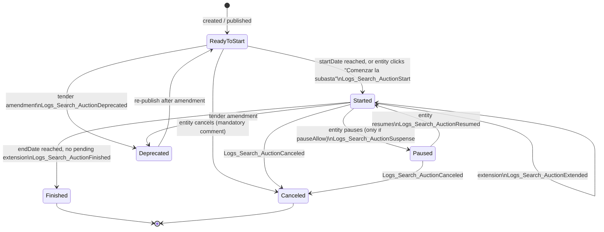

# 02 — Auction Mechanics: the Rules Engine Specification

*Normative specification of how a SECOP II (VORTAL eAuctions) reverse auction actually behaves — states, clocks, decrements, extensions, visibility, and validation — precise enough to implement `domain/` and `guard/` directly from this chapter.*

**Target engine:** `subastas.secop.gov.co/eauctions.api` (VORTAL eAuctions, © VORTAL 2019, ASP.NET backend + AngularJS 1.x client).
**Evidence base:** 5 HAR captures + 65-minute screen recording of tender SASI-001-2026, auction `e66a68a3-a14b-4d8a-8f8e-fd6333ade7ca`, 2026-03-02, entity INSTITUTO DISTRITAL DE PROTECCIÓN Y BIENESTAR ANIMAL, our company code `700961121` (alias "Proveedor AB"), plus one documentary cross-auction data point, the published pliego of UNP SASI-064-2026 (not an API observation).
**Status:** supersedes the informal notes in [01-api-contract.md](01-api-contract.md) for everything concerning auction *mechanics*. Wire formats stay in [03-client-protocol.md](03-client-protocol.md); what to *do* with these rules is [04-strategy-engine.md](04-strategy-engine.md); why some of these rules are legal obligations is [05-compliance.md](05-compliance.md); where each rule lives in code is [07-architecture.md](07-architecture.md).

---

## 0. Evidence grading

Every claim in this chapter carries one of three tags. An engineer implementing from this document must treat the tags as load-bearing: **ASSUMED** claims require fail-safe code paths, and **DERIVED** claims require runtime assertions that halt on contradiction.

| Tag | Meaning | Code obligation |
|---|---|---|
| **CONFIRMED** | Directly present in a captured HTTP payload, in the client's own Angular templates, in the server's localisation bundle, or legible in a recording frame. | May be relied on; still assert at adapter boundary (wire drift). |
| **DERIVED** | Arithmetic or logical consequence of CONFIRMED facts, derivation shown. | Rely on it *and* assert it; on contradiction → halt bidding, alarm. |
| **ASSUMED** | Plausible but unverified. | Fail safe against it being wrong; never let an ASSUMED claim alone authorize a bid. |

### 0.1 Primary evidence index (new findings, beyond 01-api-contract)

1. **`minBidDifference` is a published, per-item, first-class field.** `GET /v1/auction/GetAuction/{id}/{locale}` → `biddingList[0].biddingPriceListItems[0].minBidDifference = 1.0`, `minBidDifferenceStr = "1.000000"`, alongside `itemInitialUnitPrice`, `itemInitialPrice`, `itemQuantity`, `hasDecimalPlace`. **CONFIRMED.** The minimum decrement is not reverse-engineered — it is served.
2. **`minimumBidType` is `1` in `GetAuctionSimple` and the string `"Percentage"` in `GetAuction`.** Same field, two encodings. **CONFIRMED**: `1 == Percentage`.
3. **The UI renders the rule as a percent**: the price-list grid column *"Lance mínimo"* displayed **`1%`** (recording frame, 15:31:10 local). **CONFIRMED.**
4. **Measured clock skew**: correlating 41 `auction.ReceiveClock` payloads against HAR completion times gives a constant **+13.15 s** client-ahead offset, stable ±0.05 s over 10 minutes. **CONFIRMED.**
5. **`ValidateBid` writes an entity-visible audit record on failure.** After skew correction, both failed `ValidateBid` calls map exactly (±0.4 s, ±0.1 s) onto `GetEventLogs` rows (`Logs_Search_Bid` / `Logs_Search_NewBid`, description `"Error cuando presentado el lance. Problema: …"`) carrying our `userCode` and public IP. **CONFIRMED** (2 of 2). Validation is **not** a silent dry run.
6. **`GetAuctionSimple` serves stale reads that go backwards.** At server time: 20:30:03 → `Started`; 20:30:06 → `ReadyToStart`; 20:30:09 → `ReadyToStart`; 20:30:12 → `Started`. The `Logs_Search_AuctionStart` event fired exactly once, at 20:30:12.43. **CONFIRMED**: the read path is eventually consistent and non-monotonic.
7. **`auction.newData([true,false,false])` fires ~60–130 ms after each accepted bid** (fired exactly twice, matching the two rival bids at 20:30:16.74 and 20:30:19.98). **CONFIRMED.** It is the bid-notification edge.
8. **Platform latency is the binding real-time constraint.** Non-SignalR REST: n=26, p50 **835 ms**, p90 **6.9 s**, max **10.1 s**. `ValidateBid` itself: 403 ms and **4 637 ms**. `GetSupplierBids`: up to 9.0 s. **CONFIRMED.**
9. **Cross-auction counterexample (UNP SASI-064-2026):** the published *pliego* for that tender specifies a margen mínimo of **2 % of the last valid lance**, not of the start price. **DOCUMENTARY — this is text in a tender document, not an observed API rejection.** That auction had not run at the time of writing (offers due 2026-08-12), so no `ValidateBid` response from it exists and its `minimumBidType` is unknown. Consequence: the *base* of the percentage rule is not platform-constant. See §4.6 and O-M1.

> **Security note on the evidence itself:** the screen recording contains, in cleartext, the SECOP login form payload (username + password) and a full Bearer JWT rendered in DevTools. Treat that artefact as a credential-bearing file: restrict access, rotate the account password before this project ships. Neither value is transcribed anywhere in this documentation set.

---

## 1. Canonical vocabulary

| Term | Field(s) | Notes | Grade |
|---|---|---|---|
| Auction | `id` (uuid) | Entered via `www.secop.gov.co/CO1ExternalIntegration/TenderingSupport/AuctionsIntegration/Index?…&AuctionId=…` | CONFIRMED |
| Lot | `biddingList[].internalId` = `CO1.OTLN.<n>` | In `AuctionbyProposal` a single synthetic lot with `lotInternalId: "ALLLOTS"`, `lotName: ""` | CONFIRMED |
| Item / line | `biddingPriceListItems[].id` (uuid), `.internalId` = `CO1.BILN.<n>` | Quantitative items live in a parallel array `biddingQuantitativeItems` (empty in the observed auction) | CONFIRMED |
| Lance | a bid | Event-log type `Logs_Search_Bid` | CONFIRMED |
| Lance inicial | `itemInitialPrice` / `startPrice` | The auction's opening price | CONFIRMED |
| Lance actual | locale key `Grid_Current_Bid` | **The auction's current best bid** — *not* "my bid". "Mine" is `Grid_Last_Bid` = *"Mi último lance"* | CONFIRMED (localisation bundle) |
| Lance mínimo | `minBidDifference` + `minimumBidType` | The decrement rule; rendered `1%` in the grid | CONFIRMED |
| Próximo lance | client-side input | The value about to be submitted | CONFIRMED |

### 1.1 Auction shape flags

| Field | Observed value | Meaning | Grade |
|---|---|---|---|
| `auctionVersionCode` | `AuctionbyProposal` | *Por lista* — one global bid across the whole price list. Other values: `AuctionByLot` (*Por lote*), `AuctionByItem` (*Por artículo*) | CONFIRMED (locale keys `Settings_AuctionByProposal/ByLot/ByItem`); enum mapping 0=Proposal, 1=Lot, 2=Item **DERIVED** from `ng-if` bindings in `bidderList.html` / `biddersStatus.html` |
| `auctionTypeCode` | `Reversed` | *Descendente* — lower is better. Opposite: `Forward` (*Ascendente*) | CONFIRMED (`Settings_Reversed`, `Settings_Forward`) |
| `auctionEvaluationTypeCode` | `BestPrice` | Pure price, no scoring formula (`scoreCalcFormula: null`, `evaluationRules: []`) | CONFIRMED |
| `procedureType` | `RFP` | | CONFIRMED |
| `initialValueDifferentPerBidder` | `false` | All bidders share one start price | CONFIRMED |
| `testAuction` | `false` | `true` would mean nothing persists (`Header_Test_Description`) | CONFIRMED |

> **RULE V-1.** `Forward` auctions are refused at load (per [Architecture §5.2](07-architecture.md)): every arithmetic sign in this chapter assumes descending prices, and running that code against an ascending auction inverts safety into danger.
>
> **RULE V-2.** `testAuction: true` → refuse to bid unless `config.allow_test_auctions` is explicitly set, and even then never emit floor-relevant real prices into a test auction (they leak our cost structure for zero contractual value).

---

## 2. The two orthogonal state machines

### 2.1 Why there are two

`auctionStateCode` is the **business/lifecycle** state of the auction object — what the entity has done to it. `auctionExecutionStateCode` is the **runtime/engine** state of the scheduler process — whether the engine is ticking. They are stored and returned independently: the observed pair was `("ReadyToStart", "Running")` *before* the auction opened, i.e. the engine was "Running" while the auction had not started. **CONFIRMED.** Treating either field alone as "the state" is the single most likely way to build a bot that bids into a closed auction or sits out an open one.

### 2.2 Machine A — `auctionStateCode` (lifecycle)

| Value | Spanish label | Source | Grade |
|---|---|---|---|
| `ReadyToStart` | *Listo para comenzar* | Observed in 6 payloads; locale keys `AuctionsAdm_Ready_To_Start`, `Sidebar_Ready_To_Start` | **CONFIRMED** |
| `Started` | *Iniciado* / *En curso* | Observed in 4 payloads; `AuctionsAdm_Started`, `Sidebar_In_Progress`; header badge read **"EN CURSO"** in the recording | **CONFIRMED** |
| `Finished` | *Terminado* | `AuctionsAdm_Finished`, `Sidebar_Finished`, `Log_Message_AuctionFinished`, `Logs_Search_AuctionFinished` | **CONFIRMED as a value**, not observed live |
| `Paused` | *Suspendido* | `AuctionsAdm_Paused`, `Sidebar_Paused`, `Log_Message_AuctionPause`, `Logs_Search_AuctionSuspense`, `Logs_Search_AuctionResumed` | **CONFIRMED as a value**, not observed (this auction had `pauseAllow: false`) |
| `Canceled` | *Cancelado* | `AuctionsAdm_Canceled`, `Sidebar_Canceled`, `Log_Message_AuctionCanceled`, `Logs_Search_AuctionCanceled` | **CONFIRMED as a value**, not observed |
| `Deprecated` | *Modificación* | `auctionheader.html` contains `ng-show="currentAuction.auctionStateCode === 'Deprecated'"` rendering `Deprecated_For_Amendment`; log subtype `Logs_Search_AuctionDeprecated`; client ships a `#modalAmendment` dialog | **CONFIRMED as a value** (client source), not observed |

Exact spellings of `Finished`, `Paused`, `Canceled` are **DERIVED** from the locale-key suffix convention that correctly predicts `ReadyToStart` and `Started`. Note the American single-l **`Canceled`**. Compare case-insensitively; treat any unrecognized string as **not tradeable** (fail closed).



| Transition | Trigger | Log type / subtype | Grade |
|---|---|---|---|
| `ReadyToStart → Started` | `startDate` reached (auto) or entity clicks *Comenzar la subasta* | `Logs_Search_Announcement` / `Logs_Search_AuctionStart`, description "Subasta en Curso" | **CONFIRMED** (observed at 20:30:12.43) |
| `Started → Started` | extension (§7) | `Logs_Search_AuctionExtended`, message `"Subasta Prorrogada por {0} segundos"` | **CONFIRMED as a log type**; arithmetic DERIVED, §7 |
| `Started → Finished` | `endDate` reached with no pending extension | `Logs_Search_AuctionFinished` | DERIVED |
| `Started → Paused` | entity, only if `pauseAllow == true` | `Logs_Search_AuctionSuspense` | DERIVED |
| `Paused → Started` | entity resumes; `pauseOptions: "ExtraTimeAndComment"` implies resume may grant extra time and requires a comment | `Logs_Search_AuctionResumed` | DERIVED |
| `* → Canceled` | entity, mandatory justification (`Settings_Cancel_Comments`) | `Logs_Search_AuctionCanceled` | DERIVED |
| `* → Deprecated` | tender amendment invalidates the auction | `Logs_Search_AuctionDeprecated` | DERIVED |

**Pause preserves remaining time.** `Log_Message_AuctionPauseWithDiffTime` / `Log_Message_AuctionCanceledWithDiffTime` ("Faltaban {0} minutos y {1} segundos para el fin") prove the engine records remaining time at pause. **CONFIRMED.** Therefore on resume the bot must **re-read `endDate`** — never assume the pre-pause deadline, and note that with `pauseOptions: "ExtraTimeAndComment"` the resume itself may have added time.

### 2.3 Machine B — `auctionExecutionStateCode` (engine runtime)

Only `Running` was ever observed (10/10 payloads). **CONFIRMED.** No other value appears in the captures, locale bundle, or templates — this field is not surfaced in the supplier UI at all. Inferred value space: something like `{NotRunning | Running | Stopped | Error}` — **ASSUMED**, unverifiable from our evidence.

Because the value space cannot be enumerated, the rules engine must be written *positively*:

> **RULE B-1 (positive test only).** Trading is permitted only if `auctionExecutionStateCode == "Running"` (exact match, case-insensitive). Any other value — including one never seen before — halts bidding and raises an operator alert. Never invert the test (never "block only on known-bad values").

### 2.4 The composite tradeable gate

```
tradeable(a, now_server) :=
      normalize(a.auctionStateCode)          == "started"        # Machine A, high-water confirmed (§2.5)
  AND normalize(a.auctionExecutionStateCode) == "running"        # Machine B, RULE B-1
  AND now_server >= a.startDate                                  # server clock only (§3)
  AND now_server <  a.endDate                                    # endDate = latest read, high-water (§7)
  AND (a.testAuction == false OR config.allow_test_auctions)     # RULE V-2
  AND a.auctionTypeCode == "Reversed"                            # RULE V-1
  AND not finished_participation(me)                             # §2.6
  AND snapshot_age <= 5 s   (ENDGAME: <= 2.5 s)                  # staleness bound, Architecture §5.2
```

Notes:

- `startDate`/`endDate` comparisons use the **disciplined server clock** (§3), never local time — the operator's PC was 13.15 s wrong.
- The explicit `now_server >= startDate` guard exists because of the stale-read hazard: `Started` was observed on a replica *before* the authoritative start event (finding 0.1.6 shows reads from divergent replicas).
- The gate is evaluated on an **immutable snapshot**; both machine values must come from the *same* snapshot (mixing fields from two reads reintroduces the race).

### 2.5 Anti-flap discipline (mandatory, from finding 0.1.6)

Because `GetAuctionSimple` demonstrably returns `ReadyToStart` *after* returning `Started`:

> **RULE B-2 (monotonic latch).** Maintain a state ordinal `ReadyToStart(0) < Started(1) < Finished(2)`, with `Paused`, `Canceled`, `Deprecated` as side states. A read that would *decrease* the ordinal is recorded in history and logged as `STALE_READ`, but does **not** lower the latched state unless corroborated by **(a)** two consecutive reads ≥ 3 s apart **and** **(b)** a matching `AuctionExtended` / `AuctionResumed` / `AuctionDeprecated` row in `GetEventLogs`.
>
> **RULE B-3 (absorbing states).** `Finished`, `Canceled`, `Deprecated` are absorbing: once latched, the runner stops and never resumes for that `auctionId` without human re-arm.
>
> **RULE B-4 (event log is the transition authority).** Recognize `→ Started` preferentially from `Logs_Search_AuctionStart` in `GetEventLogs` — append-only and exact in the capture — rather than from the state field, which flapped. The same holds for finish/pause/resume/cancel/deprecate: log rows override stale REST state reads.

### 2.6 Per-supplier terminal state: *Finalizar Participación*

Our own row in `bidders[]` carries `eauctionFinishParticipation`. Once anyone on our account invokes *Finalizar Participación*, we are locked out for the remainder of the auction — `Auction_FinishedParticipation_Modal_Text` states re-entry is impossible while the auction is *En curso*. **CONFIRMED.**

> **RULE B-5.** The bot must **never** expose, automate, or invoke *Finalizar Participación* through any driver (REST or browser). It only *reads* the flag; if it ever reads `true` for our own row, it latches CLOSED for that auction and alarms (someone acted outside the bot).

---

## 3. Clock discipline (prerequisite for every timing rule)

**CONFIRMED measurement:** across 41 `ReceiveClock` samples (20:25–20:35 UTC), `t_client − t_server = +13.15 s ± 0.05 s`, with two outliers (+13.9 s, +15.4 s) attributable to long-poll delivery jitter. The operator's PC believed the auction ended 13 seconds earlier than it did. The page header, the countdown widget, and the OS taskbar disagreed with each other by up to ~20 s in the recording. There are four clocks in play; exactly one is authoritative.

> **RULE C-1 (single time authority).** The only authoritative time source is `auction.ReceiveClock`, obtained by invoking `auction.RequestClock([])` over SignalR (wire details in [03-client-protocol.md](03-client-protocol.md)). Maintain `offset θ = server_time − local_monotonic_at_receipt` as a **median of the last N ≥ 5 samples**, discarding samples whose enclosing poll lasted > 2 s (delivery jitter inflates them one-directionally — a minimum-delay filter is the correct estimator shape).
>
> **RULE C-2 (sampling cadence).** ≥ 1 sample / 10 s while `Started`; ≥ 1 sample / 2 s during the final 120 s. The observed human client used 8–30 s (~8–10 s during the auction). Never below ~2 s: that becomes abusive polling and violates the politeness constraint ([05-compliance.md](05-compliance.md)).
>
> **RULE C-3 (monotonic arithmetic).** All deadline arithmetic is `local_monotonic + θ` — never wall-clock, which can step (NTP) mid-auction. `time.time()` is lint-banned outside logging ([Architecture §2](07-architecture.md)).
>
> **RULE C-4 (time-blindness).** If no fresh clock sample has arrived for > 30 s, the bot is **time-blind**: it must not compute new endgame decisions and must escalate to the operator. All decisions use the **pessimistic edge** `now_latest() = θ + ε`; bidding is blocked outright when ε > 2 s or the estimate is > 60 s old (Architecture §5.3 tightens this chapter's floor — the stricter of the two always wins).

### 3.1 The latency budget

The engine's own p90 is ~6.9 s, worst observed 10.1 s, and `ValidateBid` alone took 4.6 s once. Therefore:

```
T_submit_deadline = endDate
                  − RTT_p99(ValidateBid)      # budget ≥ 6 s
                  − RTT_p99(SubmitBid)        # budget ≥ 6 s — endpoint unconfirmed (O2), assume worst
                  − clock_uncertainty         # ≥ 2 s
                  − safety_margin             # ≥ 5 s
  ⇒ stop initiating new bid cycles ≈ 20 s before endDate; 15 s is a hard cutoff.
```

**DERIVED**, firmly evidence-backed. A cycle that cannot complete before the cutoff is skipped and logged `SKIP_NO_TIME`; combined with the extension mechanics (§7) this is why the strategy bids **early** (T−45 s target) and never snipes.

---

## 4. The minimum-decrement rule ("lance mínimo")

### 4.1 What the server publishes

From `GET /v1/auction/GetAuction/{id}/es-CO`:

```json
"minimumBidType": "Percentage",          // == 1 in GetAuctionSimple
"startPrice": "115670523.000000",
"roundTypeCode": "Up", "decimalNum": 2, "totalNum": 20,
"biddingList": [{
  "internalId": "CO1.OTLN.68743791", "lotInternalId": "ALLLOTS",
  "biddingPriceListItems": [{
    "id": "16c20486-…", "itemInternalReference": "1",
    "itemDescription": "MEDIOS TECNOLÓGICOS", "itemUnit": "PS",
    "itemQuantity": 1.0,
    "itemInitialUnitPrice": 115670523.0,
    "itemInitialPrice": 115670523.0,
    "minBidDifference": 1.0,             // ← the rule, per item
    "hasDecimalPlace": true
  }]
}]
```

And the server's own materialisation of it, from the rejected `ValidateBid`:

```
minBid = "1.156.705,23 COP"     (es-CO formatting: '.' thousands, ',' decimals)
```

### 4.2 The "1 % of start price" question — resolved for this auction

`115 670 523 × 0.01 = 1 156 705.23` exactly. Three independent artefacts agree:

1. `minBidDifference = 1.0` — **CONFIRMED**, published per item;
2. `minimumBidType = 1 = "Percentage"` — **CONFIRMED**, same field in two encodings;
3. the grid column *Lance mínimo* rendering **`1%`** — **CONFIRMED**, recording frame.

**Verdict for SASI-001-2026: CONFIRMED — the percentage was applied to the item's *initial* price, not to the current best bid.** Proof: at the moment of our validations the auction's *Lance actual* was `0,00 COP` (legible in frame); 1 % of 0 is 0, yet the server demanded 1 156 705,23. The only base that yields that number is `itemInitialPrice`. **DERIVED, decisive — within this auction.**

Residual ambiguity inside this auction: with a single item whose `itemInitialPrice` equals `startPrice`, "percentage of `itemInitialPrice` summed over items" and "percentage of auction `startPrice`" are indistinguishable. §4.5 computes per item and sums, which is the only reading compatible with `minBidDifference` being a *per-item* field (RULE M-4).

Structural consequence: **for this auction the minimum step was an absolute currency amount fixed for the whole auction** — it does not shrink as the price falls. At a 1 % step from 115.67 M, the ladder has ~99 rungs to zero and each rung costs 1 156 705,23 COP of margin. There is no "shave one peso off the leader" move.

### 4.3 The `minimumBidType` enum

| Code | Label | Interpretation of `minBidDifference` | Grade |
|---|---|---|---|
| `1` | `"Percentage"` | percent, base per §4.6 | **CONFIRMED** |
| `0` | probably `"Value"` / `"Amount"` | absolute currency amount per item | **DERIVED** — the field needs a type tag precisely because the same numeric field can be either; VORTAL's UI offers *Lance mínimo* as either a % or a value; a 0-based enum with 1=Percentage makes 0=Value the overwhelmingly likely partner |
| `2` | possibly `"PercentageOfBest"` or `"None"` | percent of the *current best / last valid lance* rather than the initial price | **ASSUMED** — no direct evidence; the UNP counterexample (§4.6) makes some such variant likely to exist |
| `3`+ | unknown | — | **ASSUMED** |

### 4.4 Safety rules for the decrement

> **RULE M-1 (fail closed on unknown type).** If `minimumBidType ∉ {0, 1}` (or the string form ∉ `{"Value","Amount","Percentage"}`), the engine must not compute a bid. It enters `DEGRADED_UNKNOWN_RULE`: observe-only, human confirmation required per bid.
>
> **RULE M-2 (never guess a smaller decrement).** When more than one interpretation of the rule is live (see §4.6), a candidate bid is legal only if it satisfies **every** live interpretation simultaneously — i.e. the engine applies the **maximum** candidate decrement (equivalently: bids at the lowest of the candidate thresholds). If that maximally-strict bid would breach the floor, the outcome is `STOP` (floor reached), never "try the lenient interpretation". An insufficient decrement is not merely rejected — it burns an entity-visible audit entry (finding 0.1.5).
>
> **RULE M-3 (server as oracle, budgeted).** `ValidateBid` returns `minBid` as a formatted es-CO string on rejection. Parse it (§9.3), cache it as `δ_observed`, and thereafter assert `computed_min_step == δ_observed`; on mismatch, halt and alert. **Never** binary-search `ValidateBid` to discover the rule: every failed validation is written to the procuring entity's log with our NIT and IP. Hard budget: **≤ 2 ValidateBid rejections per auction**, aligned with [Architecture §4.6](07-architecture.md).
>
> **RULE M-4 (per-item rule).** `minBidDifference` is per item and may differ between items. Never read it from one item and apply it to all; never assume homogeneity across lots.

### 4.5 Exact arithmetic

All computation in **exact decimal** (`decimal.Decimal`) or integer **centavos** (`Centavos = NewType("Centavos", int)` per [Architecture §2](07-architecture.md)). Never IEEE-754 doubles: at 1.15 × 10⁸ the double ULP is ~2 pesos — enough to flip a boundary comparison and have a legal bid rejected, or accept a bid one step lower than intended.

**Per item *i*:**

```
Q_i    = itemQuantity_i                        # decimal
P0u_i  = itemInitialUnitPrice_i                # initial UNIT price
P0_i   = itemInitialPrice_i                    # initial TOTAL for the item (= P0u_i × Q_i, see §6.1)
d_i    = minBidDifference_i

step_i =  d_i                                  if minimumBidType == 0   (absolute)
       =  round_up(P0_i × d_i / 100, 2)        if minimumBidType == 1   (percentage of initial, §4.6)
```

**Aggregates:**

```
step_lot(L)  = Σ_{i ∈ L} step_i
step_total   = Σ_i step_i                       # over the items in bidding scope (§6)
```

Check against this auction: single item → `step_total = 115 670 523 × 1 / 100 = 1 156 705.23` — matches the server's `minBid` byte-for-byte. **CONFIRMED.**

**Rounding.** `roundTypeCode: "Up"`, `decimalNum: 2`, `totalNum: 20`:

```
round_up(x, 2) ≡ ceil(x × 100) / 100           # ROUND_CEILING for positive values
```

- Apply `round_up` to **`step_i`** — rounding the required decrement up makes the constraint stricter → safe.
- Apply `round_up` to **any bid we emit** — a higher price is safer for margin and can never breach the floor from above.
- **Never** round down or round-half-even on either quantity. In a reverse auction every rounding decision must move the number **up**.
- `totalNum: 20` is the maximum total digit count; exceeding it raises `BidWarn_Wrong_Decimal` (§9). With 2 decimals that leaves 18 integer digits — not a practical COP constraint, but validated anyway before serialisation.

**COP and the decimals paradox.** COP has no circulating sub-unit and SECOP price lists are whole pesos (`115 670 523.00`) — yet `decimalNum = 2`, `hasDecimalPlace = true`, and the step itself carries centavos (`…,23`). Resolution:

> **RULE M-5 (centavos in, whole pesos out).** Compute every constraint in centavos with exact integers. Emit bids **quantised to whole pesos, rounded up**: `bid = ceil(bid_raw_pesos)`, serialised with `.00`. Rationale: (a) once the *requirement* is rounded up, a whole-peso bid at or below the threshold can never be rejected as insufficiently low; (b) whole-peso bids are legible to the entity and auditors; (c) it deletes an entire class of formatting bugs.
> Corollary for this auction: our effective step is `ceil(1 156 705.23) = 1 156 706 COP` — one peso stricter than required, which is the correct direction to err.

### 4.6 The base of the percentage — a live cross-auction contradiction

Finding 0.1.9 is the reason §4.2's verdict is scoped to *this auction*: the UNP SASI-064-2026 pliego specifies a margen mínimo of **2 % of the last valid lance** — a base that shrinks as the price falls, unlike the fixed base proven for SASI-001-2026. One observation and one documented configuration cannot be satisfied by a single universal formula, so the base is controlled by something we have not yet pinned — most plausibly the `minimumBidType` value (§4.3 row `2`), possibly an uncaptured sibling field. **This is open question O-M1** and it is governed by the architecture's decision rule ([Architecture §1.4](07-architecture.md)): δ is *read* from `GetAuction`, *calibrated* against at most two rejections, and never *assumed* from any single-auction hypothesis.

Per-auction calibration procedure (normative):

1. At load, compute `step_candidates = { step(base=initial), step(base=last_valid_lance) }` under the published `minimumBidType` and any interpretation §4.3 leaves live.
2. Until calibrated, RULE M-2 applies: a bid must satisfy **all** candidates.
3. The first authoritative server datum — an **accepted** bid (preferred; costs nothing) or a rejection's `minBid` string (costs budget) — selects the surviving candidate. Assert every subsequent computation against it (RULE M-3).
4. If no candidate matches the server's `minBid` → `DEGRADED_UNKNOWN_RULE`, human per-bid confirmation.

---

## 5. The reference value ("último lance") — which number the decrement is measured *from*

This is the most dangerous partially-resolved rule in the system: the rejected validations prove the server's comparison reference is not what a naive reading of the error message suggests.

### 5.1 The four observations (all **CONFIRMED**)

| t (server) | Actor | Bid | Outcome |
|---|---|---|---|
| 20:30:16.74 | `<COMPETITOR_A>` | item value `1.0`, `sumUnitPrice 115 670 523` | **accepted** (`auctionTotalBids → 1`) |
| 20:30:19.98 | `<COMPETITOR_B>` | item value `0.0` | **accepted** (`auctionTotalBids → 2`) |
| 20:30:26.95 | **us** | total `0` | **rejected** `BidErrMin`, response `currentRankingPosition: 1` |
| 20:31:02.52 | **us** | total `1` | **rejected** `BidErrMin`, response `currentRankingPosition: 2` |

Context: our *Lance actual* (auction current best) displayed `0,00 COP`; our own *Lances* counter displayed `0`. The error text names "su último lance" yet we had no lance — so the message's phrasing is not the rule.

### 5.2 Candidate rules tested against all four observations

| # | Rule | Explains our 2 rejections? | Explains the 2 competitor acceptances? |
|---|---|---|---|
| R1 | `new ≤ own_last − step`, with `own_last := initial price` when no own bid exists | ✗ (0 and 1 are both ≤ 114 513 817.77) | ✓ |
| R2 | `new ≤ own_last − step`, with `own_last := 0` when no own bid exists | ✓ (requires ≤ −1 156 705.23) | ✗ (would have rejected theirs too) |
| R3 | `new ≤ best − step` (motivated by `allowBidsBellowBestBid == false`) | ✓ (best was 0 → impossible) | ✓ for bid #1 (no best yet → initial), ✗ for bid #2 (best was 1 → requires ≤ −1 156 704) |
| R4 | `new ≤ ref − step`, **with fallback** `if ref − step ≤ 0 then require new < ref`; `ref := min(own_last, best)`, `ref := initial` when neither exists | ✓ (ref = 0 → need `new < 0`, impossible) | ✓ (#1: ref = initial → 1 accepted; #2: ref = 1, fallback → need `new < 1` → 0 accepted) |

**Only R4 explains all four observations.** Grade: **DERIVED — fragile**, resting on exactly four data points from one auction, two of which are degenerate probe bids near zero. R4 is the working model, not settled law.

### 5.3 Consequences of R4 (each **DERIVED** from R4, inheriting its fragility)

1. **A near-zero probe bid poisons the ladder for everyone else.** Once `best = 0`, R4's fallback demands `new < 0` — impossible — so no other supplier can place any valid lance for the rest of the auction. This exactly matches the observed auction: after the `1.0` and `0.0` probes, both of our attempts were rejected and the auction effectively froze. The counter-move is *mechanical, not clever*: **place a serious bid early**, before a probe can lock the ladder (reinforces the T−45 s doctrine and the probe-bid defense in [04-strategy-engine.md](04-strategy-engine.md)).
2. **`allowBidsBellowBestBid: false` (CONFIRMED value) is subsumed, not standalone.** Its plain reading — every bid must beat the current best — is R3, which the data refutes as a complete rule; under R4 the `min(own_last, best)` reference achieves the same effect whenever `best ≤ own_last`. Interpretation of the flag's exact contribution when `true`: **ASSUMED** (untested — the observed auction had it `false`).
3. **`currentRankingPosition` in a rejection is computed against a hypothetical.** Our two rejections returned positions 1 then 2 while our *Lances* counter stayed 0 — the field appears to rank the *attempted* bid. **DERIVED.** Do not treat it as our standing rank; standing rank comes only from `GetSupplierBids`.

### 5.4 Normative rules

> **RULE R-1 (reference computation).** `ref := min(own_last_valid_lance, current_best)`; if neither exists, `ref := Σ itemInitialPrice` over the bidding scope. `own_last` comes from the server (`GetSupplierBids`), never from local memory — reconciliation (Architecture §5.4) exists precisely so a restarted bot cannot forget a lance it already placed.
>
> **RULE R-2 (threshold).** A candidate total `T` is presumed valid iff `T ≤ ref − step_total` (all quantities in centavos, `step_total` per §4.5, already maximally strict per RULE M-2). The R4 fallback branch (`ref − step ≤ 0`) is deliberately **not** implemented as a bidding path: any `T` it could authorize is below every conceivable floor, so the guard maps that whole regime to `STOP`.
>
> **RULE R-3 (presumed, then proven).** R2's presumption is always checked through `ValidateBid` before submission (hard constraint 4 of the project). A rejection despite R2 passing means the R4 model is wrong for this auction → freeze autonomous bidding, alarm, recalibrate from the rejection payload under the §4.6 procedure and budget.

---

## 6. Lot and item value formulas

### 6.1 Price-list identities (load-time assertions)

For every item at auction load:

```
assert itemInitialPrice_i == round_up(itemInitialUnitPrice_i × Q_i, decimalNum)
```

**DERIVED** — trivially satisfied in the observed auction (`Q = 1`), so the multiplicative form is unverified for `Q ≠ 1`; hence it is an *assertion*, and a failure at load is a halt-and-alarm, not a silent adoption of either side. `biddingQuantitativeItems` (empty in the capture) is refused if non-empty until its semantics are captured — **fail closed** (O-M8).

### 6.2 Bid-body construction (from the captured `ValidateBid` request)

```json
{"auctionId", "currency": "COP", "Date": "<iso>", "ranking": -1,
 "items": [{"itemId", "quantity", "isPriceListItem": true, "isChanged": true,
            "itemInternalReference", "lotInternalId", "lotName", "itemUnit": "PS",
            "totalValue", "bidValue", "itemQuantityUnitPrice", "bidded": true}],
 "totalValue", "languageCode": "es-CO"}
```

Field formulas (per item *i*, all in exact decimal, serialised per §4.5):

| Field | Formula | Grade |
|---|---|---|
| `bidValue_i` | our unit price for item *i* | CONFIRMED (field present) |
| `totalValue_i` (item) | `round_up(bidValue_i × Q_i, decimalNum)` | DERIVED — indistinguishable from `bidValue_i` at `Q = 1`; asserted, and any auction where the server disagrees halts autonomous bidding |
| `itemQuantityUnitPrice_i` | observed equal to the item total in the capture; presumed `bidValue_i × Q_i` | ASSUMED — mirror the captured relationship byte-for-byte; never invent a third value |
| `totalValue` (bid) | `Σ_i totalValue_i` over the bidding scope | DERIVED |
| `ranking` | constant `-1` in requests (placeholder) | CONFIRMED |
| `isChanged_i` | `true` when the item's value differs from our previous lance's value for that item | ASSUMED — the capture only shows first bids; safest uniform choice is `true` on every included item |
| `bidded_i` | `true` for every item included in the bid | CONFIRMED present; the completeness rule below governs *which* items appear |

### 6.3 Scope per `auctionVersionCode`

| Version | Bidding scope of one lance | Ranking granularity | Grade |
|---|---|---|---|
| `AuctionbyProposal` | **all items of the whole price list** in a single bid (synthetic lot `ALLLOTS`); `step_total = Σ_i step_i`; RULE R-1's `ref` uses the global totals | one global ranking | CONFIRMED (observed mode) |
| `AuctionByLot` | all items of one lot per lance; independent `ref_L`, `step_lot(L)`, and validity per lot | per-lot ranking (`GetSupplierBids` returns per-lot arrays — CONFIRMED in [01-api-contract.md](01-api-contract.md)) | DERIVED from locale keys + response shape; per-lot independence ASSUMED |
| `AuctionByItem` | one item per lance; `ref_i`, `step_i` per item | per-item ranking (per-item arrays CONFIRMED in responses) | DERIVED / ASSUMED as above |

> **RULE L-1 (completeness).** In `AuctionbyProposal`, every price-list item is included with `bidded: true` in every lance — a partial proposal bid has no observed precedent and is presumed invalid. In `AuctionByLot` / `AuctionByItem`, a lance covers exactly one lot / one item, and the engine maintains fully independent state (ref, step, rank, floor) per scope. **ASSUMED in the partial-bid direction; fail closed by always sending complete scopes.**
>
> **RULE L-2 (per-scope floors).** Floors are enforced at every scope that can be bid independently: per item, per lot, and per total — see the floor architecture in [04-strategy-engine.md](04-strategy-engine.md) and [07-architecture.md](07-architecture.md) §6. This chapter's contribution: the *legality* thresholds (§5) and the *floor* thresholds are different numbers from different sources, and both must pass.

---

## 7. Extra time (prórroga) — the anti-sniping mechanism

### 7.1 Published parameters (all values **CONFIRMED** from `GetAuctionSimple`)

| Field | Observed | Meaning | Semantics grade |
|---|---|---|---|
| `extraTimeAutomaticAllow` | `true` | automatic extensions enabled | CONFIRMED value; mechanism DERIVED |
| `extraTimePeriod` | `3` | extension length, **minutes** | CONFIRMED (unit corroborated by the log message rendering seconds: 3 min = "180 segundos") |
| `extraTimeLastMinutesStartPeriod` | `1` | trigger window: the final N **minutes** before `endDate` | CONFIRMED value; window semantics DERIVED |
| `activateExtraTimeWinner` | `true` | extension tied to winner change — exact trigger condition unresolved | value CONFIRMED; **semantics ASSUMED**, see 7.3 |
| `extraTimeManualAllow` | `false` | entity cannot add time manually in this auction | CONFIRMED |
| Log evidence | — | `Logs_Search_AuctionExtended`, message `"Subasta Prorrogada por {0} segundos"` | CONFIRMED as log type/key |

`endDate` **mutates in place on every extension** (the read model serves the new deadline; the original schedule survives as the separately-served original end — the panel displays both, [Architecture §4.8](07-architecture.md)). **CONFIRMED** as read-model behaviour.

### 7.2 The mechanism (DERIVED)

A qualifying bid accepted at server time `t` with `t ∈ [endDate − extraTimeLastMinutesStartPeriod, endDate)` extends the auction: `endDate := endDate + extraTimePeriod`. Extensions are unbounded in count — no maximum appears anywhere in the payloads, templates, or locale bundle.

Two arithmetic variants are indistinguishable on current evidence (**O-M5**): `endDate += P` versus `endDate := t_bid + P`. Both are moot for us because of:

> **RULE X-1 (never compute the deadline locally).** `endDate` is always *read*, never derived: after every `AuctionExtended` event, every `newData` signal, and on the ENDGAME cadence, re-read `GetAuction` and adopt the served `endDate`. Local extension arithmetic exists only as a *sanity predictor* whose disagreement with the served value raises an alarm.
>
> **RULE X-2 (endDate high-water).** Extensions only push `endDate` forward. A read serving an *earlier* `endDate` than the high-water mark is a stale replica read (§2.5) — logged `STALE_READ`, not adopted, unless corroborated per RULE B-2 (the one legitimate shrink is a `Deprecated`/re-publish cycle, which resets everything anyway).

### 7.3 `activateExtraTimeWinner` — dual-reading discipline

Two live readings of the trigger condition: **(a)** any valid lance in the window extends; **(b)** only a lance that produces a *new rank-1* (changes the winner) extends. Evidence distinguishes neither (no extension occurred in the capture). **ASSUMED — resolved by direction-of-risk, not by choice:**

> **RULE X-3 (asymmetric assumption).** For predicting *how long the auction may last* (rival behaviour, operator staffing, session lifetime): assume the **weak** trigger (any bid extends) — the auction can run long. For relying on extension to *buy ourselves time* (our own bid extending the clock): assume the **strong** trigger (only winner-changing bids extend) — never count on an extension we did not verifiably cause. Combined with §3.1's cutoff, the engine simply never plans a cycle that needs the extension to land.

### 7.4 Worked timeline (observed parameters: 10-minute auction, L = 1 min window, P = 3 min)

```
E0 = 20:40:00Z            startDate = 20:30:00Z
W0 = [20:39:00, 20:40:00)                      # trigger window before E0

20:30:12  AuctionStart event                    → Started (latched via event log, RULE B-4)
20:35:00  rival lance, t ∉ W0                   → no extension; E stays 20:40:00
20:39:12  rival lance takes rank 1, t ∈ W0      → AuctionExtended "180 segundos"
          E1 = 20:43:00, W1 = [20:42:00, 20:43:00)
          bot: re-reads GetAuction, adopts E1 (RULE X-1); high-water advances (X-2)
20:41:30  our lance improves rank, t ∉ W1       → no extension (bid early doctrine:
          submitted at T−90 s against E1, comfortably before the §3.1 cutoff)
20:42:47  rival regains rank 1, t ∈ W1          → E2 = 20:46:00, W2 = [20:45:00, 20:46:00)
20:44:40  our final lance (T−80 s vs E2)        → under reading (b) ours may not extend;
          we never planned on it (RULE X-3)
20:45:00–20:46:00  no qualifying lance          → Started → Finished at E2
                                                  (Logs_Search_AuctionFinished)
```

A "10-minute" auction ran 16 minutes; in principle it is unbounded. Every deadline above is evaluated on the disciplined server clock — with the operator's real +13.15 s skew, a locally-computed W2 would have missed by its entire width.

**Strategic consequence (DERIVED, and the whole reason §7 matters):** sniping does not exist on this platform. A bid in the window gifts every rival 3 more minutes; reaction *reliability* beats reaction *speed*. The engine's doctrine — bid early at T−45 s, keep the REST leg alive, survive socket death — follows directly from this section plus §3.1.

---

## 8. Visibility matrix — what each side can see

All flag values **CONFIRMED** from `GetAuctionSimple`; the "leak" column records where the API demonstrably returns more than the UI shows.

| Flag | Value | UI effect for a supplier | API reality (leaks) | Grade of interpretation |
|---|---|---|---|---|
| `showRanking` | `false` | no full ranking table rendered | `ValidateBid` *rejections* returned `currentRankingPosition` (hypothetical rank, §5.3.3); `GetSupplierBids` returns our own position | CONFIRMED behaviour on the leak; UI meaning DERIVED |
| `showBestBidsForAllBids` | `true` | current best ("Lance actual") visible to all after every accepted bid | matches observation (best of `0,00` was displayed) | CONFIRMED |
| `showBestBidsForSelfBids` | `false` | the alternative mode — best revealed only after one's own bid — is off here | — | DERIVED (mode pairing inferred from the flag pair) |
| `showBidderNameForOtherBidders` | `false` | rival *names* hidden | `GetSupplierBids` still returns rival `companyCode`, position, value, `sumUnitPrice`, and an `isMyOwnCompany` flag; `chat.onConnected` returns the roster | CONFIRMED leak |
| `canSupplierSeeTotalParticipants` | `false` | participant count hidden in UI | `chat.onConnected([[{companyCode},…]])` delivers the full connected roster (44 companies observed) | CONFIRMED leak |
| `noValueRank` | `true` | likely: bidders without a lance still appear ranked / rank shown without values | irrelevant to engine logic while `showRanking` is false | ASSUMED |

> **RULE VIS-1.** The engine consumes rank and best-bid data **only** from `GetSupplierBids` responses for our own authenticated account — exactly what the platform serves us. Nothing in this table is an invitation to enumerate, correlate, or persist rival identities beyond the auction's operational needs: rival `companyCode`s are HMAC-pseudonymised in our audit log with a per-auction salt discarded at close, and the compliance boundary (no collusion-enabling analytics) is normative in [05-compliance.md](05-compliance.md).
>
> **RULE VIS-2.** Visibility flags vary per auction. Every consumer of `best_visible` / `my_rank` must tolerate their absence (`showBestBidsForAllBids: false` auctions exist) — the strategy receives `None` and the default policy degrades to floor-respecting minimal improvement against our own last lance, or HOLD, never a guess.

---

## 9. `ValidateBid` and validation-error handling

### 9.1 The cost model (why errors are budgeted)

`ValidateBid` is the closest thing to asking the server a question — and finding 0.1.5 proves each *failed* validation writes a permanent row in the entity's event log with our `userCode` and public IP. Two observed failures produced two such rows (2/2). Every rejection therefore spends reputation and audit surface, which is why calibration (§4.6) prefers *accepted* bids as evidence and RULE M-3 caps rejections at two per auction. Whether a *successful* validation also writes a row is **unknown (ASSUMED: possibly)** — the capture contains no successful validation.

Mandatory cycle order (hard constraint 4, gateway-enforced, [Architecture §4.6](07-architecture.md)):

```
SetStartBiddingAudit → ValidateBid → (isValid) → SubmitBid driver → reconcile
```

with a 5-second TTL on the validated payload and **byte-identical** body reuse between validate and submit (the L3 guard re-verifies the floor on those exact bytes).

### 9.2 Error-handling table

| Signal | Observed? | Meaning | Engine action |
|---|---|---|---|
| `isValid: true` | not in capture (both attempts failed) | bid passes server rules | proceed to submit within TTL; expiry → discard, full re-cycle |
| `errorType: "BidErrMin"`, `errorMessageLocale: "BidWarn_Total_MinBid_Diff_Desc"`, `minBid: "<es-CO string>"` | **CONFIRMED**, ×2 | decrement/reference violation (§4, §5) | parse `minBid` (§9.3) → `δ_observed`; recalibrate per §4.6; count against the 2-rejection budget; if this fires when RULE R-2 predicted validity → freeze autonomous bidding + alarm (model wrong) |
| `BidWarn_Wrong_Decimal` — "El número de dígitos soportado ha sido ultrapasado" | key CONFIRMED in locale bundle, never triggered | digit count exceeds `totalNum` / decimal shape invalid | must be unreachable (pre-validated in §4.5); if ever seen → serialisation bug → halt, do not retry |
| any other / unknown `errorType` | — | unenumerated rule | fail closed: no auto-retry, no mutation-and-retry; log full payload to `raw/`, alarm, `DEGRADED_UNKNOWN_RULE` |
| HTTP 401 / 403 | — | session dead | `TokenState.EXPIRED` immediately; refresh flow ([Architecture §4.1](07-architecture.md)); no retry loops |
| timeout / transport error / 5xx on ValidateBid or Submit | latency precedent CONFIRMED (4.6 s ValidateBid) | outcome **AMBIGUOUS** — the server may have processed and even logged it | never blind-retry: reconcile first via `GetSupplierBids` + `GetEventLogs`, adopt the server's view of "my last lance", then re-decide (Architecture §5.4d) |
| `newData` arrives mid-cycle | CONFIRMED edge exists | world changed between decide and submit | validated payload is invalidated if the refetched snapshot changes `ref` or rank — re-decide; never submit against a stale premise |

### 9.3 Parsing the es-CO `minBid` string

`"1.156.705,23 COP"` → strip currency token and whitespace → `'.'` is the thousands separator, `','` the decimal separator → `1156705.23` → **115 670 523 centavos**. Locale-explicit parser only (PyICU per the stack decision — never a regex guessing separators, never `float()`); round-trip property-tested against the es-CO formatter, including the `decimalNum`-digit fraction and values ≥ 10⁹. A parse failure is treated as an unknown error (fail closed), not as zero.

---

## 10. Consolidated invariant checklist

Every row maps to at least one property/replay test in the offline suite (nothing here is verified against production — [Architecture §10](07-architecture.md)); the "layer" column names the enforcement point.

| # | Invariant | Rules | Layer |
|---|---|---|---|
| I-1 | Never bid unless both machines gate open on one fresh snapshot | B-1, §2.4 | decision loop |
| I-2 | Lifecycle state never regresses without two-source corroboration | B-2, B-4, X-2 | state store |
| I-3 | `Finished`/`Canceled`/`Deprecated`/own-`eauctionFinishParticipation` latch closed | B-3, B-5 | state store |
| I-4 | No deadline arithmetic on wall-clock or unreliable θ | C-1..C-4 | clock + loop gate |
| I-5 | No bid cycle initiated inside the §3.1 cutoff | §3.1 | strategy + gateway |
| I-6 | Decrement computed per item, maximally strict across live interpretations, rounded up | M-1, M-2, M-4, §4.5 | domain |
| I-7 | Emitted bids are whole pesos, ceil-rounded, ≤ `totalNum` digits | M-5 | domain + serialiser |
| I-8 | δ asserted against `δ_observed` after first server datum; mismatch halts | M-3, §4.6 | guard |
| I-9 | Threshold uses `ref = min(own_last_server, best)`; R4-fallback regime maps to STOP | R-1, R-2 | domain |
| I-10 | ValidateBid always precedes submit; byte-identical reuse; 5 s TTL | §9.1 | gateway |
| I-11 | ≤ 2 ValidateBid rejections per auction, then human-confirmed only | M-3, §9.1 | gateway |
| I-12 | AMBIGUOUS outcomes reconcile before any retry | §9.2 | gateway |
| I-13 | `endDate` only ever read from the server; high-water guarded | X-1, X-2 | state store |
| I-14 | No plan depends on our own bid causing an extension | X-3 | strategy |
| I-15 | Missing visibility data degrades to HOLD/self-referenced bidding, never a guess | VIS-2 | strategy |
| I-16 | No bid below any floor at any scope — five independent layers, latched kill on violation | L-2 (mechanics of floors: [04-strategy-engine.md](04-strategy-engine.md)) | guard L1–L5 |

---

## 11. Open questions raised by this chapter

Numbered `O-M*` to keep them distinct from the protocol-level unknowns (O1, O2, O11, O12) tracked in [03-client-protocol.md](03-client-protocol.md) and [08-roadmap.md](08-roadmap.md). Resolution evidence should come from *passive* capture (accepted bids, published fields of other auctions) wherever possible — RULE M-3 forbids buying answers with rejections.

| ID | Question | Blast radius if wrong | Interim mitigation |
|---|---|---|---|
| **O-M1** | What selects the percentage *base* — `itemInitialPrice` (observed, SASI-001-2026) vs last valid lance (documented in the UNP SASI-064-2026 pliego)? Keyed by `minimumBidType` or another field? | wrong δ → rejected bids (burned budget) or over-conceded margin | dual-candidate calibration §4.6; RULE M-2 |
| **O-M2** | Exact enum for `minimumBidType` values `0`, `2`, `3+` | unknown-rule auctions unbiddable | RULE M-1 fail-closed mode |
| **O-M3** | Is R4 the true reference rule? (needs a captured *accepted* bid — couples to the SubmitBid contract, O2) | validation surprises mid-auction | RULE R-3 freeze-on-contradiction |
| **O-M4** | `activateExtraTimeWinner` trigger: any bid vs winner-changing bid | mispredicted auction length | RULE X-3 asymmetric assumption |
| **O-M5** | Extension arithmetic: `endDate += P` vs `t_bid + P` | none while RULE X-1 holds | never computed locally |
| **O-M6** | Value space of `auctionExecutionStateCode` | halt on benign unknown value (safe) vs trade on bad one (prevented) | RULE B-1 positive test |
| **O-M7** | Exact spellings of `Finished` / `Paused` / `Canceled` / `Deprecated` on the wire | unrecognized-string false halts (safe direction) | case-insensitive compare + fail-closed |
| **O-M8** | Semantics of `biddingQuantitativeItems`, `sumUnitPrice` definition, and item-total rounding at `Q ≠ 1` | wrong bid body in multi-quantity auctions | load-time assertions §6.1; refuse non-empty quantitative arrays |
| **O-M9** | Are partial bids ever valid in `AuctionbyProposal`? | rejected lance | RULE L-1 always sends complete scope |

Each `O-M` resolution is a documentation change to *this* chapter first, code second — per the source-of-truth discipline in [07-architecture.md](07-architecture.md).
