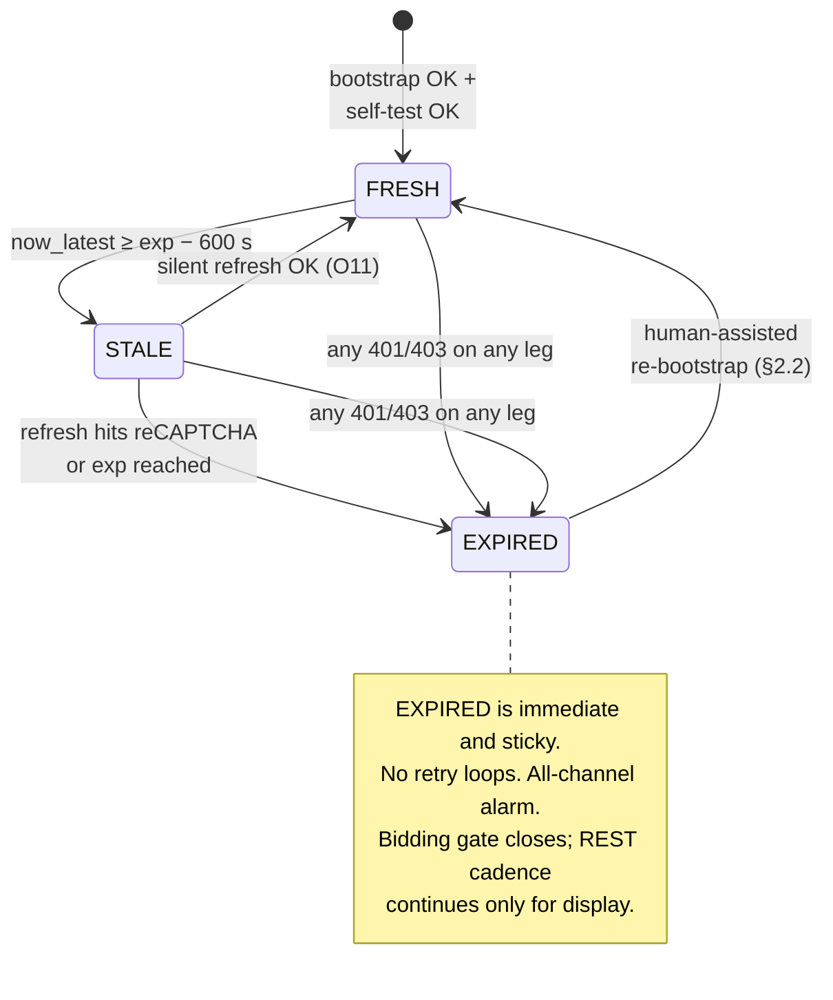
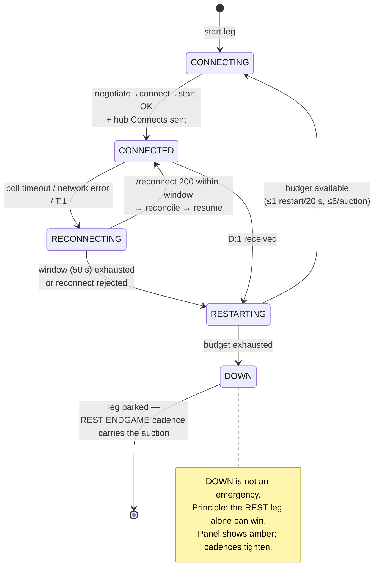

# 03 — Client Protocol

*The exact wire-level contract `centinela` speaks to SECOP II: authentication bootstrap and token lifecycle, the hand-rolled SignalR transport with its reconnection algorithm, the server-clock discipline and its math, the REST cadence rules, and the plan that turns the one unknown write operation (`SubmitBid`) into a pinned contract.*

This chapter is the implementation reference for `session/`, the SignalR leg, the REST leg, and `ServerClock` (component map in [Architecture](07-architecture.md)). The *meaning* of the data these protocols move is specified in [Auction mechanics](02-auction-mechanics.md); the raw evidence is in the [API contract](01-api-contract.md) and the [platform vocabulary](09-platform-vocabulary.md). Every statement below is tagged **CONFIRMED** (served by the platform in a capture), **DERIVED** (our inference, must be verified), or **POLICY** (our own design decision).

---

## 1. Scope, hosts, and layering

Three hosts, three distinct trust relationships:

| Host | Role | What the client sends it |
|---|---|---|
| `community.secop.gov.co` | STS / identity. Issues the RS256 JWT. Login is reCAPTCHA-gated. | Nothing programmatic. Only the human-driven browser ever talks to it. |
| `www.secop.gov.co` | SECOP II portal (`CO1BusinessLine`). Hosts the auction-room launcher. | Browser-driven navigation only (bootstrap, refresh, and the rung-2/3 submit surface). |
| `subastas.secop.gov.co` | Auction engine: `/eauctions.api` REST + `/signalr`. | Everything the runner does programmatically. |

**Layering rule (POLICY, enforced by `import-linter`):** SECOP base URLs and wire shapes appear only in `adapters/secop/`. The decision loop sees typed, frozen pydantic snapshots; it never sees a URL, a cookie, or a raw JSON body.

**Connection pools (POLICY):** three isolated `httpx.AsyncClient` pools so a hung request can never starve a bid:

| Pool | Used by | Read timeout | Notes |
|---|---|---:|---|
| `pool_poll` | `/signalr/poll` only | 125 s | One request in flight, ever. Sized above the server's observed 110 s poll horizon (§4.5). |
| `pool_rest` | All cadence REST + `/signalr/send`, `/negotiate`, `/start`, `/ping`, `/abort` | 30 s | Subject to the politeness budget (§6.4). |
| `pool_bid` | `SetStartBiddingAudit`, `ValidateBid`, `SubmitBid` | 30 s | TLS pre-established at ARM, kept warm with one no-op request per 60 s drawn from the politeness budget. Reserved lane — never queued behind cadence traffic. |

All three pools pin `https://subastas.secop.gov.co`, HTTP/1.1 keep-alive, and send the browser-mirroring header set of §6.2.

---

## 2. Authentication

### 2.1 Why bootstrap is browser-assisted (CONFIRMED)

Two independent facts close the door on fully-headless auth:

1. **Login is reCAPTCHA-protected.** 53 reCAPTCHA-related requests were observed around `POST /STS/Users/Login/LoginAuthenticate`. A human must be present at login time.
2. **REST calls carry ~2.5 KB of stripped auth headers.** Byte-accounting of the sanitized HAR shows every `/v1/` request is missing ≈2528 bytes of headers — the size of a VORTAL/ASP.NET cookie jar. The JWT alone is only *proven* to authenticate the SignalR transport (`token=` query param). Until **O1** resolves, the client must assume REST requires the full browser cookie session.

Consequently (POLICY): the session is born in a **headful Playwright persistent context**, in a **separate OS process** from the runner (see [Architecture](07-architecture.md) §3.4), and the runner receives from it (a) the JWT, (b) the exported `storage_state` (cookies for all three domains), (c) the JWT's decoded claims.

### 2.2 Bootstrap sequence

```mermaid
sequenceDiagram
    autonumber
    actor H as Human operator
    participant B as Browser process<br/>(Playwright, headful,<br/>persistent context)
    participant STS as community.secop.gov.co
    participant P as www.secop.gov.co
    participant A as subastas.secop.gov.co
    participant R as Runner (session/)

    H->>B: centinela login <auction-url>
    B->>STS: /STS/Users/Login/Index
    H->>STS: credentials + solve reCAPTCHA
    STS->>STS: LoginAuthenticate → ChooseInformation → issue.aspx
    STS-->>B: portal session cookies
    B->>P: CO1ExternalIntegration/TenderingSupport/<br/>AuctionsIntegration/Index?AuctionId=…&OpportunityWorkAreaUniqueIdentifier=…
    P-->>B: auction-room page, iframe → eauctions.site
    B->>A: iframe loads /eauctions.site/?auctionId=…&languageCode=es-CO
    A->>A: page negotiates SignalR
    Note over B: network interceptor captures the first<br/>GET /signalr/negotiate?…&token=&lt;JWT&gt;
    B->>R: JWT (sniffed) + storage_state export + claims
    R->>R: validate claims, keychain-store token,<br/>run REST auth self-test (§2.5)
```

Wire details of the sniff (POLICY, grounded in CONFIRMED behavior):

- The interceptor matches `**/signalr/negotiate*` on `subastas.secop.gov.co` and extracts the `token` query parameter. This is the *only* sanctioned way to obtain the JWT — we never scrape it from DOM or storage, because the negotiate URL is the one place it is guaranteed to appear in its transport-ready form.
- Immediately after the sniff, the browser process exports `context.storage_state()` to an encrypted file with the same protection level as the token (both are credentials).
- The runner decodes the JWT **without verification** (we are the audience, not the verifier) and extracts: `LoggedInCompanyCode` (becomes `company_code` — **never** read from config), `LoggedInCompanyName`, `unique_name`, `LoginGUID`, `nbf`, `exp`. Observed lifetime: `exp − nbf = 86 400 s` (24 h) (CONFIRMED).
- If `LoggedInCompanyCode` is absent or non-numeric, bootstrap **fails closed** — a malformed token must never fall back to a configured NIT.

### 2.3 Token lifecycle



Rules (POLICY):

- **Refresh trigger:** at `exp − 600 s` by the disciplined clock, or immediately upon entering `STALE`.
- **Silent refresh procedure (O11, DERIVED):** the browser process re-navigates the auction-room launcher URL inside the still-live persistent context. If the STS session cookie is still valid, `issue.aspx` re-issues a JWT without showing reCAPTCHA; the interceptor sniffs the new negotiate call exactly as at bootstrap. Whether this works unattended for >24 h operation is **open question O11** — until it is confirmed, every auction day starts with a human-present bootstrap no earlier than T−4 h (so the 24 h token comfortably covers the auction plus extensions).
- **Refresh failure is loud:** if the re-navigation lands on the login page or a reCAPTCHA frame is detected, the session layer raises `CAPTCHA_REQUIRED` → Telegram + panel + audible bell. It never silently spins.
- **401/403 anywhere → `EXPIRED` instantly.** No token is ever retried after a 401. The SignalR leg parks; the REST leg stops; the panel shows the degradation ladder's bottom rung: **TOMAR CONTROL** (human in the still-authenticated browser).
- The new JWT after refresh may carry a new `LoginGUID`; the SignalR connection built on the old token keeps working until it drops (CONFIRMED-adjacent: the token is presented per-request on the SignalR transport, §4), but the client proactively restarts the SignalR leg within 60 s of a token change to avoid an ambiguous half-authenticated state (POLICY). The restart consumes no reconnect budget (§4.7) because it is planned.

### 2.4 Credential storage and redaction (POLICY)

- JWT and `storage_state.json`: OS keychain on the laptop, Docker secret on the VPS; file fallback is `0600` and encrypted at rest.
- A `structlog` processor on **every** handler redacts anything matching `token=[^&\s]+`, `Bearer\s+\S+`, and cookie header values, before any sink sees the record. URLs are logged post-redaction.
- Decommission (never between auctions): delete token + storage state, then best-effort `POST /signalr/abort` if a connection is live (`abort` is a DERIVED endpoint, never captured — §4.6, O14; if it 404s, the connection is simply left to die by poll timeout), then browser context wipe.

### 2.5 The REST auth self-test — resolves O1, fails closed

At startup, and again whenever the token changes, `session/` performs three attempts of `GET /v1/auction/GetAuctionSimple/{auctionId}` (the cheapest read):

| Strategy | Sends |
|---|---|
| A | Browser cookie jar only |
| B | `Authorization: Bearer <JWT>` only |
| C | Cookie jar + bearer |

The first strategy returning 200 with a parseable body becomes the session's REST auth mode, recorded in the audit log. If **none** succeeds, the runner refuses to arm — it starts in `copilot`-display mode with a red REST-leg indicator. The result of this self-test on the first live run **is** the resolution of O1; the code path already exists for all three outcomes, so no release is needed when the answer arrives.

---

## 3. REST leg — request conventions

### 3.1 Endpoint inventory (CONFIRMED, from the [API contract](01-api-contract.md))

| # | Endpoint | Purpose | Cadence class |
|---|---|---|---|
| R1 | `GET /eauctions.api/v1/auction/GetAuction/{auctionId}/{locale}` | Full ruleset: `minBidDifference`, `minimumBidType` as string, price list (lots/items), roster, **`endDate`/`originalEndDate`**, both state machines | Primary state poll |
| R2 | `GET /eauctions.api/v1/auction/GetAuctionSimple/{auctionId}` | Cheap state read (integer enums, **no** `minBidDifference`) | Auth self-test + fast state checks |
| R3 | `GET /eauctions.api/v1/bid/GetSupplierBids/{auctionId}/{companyCode}/{page}` | Leaderboard: per-item, per-lot, global rankings; `isMyOwnCompany`; my last lance | Primary leaderboard poll |
| R4 | `POST /eauctions.api/v1/bid/ValidateBid` | Server-side legality check, non-committing | Bid path only |
| R5 | `POST /eauctions.api/v1/audit/SetStartBiddingAudit?auctionId=…` | Mandatory "Comenzar Lances" audit event before bidding | Bid path only |
| R6 | `GET /eauctions.api/v1/audit/GetEventLogs?…` | DataTables-style authoritative event history; reconciliation source | Reconcile + slow poll |
| R7 | `GET /eauctions.api/v1/chat/GetAllMessages?auctionId=…&pageIndex=0&pageSize=100` | Entity chat/announcements | Slow poll |
| R8 | `GET /eauctions.api/v1/localization/GetResourceLocaleString?…` | Locale bundle (566 keys) | Once per auction |
| R9 | `POST /eauctions.api/v1/bid/SubmitBid` *(path DERIVED)* | The commit — contract unknown, see §8 | Bid path only, gated |

Path quirk (CONFIRMED): captures show a doubled slash in some paths (`/v1//auction/…`). The client normalizes to single-slash but must tolerate either in recorded fixtures.

**Rule-of-record (POLICY, from confirmed payload differences):** `GetAuction` (R1) is the ruleset authority — it is the only endpoint carrying `minBidDifference` and string enums. `GetAuctionSimple` must never be used to derive the minimum step. See [Auction mechanics](02-auction-mechanics.md) for the δ-resolution algorithm.

### 3.2 Header discipline (POLICY, mirroring CONFIRMED browser headers)

Every REST request mirrors the captured browser header set: `Accept: application/json, text/plain, */*`, `Accept-Language: es-ES,es;q=0.9,en;q=0.8`, the sentinel `If-Modified-Since: Mon, 26 Jul 1997 05:00:00 GMT` (the platform's own cache-buster — keep it), `Referer: https://subastas.secop.gov.co/eauctions.site/?auctionId=<id>&languageCode=es-CO&marketCode=GovCo`, and a pinned, honest `User-Agent`. We do not spoof per-request entropy; we are not hiding — the same UA appears in the entity's `ipAddress`-stamped event log, and looking like the real client is a compatibility measure, not an evasion (see [Compliance](05-compliance.md)).

### 3.3 Cadences by phase (POLICY)

All numbers are per-auction config defaults; the global politeness budget (§6.4) is the hard ceiling.

| Endpoint | IDLE (>10 min to start) | ARMED | ENDGAME (≤60 s to `endDate`) | On `newData` |
|---|---:|---:|---:|---|
| R1 `GetAuction` | 60 s | 10 s | 2.5 s | immediate, single-flight, 300 ms debounce |
| R3 `GetSupplierBids` | 60 s | 10 s | 2.5 s | immediate, single-flight, 300 ms debounce |
| R6 `GetEventLogs` | 300 s | 60 s | on reconcile only | on reconcile |
| R7 `GetAllMessages` | 300 s | 60 s | — | — |
| SignalR `RequestClock` | 60 s | 15 s | 5 s | — |

Rationale: the ENDGAME 2.5 s REST cadence alone bounds the staleness of our view to ≤ 2.5 s + platform latency, which is sufficient because the extension rule (any rival bid in the last minute adds `extraTimePeriod` minutes) means we never need sub-second reaction — see [Auction mechanics](02-auction-mechanics.md). This is what makes **REST-only degraded mode a winning mode**, not an emergency.

`newData` handling: the SignalR `auction.newData` push (observed 60–130 ms after each rival bid) triggers *one* immediate refetch of R1+R3. Debounce 300 ms: bursts of `newData` collapse into a single refetch. Single-flight: if a refetch is already in the air, the trigger sets a dirty flag instead of stacking a second request.

### 3.4 Pagination (O12)

`GetSupplierBids` page semantics observed: page `0` → `[]`, page `1` → data. **DERIVED rule:** pages start at 1; iterate `page = 1, 2, …` until an empty array returns. The empty-`[]`-at-0 observation is a single data point — **O12** stays open until a multi-page auction confirms the terminator. The client treats "page N returned fewer entries than page N−1 shape suggests" as *possibly* terminal but always requests N+1 once to confirm emptiness.

### 3.5 Parsing rules (bind the adapters, property-tested)

- **Timestamps:** the platform emits 7-fractional-digit ISO-8601 (`2026-03-02T20:25:17.4058426Z`). Python's pre-3.11 `fromisoformat` truncation behavior is banned; `adapters/secop/codec.py` owns one explicit parser handling 0–7 fractional digits and requiring `Z`.
- **Money:** amounts arrive in three shapes — JSON float (`115670523.0`), fixed-point string (`"115670523.000000000000"`), and es-CO display strings (`"1.156.705,23 COP"` in `minBid` and inside `errorMessage`). All three parse to `Centavos` (integer). The es-CO parser (PyICU) is the only code allowed to touch dot-thousands/comma-decimal strings. Floats from JSON are converted via `Decimal(str(x))` at the adapter boundary and *rejected* if the round trip is lossy at `decimalNum` precision.
- **Enums/states:** case-insensitive comparison; any unrecognized `auctionStateCode` / `auctionExecutionStateCode` string ⇒ *not tradeable*, fail closed. The full known vocabulary is in [platform vocabulary](09-platform-vocabulary.md).
- **`Settings_Confidential` sentinel:** treated as `None`, never displayed as a value.

---

## 4. The SignalR leg — hand-rolled classic transport

The platform runs **ASP.NET SignalR 1.x/2.x ("classic")** with the `longPolling` transport (CONFIRMED: endpoint set `negotiate/connect/start/poll/send/ping`, form-encoded `data={json}` sends, `{"C":…,"M":[…]}` poll frames). We standardize on `longPolling` even if negotiate advertises WebSockets — it is the only transport with captured evidence, it traverses the platform's proxies demonstrably, and principle 2 of the [Architecture](07-architecture.md) says latency above "seconds" buys nothing.

### 4.1 Protocol constants (POLICY unless noted)

| Constant | Value | Source |
|---|---|---|
| `clientProtocol` | `1.5` | classic SignalR JS client line; **verify byte-identical against the HAR before first live use** |
| `connectionData` | `[{"name":"auction"},{"name":"chat"}]`, JSON, percent-encoded **once**, computed **once** per process and reused byte-identically on every request | Hub names CONFIRMED from `H` fields |
| Transport | `longPolling` | CONFIRMED |
| Poll read timeout | 125 s | Observed max poll duration 110 154 ms ≈ the classic-SignalR 110 s `ConnectionTimeout` default; client must out-wait it (CONFIRMED + POLICY) |
| JWT | `token=<JWT>` query param on **every** `/signalr/*` request | CONFIRMED |
| `tid` | random integer 0–11 on `/connect` | classic client convention; mirror the HAR |
| `_` | ms-epoch cache-buster on `negotiate`/`start`/`ping` | CONFIRMED (param observed) |

**Byte-identity rule (POLICY, non-negotiable):** `connectionData` and the percent-encoded `connectionToken` must be byte-identical across `connect`, `start`, `poll`, `send`, `reconnect`, `abort` (the last two are DERIVED endpoints, never captured — §4.6, O14). The `connectionToken` from negotiate contains `+`, `/`, `=` — it must be percent-encoded on every use; a raw `+` decodes server-side as a space and yields an unauthorized-connection error that looks like an auth failure. This class of bug is why the client is hand-rolled (~600 lines) instead of adapted from a package that hides its encoder.

### 4.2 Handshake — exact wire formats

```mermaid
sequenceDiagram
    autonumber
    participant C as centinela SignalR leg
    participant S as subastas.secop.gov.co

    C->>S: GET /signalr/negotiate?clientProtocol=1.5<br/>&connectionData=%5B%7B%22name%22%3A%22auction%22%7D%2C%7B%22name%22%3A%22chat%22%7D%5D<br/>&token=<JWT>&_=<ms-epoch>
    S-->>C: 200 {"Url":"/signalr","ConnectionToken":"…","ConnectionId":"…",<br/>"KeepAliveTimeout":…,"DisconnectTimeout":…,"ConnectionTimeout":…,<br/>"TryWebSockets":…,"ProtocolVersion":"1.5",…}
    C->>S: GET /signalr/connect?transport=longPolling&clientProtocol=1.5<br/>&connectionToken=<pct-enc>&connectionData=<same bytes>&token=<JWT>&tid=<0..11>
    S-->>C: 200 {"C":"<cursor>","S":1,"M":[]}   (init frame)
    C->>S: GET /signalr/start?transport=longPolling&clientProtocol=1.5<br/>&connectionToken=<pct-enc>&connectionData=<same bytes>&token=<JWT>&_=<ms-epoch>
    S-->>C: 200 {"Response":"started"}
    C->>S: POST /signalr/send  (data={"H":"auction","M":"Connect","A":["<auctionId>"],"I":1})
    S-->>C: 200 {"I":"1"}
    C->>S: POST /signalr/send  (data={"H":"chat","M":"Connect","A":["<auctionId>"],"I":2})
    S-->>C: 200 {"I":"2"}
    loop poll loop (exactly one in flight)
        C->>S: POST /signalr/poll?transport=longPolling&clientProtocol=1.5<br/>&connectionToken=<pct-enc>&connectionData=<same bytes>&token=<JWT><br/>body: messageId=<last C>[&groupsToken=<G>]
        S-->>C: 200 {"C":"<new cursor>","M":[{"H":"…","M":"…","A":[…]},…]}<br/>(≤ ~110 s later; empty M allowed)
    end
```

Ordering rules (POLICY):

1. Persist all negotiate fields; honor server-supplied `KeepAliveTimeout` / `DisconnectTimeout` / `ConnectionTimeout` over our defaults if they differ.
2. The handshake is `negotiate → connect → start`, strictly ordered; hub `Connect` invocations go out only after `start` returns `{"Response":"started"}` **and** the first poll is open.
3. `auction.Connect([auctionId])` then `chat.Connect([auctionId])` — the chat hub is joined for the roster events (`onConnected` = full connected-company list, `onNewUserConnected`, `onUserDisconnected`), which feed the panel's participant display. There is **no** outbound chat-send capability anywhere in the codebase ([Compliance](05-compliance.md)).
4. HTTP verbs: `negotiate`/`connect`/`start`/`ping` GET; `poll`/`send` POST with `Content-Type: application/x-www-form-urlencoded` (the same POST form is assumed for the DERIVED `reconnect`/`abort` — §4.6, O14). The captured `poll` requests list only transport/protocol/token params in the query string, placing `messageId` in the POST body (classic 2.x behavior). **DERIVED — the first implementation task is to confirm verb + `messageId` placement against the raw HAR bytes and encode both into the replay fixture.**

### 4.3 Client → server: `/signalr/send`

Form-encoded single field `data`, value a compact JSON object:

```
data={"H":"<hub>","M":"<method>","A":[<args>],"I":<invocationId>}
```

| Invocation | Wire form (CONFIRMED) | When |
|---|---|---|
| `auction.Connect` | `{"H":"auction","M":"Connect","A":["e66a68a3-…"],"I":1}` | after start; after every reconnect/restart |
| `chat.Connect` | `{"H":"chat","M":"Connect","A":["e66a68a3-…"],"I":2}` | after `auction.Connect` |
| `auction.RequestClock` | `{"H":"auction","M":"RequestClock","A":[],"I":<n>}` | clock cadence (§5.3); ≤ 1 outstanding |

`I` is a per-connection monotonically increasing integer. The send *response* acknowledges the invocation (`{"I":"<n>"}`, optionally `R` result / `E` error); the *payload* answer (e.g. `ReceiveClock`) arrives on the open poll. `E` on a hub invocation is logged and the invocation is not blind-retried.

### 4.4 Server → client: poll frame grammar

Every poll (and the connect init) returns one JSON object; fields we handle:

| Field | Meaning | Client action |
|---|---|---|
| `C` | Message cursor | **Persist before dispatching `M`** — the crash-safety invariant: a crash between persist and dispatch causes a replayed message (handlers are idempotent), never a lost one. |
| `M` | Array of `{"H","M","A"}` hub messages | Dispatch to handlers (below). |
| `S:1` | Init marker on connect | Marks transport established. |
| `G` | Groups token | Persist; echo on subsequent polls/reconnects. |
| `T:1` | Server orders transport reconnect | Enter RECONNECTING (§4.6). |
| `D:1` | Server disconnected us | Full restart path (§4.6). |
| `L` | Long-poll delay (ms) | Sleep `L` before re-polling (observed configurations use 0). |
| `{}` empty | Poll horizon reached, nothing queued | Re-poll immediately. |

Handlers (all idempotent, all CONFIRMED message shapes):

- `auction.ReceiveClock(["<iso7>"])` → clock sample (§5).
- `auction.newData([bool,bool,bool])` → dirty-flag refetch (§3.3). The three booleans' semantics are **DERIVED-unknown**; until pinned we treat *any* `newData` as "state changed". Its arrival time also feeds the rival-activity clock in the [strategy engine](04-strategy-engine.md).
- `chat.onConnected([[{companyCode},…]])` → replace roster snapshot.
- `chat.onNewUserConnected([{id,companyCode}])` / `chat.onUserDisconnected([{companyCode}])` → roster delta. Company codes are HMAC-pseudonymised before persistence ([Compliance](05-compliance.md)).

### 4.5 Poll loop discipline

- **Exactly one poll in flight.** The next poll is issued only after the previous returns and its `C` is persisted.
- Client read timeout 125 s > server's ~110 s horizon. A client-side timeout therefore means the network path died, not that the server was quiet → RECONNECTING.
- The poll uses `pool_poll` exclusively; a 110 s quiet poll cannot occupy a connection any other request wants.
- Keep-alive supervision: if no frame (even `{}`) for `KeepAliveTimeout × 1.5` on a streaming transport this would apply; for longPolling the equivalent is the read timeout above.

### 4.6 Reconnection algorithm



**Step 1 — `/reconnect` (cheap path, on `T:1` or transport error):**

**DERIVED, not captured:** `/signalr/reconnect` appears nowhere in our evidence — the [API contract](01-api-contract.md) §4 inventory lists only `negotiate/connect/start/poll/send/ping`. The request line below is taken from the classic ASP.NET SignalR protocol, which every observed endpoint matches byte-for-byte in shape; it is a well-grounded inference, not an observation, and stays unverified until the O14 probe (§10) confirms it.

```
POST /signalr/reconnect?transport=longPolling&clientProtocol=1.5
     &connectionToken=<pct-enc>&connectionData=<same bytes>&token=<JWT>
body: messageId=<last persisted C>[&groupsToken=<G>]
```

The server replays missed messages from the cursor. Retry with jittered backoff `1 s, 2 s, 4 s, 8 s…` inside a **50 s window** (classic servers discard connection state after `DisconnectTimeout`, default 30 s — so attempts past ~30 s usually fail, but the window costs nothing and covers non-default configs). Success → emit `RECONNECTED`, then **mandatory reconciliation** (§4.7) before the strategy may run. **Fallback (POLICY):** if `/reconnect` returns 404 — or any response indicating the endpoint is absent rather than the connection stale — the cheap path is disabled for the rest of the session and the leg goes straight to full restart, which uses only CONFIRMED endpoints and consumes restart budget. The reconnection design therefore degrades gracefully if the inference is wrong.

**Step 2 — full restart (on `D:1`, rejected reconnect, or window exhaustion):** discard `connectionToken`, re-run the entire handshake (`negotiate → connect → start → hub Connects`), then reconcile.

**Budget (POLICY):** ≤ 1 full restart per 20 s and ≤ 6 per auction. Past budget the leg parks in DOWN for the remainder of the auction and the REST leg's ENDGAME cadence (2.5 s) is the sole state source. Rationale: the real capture shows ~100 disconnect events across 44 companies in 10 minutes — churn is *normal* here, and a client that fights the platform's instability with aggressive reconnects becomes the "consultas masivas" traffic the WAF exists to block.

**O13 note:** every `connect` writes a `MessengerLogin` row into the entity's event log (CONFIRMED — three logins visible in a 5-minute window of the capture). Whether `/reconnect` avoids the new row is **O13**; until answered, the restart budget doubles as an audit-log-hygiene control. Clean shutdown issues `POST /signalr/abort` — but `abort`, like `/reconnect`, is **DERIVED** from the classic-SignalR protocol and was never observed in our captures (O14, §10). The expectation that abort produces a tidy `MessengerLogout` row is **ASSUMED**, not confirmed: the `Logs_Search_MessengerLogout` row in the capture is equally explicable by an ordinary disconnect (poll timeout), so the abort ↔ clean-logout correlation is unproven. The O13 test-auction experiment therefore covers all three questions at once: diff `GetEventLogs` around (a) a forced `/reconnect`, (b) a deliberate `abort`, and (c) confirm both endpoints exist on this deployment. A 404 on `abort` is harmless — the connection dies by poll timeout anyway, at worst leaving the same disconnect row a browser crash would.

### 4.7 Post-reconnect reconciliation (the invariant that makes all of §4 safe)

After (a) any reconnect or restart, (b) any ≥ 10 s unhealthy period, (c) process restart, (d) every submit regardless of outcome: fetch `GetAuction` + `GetSupplierBids` (all pages) + `GetEventLogs`, adopt the **server's** view of my-last-lance / `endDate` / both state machines, bump the snapshot version, write a `RECONCILE` audit record — and only then unfreeze the strategy. Messages replayed by the cursor mechanism are informative but never authoritative over a reconcile.

---

## 5. Clock synchronization

### 5.1 Why (CONFIRMED evidence)

- The operator's PC was **+13.15 s** wrong against the auction server (stable to ±0.05 s across the recording).
- `GetAuctionSimple` reads regress (`Started → ReadyToStart → Started` observed) — server-side reads are eventually consistent, so server-sent *timestamps*, not server-sent *states*, are the timing authority.
- `endDate` mutates on every extension; deadlines must be recomputed from fresh reads against a disciplined clock, never extrapolated.

The clock source is `auction.ReceiveClock(["2026-03-02T20:25:17.4058426Z"])` — the authoritative server wall clock, requested via `auction.RequestClock`.

### 5.2 Sampling protocol (POLICY)

- One `RequestClock` outstanding at a time, issued **only while a poll is open** (the answer arrives on the poll; without an open poll the sample is undeliverable).
- `t0` = monotonic time immediately before the `/send` POST is written; `t1` = monotonic time the correlated `ReceiveClock` is parsed from the poll. Correlation is unambiguous because only one request is outstanding.
- The sample delay is `d = t1 − t0`. **Never** measure against the poll's open duration — a poll that has been open 90 s says nothing about this sample's latency; only the send-to-delivery interval does.
- Cadence per §3.3 (60 s / 15 s / 5 s by phase). Observed human-client cadence was p50 8.2 s — ours is deliberately gentler outside ENDGAME.

### 5.3 The math

Notation: monotonic clock `m(·)`; server wall clock `s(·)`; we estimate the affine map `s ≈ m + θ` (drift over a 10-minute auction is negligible; we bound it, not model it).

For sample *i* with send time `t0ᵢ`, receive time `t1ᵢ`, server timestamp `Sᵢ`, delay `dᵢ = t1ᵢ − t0ᵢ`:

- The server stamped `Sᵢ` at some unknown instant inside `[t0ᵢ, t1ᵢ]`.
- Midpoint estimator: the server's clock at `t1ᵢ` read approximately `Sᵢ + dᵢ/2`, with worst-case error `±dᵢ/2` (this bound holds even under fully asymmetric paths — it does *not* assume symmetry, it only assumes the stamp happened inside the interval).
- Offset sample: `θᵢ = Sᵢ + dᵢ/2 − t1ᵢ`, with per-sample uncertainty `dᵢ/2`.

**Minimum-delay filter:** over a sliding window (last 32 samples, ≤ 10 min old), select `i* = argminᵢ dᵢ`. Then:

```
θ = θᵢ*                                (the lowest-latency sample is the least contaminated)
ε = dᵢ*/2 + ρ·(now − t1ᵢ*) + ε_floor   with ρ = 1 ms/s drift bound, ε_floor = 50 ms
```

With observed REST/SignalR delays (sub-second p50), typical `ε ≈ 0.2–0.6 s` — comfortably inside the gate.

**Step vs slew (POLICY):** the first fix *steps* θ. Later, if `|θ_new − θ| > 1 s`, step and log a `CLOCK_STEP` audit record (a step this large mid-auction means the earlier estimate was contaminated); otherwise *slew* toward `θ_new` at ≤ 100 ms per second of real time, so a deadline never jumps discontinuously under the decision loop.

**Directional pessimism:** two read edges, used asymmetrically so every error margin works *against* us:

```
now_latest()   = m_now + θ + ε     # server is AT MOST this far along → use for deadlines:
                                   #   remaining = end_epoch − now_latest()
now_earliest() = m_now + θ − ε     # server is AT LEAST this far along → use for "has it started":
                                   #   may_bid_start = now_earliest() ≥ start_epoch
```

### 5.4 Gates and degradation (POLICY)

Every clock estimate carries a **source-quality flag**, `source ∈ {RECEIVE_CLOCK, DATE_HEADER}`, set by whichever sampler produced the winning (minimum-delay) sample. The bidding gate is three conjuncts, and the third is structural, not numeric:

```
clock_ok_for_bidding = (ε ≤ 2 s) and (estimate age ≤ 60 s) and (source == RECEIVE_CLOCK)
```

The source conjunct exists because the numeric comparison alone cannot implement "the Date-header fallback must never bid": a Date-header estimate has `ε_floor = 1.5 s`, which *passes* `ε ≤ 2 s`, so without the flag the stated rule and the implemented gate would disagree. With it, this is the same rule as [Architecture](07-architecture.md) §5.3 ("not enough to bid on its own"), stated identically in both chapters. Property test (in the `hypothesis` suite of [Architecture](07-architecture.md) §10): **no generated history reaches a `BID` event while the current estimate's source is `DATE_HEADER`**, regardless of ε.

| Condition | Effect |
|---|---|
| `ε > 2 s`, or estimate age > 60 s, or `source = DATE_HEADER` | Clock **unreliable for bidding**: bidding gate closes, phase computation freezes (holds, never regresses), panel shows amber clock, alarm at ENDGAME |
| SignalR leg DOWN | Fallback sampler: HTTP `Date` response headers from cadence REST calls, quantized to 1 s ⇒ `ε_floor = 1.5 s`, `source = DATE_HEADER`. Keeps the countdown and phase display honest on the panel; **never** opens — or keeps open — the bidding gate, even for an already-armed auction: the moment the winning sample is Date-header-derived, the gate closes and stays closed until a fresh `ReceiveClock` sample restores `RECEIVE_CLOCK` source. Stated consequence: a SignalR outage longer than the 60 s age window suspends *autonomous* bidding for its duration — REST-only mode then wins through the panel + human (copilot rung, TOMAR CONTROL), or through lances already fired at the T−45 s target before the window expired (see [Auction mechanics](02-auction-mechanics.md) timing budget). We accept that cost: a bid timed against a ±1.5 s quantized clock near a deadline is exactly the guess the last row of this table forbids. |
| No samples at all | Freeze + alarm. We HOLD; we never guess a deadline. |

All timestamps internal to the runner are monotonic + θ. `time.time()` is lint-banned outside logging ([Architecture](07-architecture.md) §2).

---

## 6. Politeness, budgets, and traffic shape

Rate discipline is a correctness requirement, not manners: SECOP's WAF blocks IPs generating "consultas masivas de interacción no humana", and a blocked IP mid-auction is legally a *withdrawal* (Decreto 1082 art. 2.2.1.2.1.2.6 — see [Compliance](05-compliance.md)).

### 6.1 Token bucket (POLICY)

Global bucket: **capacity 10, refill 2 req/s**, covering all REST + SignalR-control traffic. The bid path (`pool_bid`: audit → validate → submit) draws from a **reserved lane** that is never blocked by cadence traffic — a leaderboard poll must never delay a lance.

### 6.2 Server pushback

| Signal | Response |
|---|---|
| `429` / `503` with `Retry-After` | Honor the header exactly; downgrade one cadence tier for 5 min |
| `429` / `503` without header | Exponential backoff 2 s → 60 s, jittered; downgrade one cadence tier |
| Repeated 5xx on one endpoint | Circuit-break that endpoint for 60 s; others unaffected |
| WAF challenge page (HTML where JSON expected) | Treat as auth-adjacent incident: alarm, freeze cadence to IDLE tier, surface TOMAR CONTROL |

### 6.3 Traffic identity

One stable, attributable egress IP (the VPS), registered in the runbook. The entity's event log records our IP on every action (CONFIRMED) — rotating IPs would serve no legitimate purpose and would look evasive in exactly the record a dispute examines.

---

## 7. The bid-path wire cycle

Full decision semantics live in the [strategy engine](04-strategy-engine.md); mechanics of δ and legality in [Auction mechanics](02-auction-mechanics.md). Here, the wire sequence only — always in this order, always through the `SubmitGateway`, non-reentrant:

1. **`POST /v1/audit/SetStartBiddingAudit?auctionId=…`** — writes "Comenzar Lances" to the entity log (endpoint and log row CONFIRMED). The captured event log shows this is **once per bid attempt, not once per session**: two `Logs_Search_StartBidding` rows (20:30:27.6078527 and 20:31:03.0025611), one for each of the two human bid attempts. POLICY, matching that observation and the cycle order in [Auction mechanics](02-auction-mechanics.md) §9.1: the gateway calls it before **every** `ValidateBid`. One honest caveat on ordering — for the *first* attempt the `NewBid` error row (20:30:27.353692) *precedes* its StartBidding row by ~254 ms, while the second attempt shows the expected order (start 20:31:03.002 → error 20:31:07.049). The platform therefore demonstrably processed a validate whose audit row had not yet landed. The most plausible reading is an asynchronous audit write (`registerDate` stamps the log commit, not the HTTP request), but log timestamps cannot settle request-level order; only the byte-level HAR timeline can, and that check is on the O2 capture checklist (§8) and in §10's open questions. Until then, audit-before-validate is **our** gateway's discipline (POLICY, DERIVED from the second attempt and the endpoint's evident purpose), not a proven platform precondition.
2. **`POST /v1/bid/ValidateBid`** — body per the CONFIRMED shape in the [API contract](01-api-contract.md): `auctionId`, `currency`, ISO `Date`, `ranking:-1`, per-item entries (`itemId`, `quantity`, `isPriceListItem`, `isChanged`, `itemInternalReference`, `lotInternalId`, `lotName`, `itemUnit`, `totalValue`, `bidValue`, `itemQuantityUnitPrice`, `bidded`), string `totalValue`, `languageCode`. Response carries `isValid`, and on rejection `errorType` (e.g. `BidErrMin`), `errorMessageLocale`, and the localized `minBid` string — which the min-step calibrator may parse (es-CO parser, §3.5) **at most twice per auction**, because rejections are permanently logged with our NIT and IP (CONFIRMED).
   - The `itemQuantityUnitPrice` sub-object (`{ind, form, mant, exp}`) is an ICU-style decimal serialization; only the zero encoding is captured. Its non-zero encoding is part of the O2 capture target (§8) — one more reason the REST submit rung stays gated.
3. **`SubmitBid`** — within 5 s of a successful validate, **byte-identical body reuse** (the validated bytes are the submitted bytes; recomputation between the two calls is forbidden), kill-switch check and L3 byte-level floor re-verification immediately before the write (see [Architecture](07-architecture.md) §6). Until O2 resolves, "SubmitBid" means the **browser driver** (rung 2): the Playwright process fills and clicks the audited selectors from `adapters/secop/selectors.yaml`, having passed its DOM canary at ARM time.
4. **Reconcile** (§4.7) after every submit, including AMBIGUOUS outcomes (timeout mid-submit). An ambiguous submit is *never* blindly retried — the reconcile's `GetSupplierBids` + `GetEventLogs` read tells us whether the lance landed.

> **RULE D-1 (which clock stamps the bid body's `Date`).** The `Date` field of every `ValidateBid`/`SubmitBid` body is stamped with the **disciplined server-clock estimate** `m_now + θ` — the best estimate, *not* the pessimistic edge (edges exist for deadline comparisons, §5.3; a reported timestamp should be the closest estimate of server truth, not a bound). Evidence and reasoning:
>
> - The captured body carried the **operator's local wall clock**: `2026-03-02T20:30:40.104Z`, which is +13.15 s ahead of the server (server ≈ 20:30:26.95). The platform rejected that bid on `BidErrMin` grounds, not date grounds — so tolerance of at least +13 s skew is CONFIRMED, and mirroring the browser (local time) would *probably* also work. What the server does with the field — echo, log, or validate — is **ASSUMED (informational)**.
> - θ-stamping is chosen anyway because it is safe under **every** hypothesis: if the field is informational, both choices work; if the server ever compares it to its own clock (e.g. against `endDate` at the close boundary), a θ-stamped value is within ±ε ≈ 0.2–0.6 s of server truth — strictly better than anything a local clock can guarantee. It also makes our audit chain, the bid bodies, and the entity's event log tell one coherent timeline in a dispute.
> - Interaction with the cycle: byte-identical reuse (§7.3) means the `Date` frozen at ValidateBid time is the one submitted — the 5 s TTL bounds its staleness. And because the clock gate (§5.4) closes bidding whenever the estimate is unreliable, a `Date` is never stamped from a degraded (`DATE_HEADER`) or stale estimate: no bid body exists to stamp.
> - Verification: the OQ-02 capture records whether the success response echoes or transforms `Date` (table below; global **OQ-30**).

First-bid caveat (DERIVED from the vocabulary bundle): `BidWarn_Min_Bid_Diff_Desc` suggests a bidder's *first* lance may be required to equal the base price. If true, reaching a competitive number takes two full cycles. This is a priority question for the [strategy engine](04-strategy-engine.md) timing budget and is answerable from the same O2 capture.

---

## 8. Resolving the SubmitBid contract (O2) — the plan

`SubmitBid` exists (the string appears in the localization bundle) but was never captured: both human attempts in the recording failed validation, so the commit call never fired. The path, verb, body, headers, and success-response schema are all **unknown**. Plan, in order of preference:

**Step 1 — ask before inferring.** Request supplier-facing API documentation and access to a sanctioned test environment from Vortal (the platform vendor — the `vortalTrust` field marks their fingerprints) and Colombia Compra Eficiente. The `testAuction: true` flag in the schema proves a test-auction facility exists in the data model. A documented contract or a test auction is faster, safer, and unimpeachably legitimate compared to reverse-engineering a state-changing endpoint. **But the request itself is a risk decision, not a free move**: a written query puts CCE on notice of contemplated automation, and CCE holds a preventive-suspension power (§VII.A.f). The outreach is therefore counsel-gated, with explicit decision criteria and a fallback if the answer is no — see [05 §3.7](05-compliance.md), which owns that analysis.

**Step 2 — capture one real, successful, manual bid.** At the cooperative's next live auction, the operator bids **manually anyway** (bot in `copilot` mode computes the floor-clamped legal value; human types it into the real UI). The browser session records an unsanitized HAR (DevTools export, or the Playwright context's built-in HAR recorder). That single capture pins, at zero incremental risk — the bid was going to be placed regardless:

| Unknown | Resolved by the capture |
|---|---|
| O2: `SubmitBid` path, verb, body schema, success response | The commit request/response pair |
| O1: REST auth mechanism (cookies vs bearer vs both) | Unstripped request headers |
| Non-zero `itemQuantityUnitPrice` ICU encoding | The submitted item entry |
| First-bid-equals-base-price rule (§7) | Whether the first lance at base price validates |
| `SetStartBiddingAudit` ↔ `ValidateBid` request order + per-attempt count (§7) | The HAR request timeline of the audit and validate calls around the manual bid — free evidence from the same session |
| O10: does a leader's own bid extend? | `endDate` before/after, correlated with bidder |
| OQ-30: `Date`-field semantics (RULE D-1, §7) | Whether the server accepts, echoes, or transforms the request's `Date`; the manual bid's stamp (browser local time) vs the server's log timestamps |

**Step 3 — pin and gate.** The captured pair becomes (a) a frozen pydantic model in `adapters/secop/`, (b) a replay fixture in `fixtures/` (built with `tools/build_replay_fixture.py`), (c) a simulator behavior in `vortal-sim`. Only after a schema-validated round trip replays green does `submit.confirmed` flip to `true`, enabling REST rung 1. Until then every armed submit uses the browser driver (rung 2), whose contract with the DOM is guarded by the selector canary.

**Derived expectations, explicitly not to be coded against:** by UI symmetry the endpoint is *probably* `POST /v1/bid/SubmitBid` with a body identical to `ValidateBid`'s and a response resembling the populated bid DTO that `GetSupplierBids` returns. These guesses exist so the capture reviewer knows what "looks right" — they justify **no** production code path while unconfirmed.

---

## 9. Constants and budgets — single reference table

| Constant | Value | Section |
|---|---:|---|
| JWT lifetime (observed) | 24 h | §2.2 |
| Token refresh trigger | `exp − 600 s` | §2.3 |
| Poll read timeout | 125 s | §4.1 |
| Server poll horizon (observed max) | ≈ 110 s | §4.5 |
| Reconnect window | 50 s | §4.6 |
| Reconnect backoff | 1→2→4→8 s jittered | §4.6 |
| Restart budget | ≤ 1 / 20 s, ≤ 6 / auction | §4.6 |
| REST cadence IDLE / ARMED / ENDGAME | 60 / 10 / 2.5 s | §3.3 |
| `RequestClock` cadence IDLE / ARMED / ENDGAME | 60 / 15 / 5 s | §3.3 |
| `newData` debounce | 300 ms, single-flight | §3.3 |
| Clock window / samples | 10 min / 32 | §5.3 |
| Drift bound ρ / ε floor | 1 ms/s / 50 ms | §5.3 |
| Clock gate | ε ≤ 2 s and age ≤ 60 s and source = `RECEIVE_CLOCK` | §5.4 |
| `Date`-header fallback ε floor | 1.5 s (`source = DATE_HEADER` — display only, never opens the bidding gate) | §5.4 |
| Token bucket | 10 burst / 2 per s | §6.1 |
| ValidateBid rejection budget | ≤ 2 per auction | §7 |
| ValidatedBid TTL | 5 s | §7 |
| Snapshot freshness for bidding (ARMED / ENDGAME) | ≤ 5 s / ≤ 2.5 s | §4.7, [07](07-architecture.md) |

---

## 10. Open questions owned by this chapter

| ID | Question | Resolution path | Blocking? |
|---|---|---|---|
| O1 | REST auth: cookies, bearer, or both? | Startup self-test (§2.5) + the O2 capture | Blocks REST rung, not copilot |
| O2 | `SubmitBid` path/verb/body/response | §8 plan | Blocks rung 1 only |
| O11 | Silent token refresh without reCAPTCHA? | Clear auction-site token, re-navigate launcher, observe (§2.3) | Blocks >24 h unattended only |
| O12 | `GetSupplierBids` pagination terminator | Page-until-empty on a multi-page auction (§3.4) | No — conservative iteration covers it |
| O13 | Does `/reconnect` skip the `MessengerLogin` log row? Does `abort` produce the clean `MessengerLogout` row we hope for? | Diff `GetEventLogs` around a forced reconnect and a deliberate abort in a test auction (§4.6) | No — budget compensates |
| O14 | Do `/signalr/reconnect` and `/signalr/abort` exist on this deployment at all? Both are DERIVED from the classic-SignalR protocol; neither appears in the captures ([01](01-api-contract.md) §4 lists only `negotiate/connect/start/poll/send/ping`) | Probe both in the O13 test-auction experiment (§4.6) | No — the §4.6 fallback (full restart / poll-timeout death) uses only CONFIRMED endpoints |
| — | Poll `messageId` placement + HTTP verbs per SignalR endpoint | Byte-level re-read of the raw HAR before implementation (§4.2) | Yes — first implementation task |
| — | `SetStartBiddingAudit` ↔ `ValidateBid` request-level order (the first attempt's log rows arrive reversed — §7) | HAR request timeline in the O2 capture (§8) | No — the gateway enforces audit-first regardless |
| — | Semantics of `newData`'s three booleans | Correlate against event-log rows across auctions (§4.4) | No — treated as generic dirty flag |

Everything in this chapter is testable offline: the handshake, reconnect budgets, cursor discipline, clock math, and cadence logic are all reproduced in `vortal-sim` with the platform's confirmed pathologies (backwards state reads, +13 s skew, `T:1` storms, mid-auction 401, es-CO `minBid` strings) — see the test strategy in [Architecture](07-architecture.md) §10 and the build order in the [Roadmap](08-roadmap.md).
