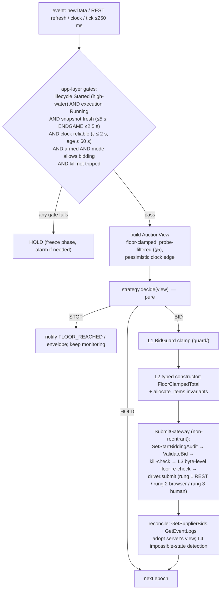
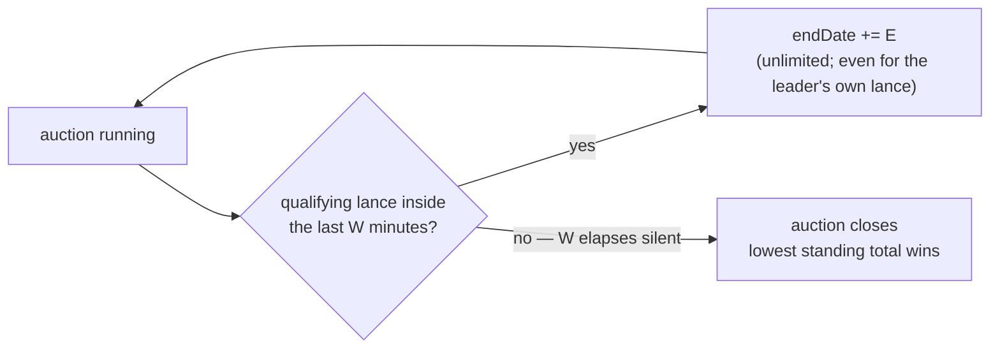

# 04 — Strategy Engine

*This chapter specifies the pure decision core of `centinela`: the objective it optimizes, the information it may legally use, the five-layer floor defence that makes a below-floor lance impossible, the strategy library, the end-game policy, and the offline simulator that proves all of it before any code ever touches SECOP II.*

---

**Position in the system.** The strategy engine is the `strategy/` package of the [Architecture](07-architecture.md): a pure, deterministic function `decide(view) -> Decision` with no I/O, no clock access, no RNG, and no submit capability. It consumes floor-clamped, probe-filtered `AuctionView` snapshots built by the app layer from the [client protocol](03-client-protocol.md) legs, and emits `HOLD | BID | STOP`. Everything it proposes is then re-checked by `guard/` and the SubmitGateway — the strategy is *advisory by construction*; the layers below it are what make the system safe. Mechanism facts are tagged **[OBSERVED]** (from the HAR/recording evidence in the [API contract](01-api-contract.md) and [auction mechanics](02-auction-mechanics.md)) or **[DERIVED — VERIFY]** (hypothesis; tracked as an open question in §11 and in the [Roadmap](08-roadmap.md)).

---

## 1. Mechanism assumptions the engine is built on

| # | Fact | Source | Status |
|---|---|---|---|
| M1 | Reverse auction (`auctionTypeCode: "Reversed"`): **lower is better**; winner = best total at close under `BestPrice` evaluation, with per-lot/per-item structure | `GetAuctionSimple` | OBSERVED |
| M2 | `AuctionbyProposal`: each supplier enters with an initial proposal; the min-decrement error text references "**su último lance**" — the improvement constraint appears to bind against **your own last lance** (or initial proposal for the first lance), not the global best | `ValidateBid` error text | DERIVED — VERIFY (O-SE1, the single most important mechanic to confirm: it decides whether this is a public price war or a parallel self-improvement race on a hidden leaderboard) |
| M3 | Minimum decrement δ: `minimumBidType: 1` ("Percentage" in `GetAuction` — the two endpoints cross-confirm the enum). Observed `minBid` = 1,156,705.23 COP = exactly 1.00% of `startPrice`. Hypothesis: δ = pct × startPrice, a **fixed absolute step**. A documented counter-configuration exists for the naive 1%-of-startPrice shortcut (the UNP SASI-064-2026 pliego specifies 2% of the last valid lance; documentary, not an API observation). Therefore: **δ is always taken from the server**, never computed locally | `ValidateBid.minBid` | DERIVED — VERIFY (O-SE2); server value authoritative regardless |
| M4 | Money: COP, `decimalNum: 2`, `roundTypeCode: "Up"` → tick = 1 centavo. All engine arithmetic is **integer `Centavos`**; rounding is always `ROUND_CEILING` (upward = toward the safe side in a reverse auction) | config | OBSERVED |
| M5 | Time: 10-minute base window; any qualifying lance inside the last `extraTimeLastMinutesStartPeriod` (1 min) extends by `extraTimePeriod` (3 min); `extraTimeMaximumBids: null` → **unlimited extensions**; `activateExtraTimeWinner: true` → even the leader's own lance extends | `GetAuctionSimple` | OBSERVED (leader-extends semantics DERIVED — VERIFY, O-SE3) |
| M6 | Two orthogonal state machines: `auctionStateCode` (lifecycle) and `auctionExecutionStateCode` (execution). Bidding requires both, from a fresh snapshot; reads can go **backwards** (regression guards live in the app layer, see [Architecture §5.2](07-architecture.md)) | live capture | OBSERVED |
| M7 | Both human ValidateBid attempts **failed** in the real auction (`BidErrMin`, even on a 0-value payload) and Starcoop never landed a lance in 65 minutes. "My validity model disagrees with the server" is a first-class, *expected* state — not an edge case | recording + `GetEventLogs` | OBSERVED |
| M8 | Every ValidateBid failure is written permanently to the procuring entity's audit log with our NIT and public IP. Server questions are **billed**: the calibration budget is ≤ 2 ValidateBid rejections per auction | `GetEventLogs` | OBSERVED |
| M9 | `allowBidsBellowBestBid: false` — semantics not fully pinned; interacts with M2 | `GetAuctionSimple` | DERIVED — VERIFY (O-SE1) |

---

## 2. Formal problem statement

### 2.1 Objective — expected profit, not win probability

```
maximize   E[π] = P(win | policy) · (p_final − C)      subject to   p_final ≥ F
```

where `C` = true economic cost of performing the contract, `F` = the reserve floor (§4; always `F ≥ C + margin_min` and `F ≥` the regulatory tariff minimum), and `p_final` = our last standing lance if we win.

For multi-lot auctions with per-lot awards:

```
maximize   Σ_l E[π_l] = Σ_l P(win_l) · (p_l − C_l)
subject to p_l ≥ F_l  ∀l,     capacity coupling:  Σ_{l ∈ won} guards_l ≤ capacity
```

The capacity constraint is real for a cooperative with finite personnel: winning every lot below deliverable capacity is a loss, not a triumph. When capacity binds, lot selection is a **knapsack solved before the auction** — the "fight set" is chosen during planning (see [Tender Discovery](06-tender-discovery.md)), never improvised mid-auction.

Two corollaries of maximizing E[π] rather than P(win), both enforced as hard invariants:

1. **Never improve your own rank-1 position.** Every peso conceded while already winning is pure surplus destruction. `BID` is only ever emitted when `my_rank_serious > 1` (§5 defines *serious*).
2. **The floor is a stopping rule, not a target.** The engine's job is to stop the descent *as high as possible while still winning* — to capture the gap between the runner-up's stopping point and ours. It never "spends" price to accelerate toward the floor.

### 2.2 Decision variables

At each decision epoch t (triggered by `newData`, a REST refresh, a clock update, or the ≤ 250 ms loop tick):

- `a_t ∈ {HOLD, BID(v_t), STOP}` where `v_t` is a vector of item-level prices with induced lot totals and grand total — the lance payload shape **[OBSERVED]** in the [API contract](01-api-contract.md).
- Implicitly, the *timing* of the next planned lance. There is no scheduling primitive: a patient strategy simply returns `HOLD` until `view.now ≥ fire_at`, recomputing `fire_at` from the view on every epoch. Because the decision loop guarantees a tick at least every 250 ms, a deadline crossing is observed within one tick. This keeps the strategy pure and every replay exact.

### 2.3 Observable and hidden state

Observable (fully specified in §3): mechanism config, disciplined server clock, own last lance, leaderboard with rival values, live connection roster, event timestamps, own rank, link health, phase.

Hidden — the payoff-relevant unknowns:

- Rival floors `F_j` (their reserve prices).
- Rival types: automated vs human, attentive vs absent, serious vs prober.
- Rivals' remaining willingness (they may stop above their floor out of fatigue or policy).

Rival j is modeled by a subjective distribution `G_j(p) = P(F_j ≤ p)`, updated online (§6.4).

### 2.4 Game-theoretic characterization

With unlimited automatic extensions and costless lances, this is a **reverse English (open-outcry descending) auction**: it terminates only when nobody will improve. The standard result, adapted:

> For a bidder whose only cost of bidding is the price itself, the weakly dominant policy is: *while not winning and a valid improving lance ≥ F exists, place the smallest such improvement; stop at F.* Under this profile the lowest-floor bidder wins at a price in `[F_(1), F_(2) + δ)` — essentially the second-lowest floor, quantized by the decrement grid.

Consequences the design is honest about:

- **No strategy beats a rival with a genuinely lower floor who runs the same policy.** Against attentive automata the outcome is determined by cost structures. The strategic alpha lies entirely in: (a) never conceding more than the mechanism requires; (b) exploiting rival *latency, inattention and disconnection* — abundant in practice: the recording itself shows a dropped connection, 100 disconnects across 44 companies in ten minutes, and a human failing to land a single lance; (c) not being baited below floor by non-serious bids; (d) timing that compresses slow rivals' decision windows.
- Because responding is free and extensions guarantee a response window, **sniping cannot steal a win from an attentive rival** (§7) — but disciplined early response reliably beats humans with slow OODA loops, which is most of today's field. That asymmetry is the product's economic thesis.

---

## 3. Information model — exactly what the engine sees

### 3.1 Observation inventory

| Channel | Field(s) | What it yields | Confidence |
|---|---|---|---|
| `GetAuctionSimple` / `GetAuction` | all rule flags, δ basis, dates, `startPrice` | complete mechanism parameters; **`endDate` mutates on every extension** — the engine always uses the *read* `endDate` (high-water guarded), never a locally computed one | OBSERVED |
| `GetAuction.bidders[]` | registered bidders: `companyCode`, alias, color, `eauctionFinishParticipation` | the *registered* set (superset of active); formal withdrawal flag — polled | OBSERVED |
| `chat.onConnected` / `onNewUserConnected` / `onUserDisconnected` | live roster of `companyCode`s | **N and identity-as-code of connected rivals**, arrivals/departures with timestamps — despite `canSupplierSeeTotalParticipants: false` in the UI, the SignalR chat hub hands the roster to every client | OBSERVED |
| `GetSupplierBids/{auctionId}/{myCompanyCode}/{page}` | `globalRanking`, `lotRanking`, `itemRanking` with rival `companyCode`, `position`, `value`, `sumUnitPrice`, `supplierTotalBids`; `auctionTotalBids`; `isValid`/`errorMessage` on own rows | **the full anonymized-by-code leaderboard with values** — despite `showRanking: false` and `noValueRank: true` in the UI config, the API returns positions and values. The UI hides; the API does not | OBSERVED |
| `auction.newData([b1,b2,b3])` | change notification | refetch trigger; the *arrival timestamp itself* is a rival-activity clock even before the refetch lands | OBSERVED (boolean semantics unmapped — O-SE4) |
| `auction.ReceiveClock` | authoritative server time | clock offset θ ± ε via the min-delay filter ([Client Protocol](03-client-protocol.md)) | OBSERVED |
| `ValidateBid` response | `isValid`, `errorType`, `minBid`, `currentRankingPosition` | the **server-side rule oracle**: authoritative δ and validity. Non-committing, so it is also a legitimate *measurement instrument* — but each rejection is billed to our audit record (M8), so it is spent sparingly: ≤ 2 rejections per auction | OBSERVED |
| `GetEventLogs` | own audit events, IPs, error texts | self-diagnosis and audit corroboration; transition authority for the state machines | OBSERVED |

**Hidden from everyone:** rival floors, rival human-vs-bot nature, extension counters, unattributed activity (bounded by `auctionTotalBids` minus attributed bids).

### 3.2 Derived features (per rival j, per auction)

```
active_j            : j ∈ roster AND (bids_j > 0 OR connected)
bids_j              : supplierTotalBids from ranking rows
decrements_j[]      : successive |Δvalue| of j's lances / δ          (units of min-step)
latency_j[]         : t(j's lance) − t(event that outbid j)          (response time)
serious_j           : min value_j ≥ sanity_floor                     (§5)
automation_score_j  : 1 / median(latency_j), plus variance of latency_j
                      (sub-second, low-variance responses ⇒ bot)
```

`decrements_j` and `latency_j` feed the adaptive model (§6.4). All of this is computed from data the platform serves to every authenticated participant.

### 3.3 Legitimacy boundary — bright lines enforced in code

These are engine-level guarantees; the legal analysis lives in [Compliance](05-compliance.md).

- **No de-anonymization.** `companyCode` is an opaque token. The engine never joins it against external registries (RUES, SECOP award histories) *during or for* an auction to identify who is bidding. Post-hoc statistical calibration of anonymous "persona archetypes" from our own accumulated logs is fine; targeting a named competitor is not, and is the on-ramp to coordination problems. In the audit trail rival codes are HMAC-pseudonymised with a per-auction salt discarded at close.
- **No signaling.** The chat channel is read-only for the bot (roster side-effect only). Lance *values* are never used to encode messages — no round-number patterns; every decrement is a δ-multiple chosen by the profit logic alone.
- **No probing other suppliers.** `GetSupplierBids` is called only with our own `companyCode`.
- **Polite cadence.** ≤ 1 `GetSupplierBids` per `newData` plus the phase heartbeat; `ValidateBid` only inside the pre-submit path; all cadences draw from the global politeness budget (rationale: WAF blocking = deemed withdrawal under Decreto 1082 — see [Compliance](05-compliance.md)).

### 3.4 The `AuctionView` contract

The strategy sees only this frozen projection, constructed by the app layer:

```python
@dataclass(frozen=True)
class AuctionView:
    ruleset: Ruleset                       # δ basis, tick, rounding, extension params
    now: ServerInstant                     # pessimistic clock edge (θ + ε), injected
    end_at: ServerInstant                  # the READ endDate, high-water guarded
    my_last_bid: Centavos | None           # server's view after reconciliation
    my_rank: int | None                    # rank among SERIOUS bids only (§5)
    best_serious_visible: Centavos | None
    min_step: Centavos                     # server-resolved δ (M3)
    floor: Centavos                        # visible; unchangeable; already clamped
    phase: Phase                           # IDLE | ARMED | ENDGAME | CLOSED
    link_health: LinkHealth                # HEALTHY | DEGRADED | DOWN (REST+SignalR composite)
    roster: RosterStats                    # counts + per-rival derived features (§3.2)
```

Determinism is load-bearing: `decide` has no clock, no I/O, no RNG (a seeded RNG in a policy object is permitted if jitter is ever wanted). This makes replay tests exact (§9) and makes the panel's "what would it do next" preview trustworthy.

---

## 4. THE FLOOR — computation and five-layer defence

> **THIS SECTION IS THE POINT OF THE WHOLE SYSTEM.**
> A reverse-auction bot that bids one centavo below the floor has destroyed the company twice over: economically (a contract performed at a loss for years) and legally (below-tariff vigilancia pricing is sanctionable, up to license revocation). A lance **cannot be retracted**. One wrong bid is unrecoverable. Every other feature in this document is negotiable; nothing in this section is.

### 4.1 Computing F for a security-services contract

For vigilancia y seguridad privada in Colombia the floor is **regulatory before it is economic**. The tariff regime (Decreto 4950 de 2007 and the Supervigilancia's annual circulars — currently Resolución 20251000059517) fixes minimum tariffs as multiples of the SMMLV per guard-post type (24 h, 12 h, armed, canine, …) plus the mandated administration & supervision charge. All parameters are **versioned config inputs per year, never hardcoded**:

```
per-post monthly cost:
  direct labour         = Σ shifts × (salario + recargos nocturnos/dominicales/festivos)
  prestaciones sociales = labour × factor_prestacional      (cesantías, prima, vacaciones,
                          salud, pensión, ARL, parafiscales; ≈ 1.5–1.7)
  dotación & supplies   = uniforms, comms, weapon permits, K9 costs, ...
  supervision & admin   = regulated A&S percentage
  overhead              = allocated fixed costs
subtotal_cost C_l       = Σ posts × months
AIU                     = Administración + Imprevistos + Utilidad (tender-specified or
                          company policy; IVA on the AIU/utility base per E.T. art. 462-1)
FLOOR F_l               = max( regulatory_tariff_minimum_l ,  C_l + margin_min_l )
```

Why a below-floor lance is *illegal*, not merely unprofitable: (i) the Superintendencia sanctions contracting below the regulated tariff; (ii) a price that cannot cover SMMLV + prestaciones implies labor-law violations; (iii) procurement law (Ley 1150, Decreto 1082, and Colombia Compra Eficiente's guide on **ofertas artificialmente bajas**) obliges the entity to challenge and may reject artificially low offers — a below-floor "win" converts into rejection, contract failure, or sanction. This same fact is what lets the engine classify rival 0/1-COP bids as non-serious with confidence (§5). Full legal treatment in [Compliance](05-compliance.md).

### 4.2 The five layers

The floor is expressed **per item, per lot, and total**, in integer centavos, in a signed config file. The layers are *independent*: different code, different data sources, separately reviewed — each would stop a below-floor lance even if all the others were deleted. Layer numbering matches the [Architecture](07-architecture.md) (`guard/` = L1+L2, SubmitGateway = L3).

```mermaid
flowchart TB
    F0["L0 — CONFIG TIME (before the auction)<br/>schema-validated signed floor file<br/>SHA-256 + second-person approval<br/>consistency: Σ item floors ⇄ lot ⇄ total under platform rounding<br/>sanity: 0 &lt; F &lt; startPrice; F ≥ regulatory tariff or signed waiver<br/>loaded once, frozen; no runtime mutation API exists"]
    F1["L1 — BidGuard (guard/ package)<br/>independent runtime clamp on every Decision<br/>raw target &lt; F ⇒ clamp to F; if clamped target no longer<br/>satisfies the improvement rule ⇒ HOLD — never 'bid floor anyway'"]
    F2["L2 — TYPE-LEVEL CLAMP (bid constructor)<br/>a below-floor total is UNREPRESENTABLE:<br/>FloorClampedTotal can only be constructed by a checked<br/>factory that asserts item ≥ F_i ∀i, lot ≥ F_l ∀l, total ≥ F,<br/>integer Centavos only (float lint-banned), Σ(item×qty) == total<br/>under platform rounding"]
    F3["L3 — SUBMIT GATEWAY (byte-level re-check)<br/>the ONLY code with submit capability<br/>independently RE-READS the raw floor file bytes,<br/>re-verifies hash+signature, re-parses, re-asserts every<br/>L2 invariant from scratch; shares no mutable state with strategy;<br/>kill-check immediately pre-submit; ValidateBid must return isValid<br/>and its minBid must agree with the local δ model — mismatch ⇒ FREEZE"]
    F4["L4 — POST-SUBMIT DETECTION<br/>after every submit (any outcome): reconcile against<br/>GetSupplierBids + GetEventLogs; if our recorded lance &lt; F<br/>ever appears ⇒ LATCHED KILL + all-channel alarm<br/>(detection of the 'impossible')"]
    F0 --> F1 --> F2 --> F3 --> F4
```



Notes that make the layers genuinely independent:

- **L0** is dual-controlled: the engine refuses to ARM automated bidding without the second-person signature on the floor file. There is deliberately no API, panel button, or CLI flag that mutates a floor at runtime — lowering a floor mid-auction requires stopping the runner, which is the intended friction.
- **L1** lives in the separately packaged, separately code-reviewed, version-pinned `guard/` module. `strategy/` cannot even import it (`import-linter` contract), so no strategy bug can weaken it.
- **L2** makes the unsafe state unrepresentable rather than checked-then-forgotten: the `ValidatedBid` handed to the gateway *contains* a `FloorClampedTotal`, and that type has exactly one constructor. `ruff` custom rules ban the tokens `float` and `time.time()` in `domain/`, `guard/`, `strategy/`, `submit/`.
- **L3** trusts nothing upstream — not the frozen config object, not the guard, not the type system. It goes back to the raw bytes on disk. It also enforces the `ValidatedBid` TTL (5 s) and byte-identical body reuse between ValidateBid and SubmitBid, so the thing submitted is provably the thing validated. The server cross-check note: SECOP does not know our floor — `ValidateBid` verifies the *mechanism* rules (δ, improvement), so it complements but can never replace the floor layers.
- **L4** closes the loop with reality: the server's record, not our intent, is the ground truth. `roundTypeCode: "Up"` conveniently rounds toward the floor's safe side, but the engine still recomputes rounded values itself and compares post-rounding.

**Latched kill semantics.** A floor violation detected at any layer trips the latched kill switch ([Architecture §5.1](07-architecture.md)): bidding capability is revoked process-wide, the trip survives restart, and a named human must investigate and explicitly re-arm. Floor violations are the *only* condition that auto-kills; every other pathology alarms and waits for a human.

---

## 5. Serious-bid filter — the probe defence

**[OBSERVED]** Rivals posted 1,00 and 0,00 COP placeholder lances in the real capture. A naive `rank == 1` invariant would chase these nonsense numbers straight through our floor — the exact bait a below-floor probe creates.

A rival bid is **serious** iff:

```
bid ≥ sanity_floor  =  max( floor_legal_estimate ,  max_undercut_pct × start_price )
```

where `floor_legal_estimate` is the regulatory tariff minimum for the tender's post-mix (computable for any competent rival, because everyone's direct-cost base is regulated and therefore similar), and `max_undercut_pct` is a config parameter (default 0.50) expressing "no serious vigilancia offer is below half the official budget".

Non-serious bids are excluded from `my_rank` (yielding `my_rank_serious`) and from `best_serious_visible` before the view is built. Consequences:

- The engine never responds to a probe. If the only bids "beating" us are non-serious, we are rank 1 serious and we `HOLD`.
- A probe can never manufacture a `BID` decision below our floor even conceptually — but note the floor layers of §4 do not depend on this filter; it exists to avoid *wasting legal headroom*, not to provide safety.
- Every reclassification (serious ⇄ non-serious) is written to the audit trail, because the award decision at close may still treat a probe as standing; the operator sees both ranks on the panel.

Residual risk (accepted, monitored): a rival bidding *slightly above* the sanity floor but below their true cost is indistinguishable from a lean competitor. The engine treats them as serious — which is correct, because against them the floor stopping rule already produces our best possible outcome.

---

## 6. Strategy library

### 6.1 Common interface and shared target computation

```python
class DecisionKind(Enum): HOLD = "hold"; BID = "bid"; STOP = "stop"

@dataclass(frozen=True)
class Decision:
    kind: DecisionKind
    bid: PlannedBid | None = None      # present iff kind is BID
    reason: str = ""                   # e.g. "FLOOR_REACHED", "steps-exhausted"

class Strategy(Protocol):
    name: str
    def decide(self, view: AuctionView) -> Decision: ...   # pure, deterministic
```

`STOP` means "no floor-respecting winning lance exists (or the envelope is exhausted)"; the app layer converts it into a `FLOOR_REACHED` (or envelope) alarm and keeps monitoring. Because `own_ceiling` only ever descends, `STOP` on floor grounds is terminal for the auction.

The target computation shared by every strategy:

```python
def next_legal_total(view: AuctionView) -> Centavos | None:
    """Largest total that (a) the platform will accept, (b) takes serious rank 1.
       None if no floor-respecting winning lance exists."""
    delta = view.min_step                          # ALWAYS the server-resolved δ (M3)
    tick  = view.ruleset.tick                      # 1 centavo (decimalNum == 2)

    baseline = view.my_last_bid                    # AuctionbyProposal rule (M2):
    if baseline is None:                           #   first lance improves on the
        baseline = view.my_initial_proposal        #   initial proposal — O-SE1 VERIFY
    own_ceiling = baseline - delta

    t = own_ceiling
    if view.best_serious_visible is not None:      # take serious rank 1 strictly
        t = min(t, view.best_serious_visible - tick)

    t = round_up_to_grid(t, view.ruleset)          # ROUND_CEILING onto the platform grid
    return t if t >= view.floor else None          # floor is the stopping rule


def allocate_items(view: AuctionView, total: Centavos) -> dict[ItemId, Centavos]:
    """Distribute total across items proportionally to floor-share, honoring per-item
       floors and per-lot improvement rules; round Up per item; absorb the rounding
       residue in the item with the most headroom; re-assert Σ(item×qty) == total
       under platform rounding. Raises (never returns garbage) on infeasibility."""
```

The invariant *bid only when `my_rank_serious > 1`* is enforced in the shared wrapper around every strategy, not per-strategy — a strategy bug cannot bypass it, and it is property-tested independently (§9.4).

### 6.2 S1 — `min_step` (minimum-step responder)

```python
class MinStepResponder:
    name = "min_step"
    def decide(self, view: AuctionView) -> Decision:
        if view.my_rank == 1:  return Decision(HOLD)
        t = next_legal_total(view)
        if t is None:          return Decision(STOP, reason="FLOOR_REACHED")
        return Decision(BID, bid=planned(view, t))          # respond immediately
```

- **Pros:** simple, verifiable, never concedes more than one grid step, guaranteed to track serious rank 1 while profitable.
- **Cons:** responds instantly → reveals we are automated and attentive; invites tit-for-tat descent to `max(F_us, F_rival)` in minutes; maximizes lance count; gives rivals maximal time to react to each improvement.
- **Use when:** short un-extended windows; purely human fields where endgame timing adds nothing; and as the degraded-mode fallback whenever the adaptive model's confidence is low.

### 6.3 S2 — `patient_endgame`

```python
class PatientEndgame:
    name = "patient_endgame"
    def decide(self, view: AuctionView) -> Decision:
        if view.my_rank == 1:  return Decision(HOLD)
        t = next_legal_total(view)
        if t is None:          return Decision(STOP, reason="FLOOR_REACHED")
        fire_at = view.end_at - self.safety_margin(view)     # default T−45 s (§7.3)
        if view.link_health is not HEALTHY or view.now >= fire_at:
            return Decision(BID, bid=planned(view, t))       # act NOW
        return Decision(HOLD)      # re-evaluated on every event and ≤250 ms tick
```

Holds position knowledge until inside the closing window, then responds minimally at `end_at − safety_margin` on the pessimistic clock edge. Rationale in §7. The `link_health` clause is non-negotiable: the recording proves connections drop mid-auction; a patient strategy on a dying link converts patience into a guaranteed loss, so *degraded link ⇒ bid immediately while we still can*.

- **Use when:** default against fields containing humans; whenever extensions are enabled (they always give us a response window, so patience is structurally free).

### 6.4 S3 — `adaptive` (expected-profit optimizer)

Because minimal responses are free, the adaptive question is **not** "respond or quit" — it is **(a) how large a decrement, (b) when, (c) when to stop proactive improvement.**

Model:

- **Prior** on each active serious rival's floor: `F_j ~ LogNormal(μ0, σ0)`, `μ0` centered on the regulatory cost benchmark for the tender's post-mix. Because tariffs are regulated, every competent rival's direct-cost base is similar; floors differ mainly in overhead and target margin — which is what makes this prior informative.
- **Updates:** a rival lance at v truncates: `F_j ≤ v`. A rival silent for time τ while outbid, with responsiveness λ_j estimated from `latency_j[]`, contributes soft evidence `F_j > current_target` with weight `1 − exp(−λ_j τ)`.
- **Field survival:** `G(p) = 1 − Π_{j active, serious} (1 − G_j(p))` = P(at least one rival can profitably go below p).

**Decrement choice (jump-bid analysis).** Bidding `b − d` (d ≥ δ) instead of the minimal step trades surplus for deterrence:

```
V(d) ≈ (1 − G(b − d)) · (b − d − C)      # nobody follows: we win at b − d
     +  G(b − d) · V_cont                # someone follows: continuation value
```

Since `V_cont ≥ 0` and `(b − d − C)` strictly decreases in d, **the minimal step maximizes V against automated rivals**, for whom G is insensitive to jump psychology. A jump is justified only through the *human* channel (early resignation). Encoded as: allow one configured deterrence jump of at most `J_max` grid steps only if (i) `automation_score` of every active rival is low, (ii) `G(b − d) < g_threshold` (posterior says the jump likely ends it), (iii) the owner explicitly enabled jumps, and (iv) the jumped target still clears the floor. Otherwise minimal. Jump values remain plain δ-multiples — never patterned (§3.3).

```python
class Adaptive:
    name = "adaptive"
    def decide(self, view: AuctionView) -> Decision:
        if view.my_rank == 1:  return Decision(HOLD)
        t_min = next_legal_total(view)
        if t_min is None:      return Decision(STOP, reason="FLOOR_REACHED")
        post = self.posteriors(view)                     # truncations + latency evidence
        target = t_min                                   # default: minimal step
        if self.jump_allowed(view) and (tj := t_min - self.J * view.min_step) >= view.floor \
           and post.G(tj) < self.g_threshold:
            target = tj
        if self.timing_says_wait(view):                  # PatientEndgame timing (§6.3)
            return Decision(HOLD)
        return Decision(BID, bid=planned(view, target))
```

**Stopping refinement.** When the posterior says `G(F_us) ≈ 1` — e.g., a rival bot has answered ten consecutive steps in < 2 s and sits within 2δ of our floor — continuing cannot change the winner, only the winner's price. The expected value of continuing is the small probability the rival disconnects or errs, at zero cost to us. Policy: **keep responding minimally until floor** (the rival-failure lottery is free), but disable all jump logic and downgrade polling aggressiveness. We never spend money to lose; we happily spend free lances on the lottery.

- **Use when:** enough history exists (≥ a handful of rival lances) — realistically the mid/endgame of contested auctions, and increasingly across auctions once persona calibration accumulates from our own logs.

### 6.5 S4 — `bracket` (limit-order envelope)

The owner pre-declares the whole envelope; the engine is a pure executor. This is also the **mandatory outer envelope for every other strategy** — S1–S3 always run inside a Bracket.

```python
class Bracket:
    name = "bracket"
    def __init__(self, inner: Strategy, max_steps: int, max_total_decrement: Centavos):
        ...
    def decide(self, view: AuctionView) -> Decision:
        if view.my_rank == 1:                       return Decision(HOLD)
        if self.steps_used >= self.max_steps:       return Decision(STOP, reason="steps-exhausted")
        d = self.inner.decide(view)
        if d.kind is BID and view.start_reference - d.bid.total > self.max_total_decrement:
            return Decision(STOP, reason="band-exhausted")
        return d
```

- **Use when:** production default for a risk-averse owner; the first live auctions; any auction where the operator wants to pre-authorize exactly N steps and walk away (they should not, but the envelope makes even that survivable).

### 6.6 Composition and selection

**Production composition:** `Bracket ⊃ Adaptive(timing = PatientEndgame)`, with `MinStepResponder` as the degraded-mode fallback and `shadow` (always HOLD) for observation-only runs.

| Situation | Strategy | Why |
|---|---|---|
| First live auctions; low trust | `Bracket ⊃ MinStepResponder` | fewest moving parts; envelope caps total exposure |
| Human-dominated field, extensions on | `Bracket ⊃ PatientEndgame` | timing edge is real and free |
| Contested field, history available | `Bracket ⊃ Adaptive(PatientEndgame)` | full E[π] optimization |
| Link degraded / clock unreliable | forced fallback → immediate-response behavior or HOLD-freeze (app layer) | patience requires a healthy link; bidding requires a reliable clock |
| Rival bot at our floor | `Adaptive` stopping refinement | minimal responses only; ride the failure lottery |
| Observation / calibration runs | `shadow` | zero write capability, full model updates |

### 6.7 Decision epoch — end-to-end



---

## 7. The end-game

### 7.1 Equilibrium under unlimited extensions — why sniping fails

Let W = closing window (1 min observed), E = extension (3 min observed), unlimited count **[OBSERVED]**. The auction ends iff W elapses with no qualifying lance:



Therefore **no timing trick can end the auction while an attentive rival is outbid and above floor** — a last-instant lance does not deny them time; it *creates* E = 3 more minutes for them, by construction. Sniping in the eBay sense (deny rivals the chance to respond) is mechanically impossible here. Formally, with costless lances, the subgame-perfect outcome among attentive players is exactly §2.4's result: price descends by δ-steps until only the lowest-floor bidder remains; final price ∈ `[F_(1), F_(2) + δ)`.

So the endgame policy is *not* about beating bots. It is about three real edges:

1. **Human latency compression.** An outbid human must notice → decide → type → confirm inside E = 3 min; measured human response latencies in comparable auctions cluster 30–120 s, and the observed platform itself cost the human operator two failed validations. By always responding at `t_close − margin` rather than instantly, we (a) give rivals *zero* information during the quiet phase and (b) leave them the minimum mechanically-guaranteed decision window rather than a generous one. Every extension cycle we survive, some humans drop out from fatigue or error.
2. **Link mortality — ours.** "ESTADO: DESCONECTADO" happened in the real capture. A planned lance that waits for the last seconds gambles on our own connectivity. Hence the architecture's rule: **bid early inside the window (target T−45 s), never late.** Patience is held *between* windows, not inside them.
3. **The rival-failure lottery.** Rivals disconnect (100 disconnect events across 44 companies in 10 minutes, observed). Staying legally in the race at zero marginal cost collects that probability mass.

### 7.2 Extension bookkeeping

`endDate` mutates on every extension and REST reads can regress **[OBSERVED]**. The engine's `end_at` is always the *read* `endDate` under the high-water guard ([Architecture §5.2](07-architecture.md)) — never `previous_end + E` computed locally. Phase transitions (ARMED → ENDGAME at `end_at − endgame_lead`) are recomputed from each fresh snapshot; while the clock is unreliable the phase freezes rather than regresses.

### 7.3 Timing arithmetic

All deadline math is done in whole seconds against `now_latest()` — the pessimistic edge (θ + ε) of a clock disciplined to ±0.05 s. Required precision is ±250 ms; the loop delivers 1–5 ms timer jitter (`gc.freeze()` after warmup, `gc.disable()` during ENDGAME). Margin ≈ 100×, and it is *enforced* by the hot-path CI gate (§9.6), not assumed.

| Parameter | Default | Rationale |
|---|---|---|
| `fire_at` | `end_at − 45 s` | inside the closing window W = 60 s, so the lance both scores and extends; 45 s absorbs the platform's own p90 ≈ 6.9 s REST latency plus a failed-validate + one retry |
| `revalidate_by` | `end_at − 20 s` | if ValidateBid has not returned by here, escalate driver rung / alarm |
| `abort_after` | `end_at − 8 s` | past this point a new submit cycle is not started: emit `SKIP_NO_TIME` + alarm instead of risking a lance that lands after close. An *in-flight* submit is never cancelled — the outcome is reconciled |
| ENDGAME snapshot freshness | ≤ 2.5 s | stale state must not drive an endgame lance |

`SKIP_NO_TIME` is loud by design: it means our margins were consumed and a human should be watching the TOMAR CONTROL button.

### 7.4 The war-of-attrition tail

When two floors are within one δ of each other, the mechanism's grid decides: whoever can legally place the last improving step wins. `next_legal_total` already handles this exactly — it returns `None` (→ `STOP`, `FLOOR_REACHED`) precisely when the floor can no longer be expressed as a legal improving lance. There is deliberately no "one last heroic bid below floor" code path anywhere in the system; §4 makes it unrepresentable.

---

## 8. Risk controls

Engine-adjacent controls, in one place. System-wide controls (politeness budget, egress IP, audit chain) are specified in the [Architecture](07-architecture.md) and [Compliance](05-compliance.md).

| Control | Mechanism | Failure posture |
|---|---|---|
| Floor defence | five independent layers (§4) | **only** auto-kill condition; latched, survives restart |
| Rank-1 invariant | shared wrapper, property-tested; serious-filtered (§5) | HOLD |
| Envelope | mandatory `Bracket`: `max_steps`, `max_total_decrement` | STOP + alarm |
| δ authority | server-resolved only; local model is a cross-check; mismatch with `ValidateBid.minBid` ⇒ FREEZE + alarm (never trust local over server) | freeze bidding |
| ValidateBid budget | ≤ 2 rejections per auction (M8: rejections are logged against our NIT + IP) | past budget: HOLD + human page |
| Validated-bid integrity | `ValidatedBid` TTL 5 s; byte-identical body reuse validate→submit; non-reentrant gateway | re-validate or drop |
| Clock gate | ε > 2 s or estimate age > 60 s ⇒ bidding frozen; phase freezes, never regresses | HOLD + alarm — never a guessed deadline |
| State gate | both state machines required, high-water guarded, freshness bound (5 s / 2.5 s); unrecognized state string ⇒ not tradeable | fail closed |
| Ambiguous submit | `AMBIGUOUS` outcome ⇒ reconcile against `GetSupplierBids` + `GetEventLogs`; never blind-retry | reconcile first |
| Link degradation | `link_health` collapses patience → immediate legal lance while the link lives (§6.3) | bid early |
| Mode ladder | shadow → copilot → assisted → armed; typed confirmations to escalate; Telegram accepts only `/kill` — remote control can only make the bot **less** active | human-gated escalation |
| Kill switch | latched; file + signal + panel + Telegram; polled 4 Hz + checked immediately pre-submit | bidding revoked process-wide |
| Watchdog | OS-thread heartbeat; starvation **alarms and surfaces TOMAR CONTROL** — it does not auto-kill (a transient OS pause must not disarm us) | human decision |
| Audit | hash-chained JSONL, `fsync` before any submit leaves the machine; doubles as crash-recovery journal | evidence + safe restart |
| Jump bids | off by default; owner-enabled; ≤ `J_max` steps; δ-multiples only; auto-disabled by the stopping refinement | minimal step |
| No-signal / no-deanonymization | code-level bright lines (§3.3) | design property |

---

## 9. The simulator — `vortal-sim`

Principle 10 of the [Architecture](07-architecture.md): what is not tested offline does not exist. CI never touches `*.secop.gov.co`; every behavior of the engine — and every pathology of the platform — is reproduced in-repo.

### 9.1 What it is

A process-local asyncio implementation of the auction engine surface from the [API contract](01-api-contract.md): the REST endpoints (`GetAuction`, `GetAuctionSimple`, `GetSupplierBids`, `ValidateBid`, `SetStartBiddingAudit`, `GetEventLogs`, a configurable `SubmitBid`) and the classic-SignalR longPolling surface (`negotiate/connect/start/poll/send/reconnect/abort`, `newData`, `ReceiveClock`, chat roster events). The runner connects to it with **zero code changes** — only base URLs differ, and SECOP base URLs are lint-confined to `adapters/secop/` and deploy config, so pointing at the sim is a config file, not a patch.

### 9.2 Fixture replay

`build_replay_fixture.py` (existing evidence tooling) converts the five HAR captures + the timeline of the 2026-03-02 recording into replayable fixtures: timestamped server responses, SignalR frames, and clock payloads. Replay mode feeds these verbatim. Because strategies are deterministic, a replay run must produce a **byte-identical decision log** — any diff is a regression. The real auction (44 rivals, dead socket, two failed validations) is the first regression test.

### 9.3 Pathology injection

Every observed platform pathology is a switchable fault, individually and in combination:

- eventually-consistent reads: `Started → ReadyToStart → Started` regressions; stale `endDate`; leaderboard lag
- clock skew +13.15 s, slow drift, `ReceiveClock` gaps; 7-fractional-digit ISO timestamps
- SignalR `T:1` reconnects, `D:1` disconnects, poll hangs, duplicate/reordered `newData`
- es-CO formatted `minBid` strings (`"1.156.705,23 COP"`) in error payloads
- mid-auction 401/403 (token death), WAF-style 403 bursts
- REST latency drawn from the observed distribution (p50 ≈ 0.9 s, p90 ≈ 6.9 s, max ≈ 10.1 s; ValidateBid 4.6 s)
- extension storms: rival lance every window, dozens of extensions

### 9.4 Adversary personas

| Persona | Behavior | What it tests |
|---|---|---|
| `attentive_bot` | min-step response in < 2 s, floor parameterized | equilibrium descent; stopping refinement; we must land at `[F_(1), F_(2)+δ)` exactly |
| `sleepy_human` | log-normal 30–120 s latency, occasional miss | the timing edge; extension-cycle attrition |
| `prober` | 0,00 / 1,00 COP placeholders **[OBSERVED]** | serious-filter; no response to bait, ever |
| `kamikaze` | dives below our floor immediately | STOP at floor; no chase; correct `FLOOR_REACHED` alarm |
| `jumper` | multi-δ jump bids | posterior updates; no panic response |
| `flaky` | connects/disconnects mid-fight | rival-failure lottery accounting; roster features |
| `mirror` | our own production composition | symmetric-policy outcome; no self-oscillation |

A tournament harness runs strategy compositions against persona fields over seeded scenario batches and reports estimated E[π], win rate, mean concession beyond necessary, and lance counts — every strategy change ships with a tournament delta against the S1 baseline.

### 9.5 Property tests (hypothesis)

Safety invariants under adversarial event orderings (reordering, duplication, delay, regression of every input):

1. No emitted bid total, in any generated history, is ever below the floor — and the L2 constructor rejects every adversarially built below-floor payload.
2. `BID` is never emitted while `my_rank_serious == 1`.
3. Own lance sequence is strictly decreasing by ≥ δ on the platform grid.
4. No `BID` while the clock is unreliable or the state is not tradeable (gate-level test).
5. At most one submit cycle in flight; `ValidatedBid` never outlives its TTL.
6. `STOP(FLOOR_REACHED)` is emitted (and alarmed) exactly once per floor contact.
7. Replay determinism: identical event sequence ⇒ identical decision log.

### 9.6 CI gates

| Gate | Threshold |
|---|---|
| `test_hotpath_latency.py`: decide → guard → serialize, 10 000 iterations over the replay fixture | **fail if p99 > 5 ms** |
| Replay regression (real-auction fixture) | byte-identical decision log |
| Property suite (§9.5) | zero counterexamples |
| Network isolation | any resolution of `*.secop.gov.co` in tests fails the build |
| `import-linter` + `ruff` custom rules | layer contracts; `float`/`time.time()` bans hold |

---

## 10. Configuration surface (per auction)

One YAML per auction ([Architecture](07-architecture.md) principle 9). Strategy-relevant keys:

```yaml
auction_id: "<uuid>"
floors_file: "floors/<auctionId>.signed.yaml"   # L0 artifact — SHA-256 + second signature
strategy:
  composition: bracket            # bracket ⊃ adaptive(patient_endgame) | min_step | shadow
  bracket: { max_steps: 12, max_total_decrement_cop: "8_000_000.00" }
  timing:  { fire_margin_s: 45, revalidate_margin_s: 20, abort_margin_s: 8 }
  serious: { max_undercut_pct: 0.50 }           # sanity floor for the probe filter
  jumps:   { enabled: false, j_max_steps: 3, g_threshold: 0.15 }
  adaptive: { prior_sigma: 0.25 }               # LogNormal σ0 for rival-floor priors
mode: copilot                                   # shadow | copilot | assisted | armed
```

Floors are **not** in this file — they live in the separately signed L0 artifact, and no runtime path mutates them.

---

## 11. Open questions owned by this chapter

Tracked with the global list in the [Roadmap](08-roadmap.md); each one's resolution loops back through this document before code changes.

| ID | Question | Why it matters | Resolution path |
|---|---|---|---|
| O-SE1 | Is the improvement constraint truly against **own last lance** (M2), and what exactly does `allowBidsBellowBestBid: false` gate (M9)? | Changes `next_legal_total` and the entire game characterization (price war vs parallel descent) | Controlled probes in a `testAuction`; ≤ 2 billed ValidateBid rejections in any real auction |
| O-SE2 | δ basis across `minimumBidType` values — fixed step from startPrice vs percentage of last valid lance (counterexample exists) | δ arithmetic; harmless as long as the server value is authoritative, but the local cross-check model needs the true rule | Compare `GetAuction.minBidDifference` + `ValidateBid.minBid` across auctions with differing `minimumBidType` |
| O-SE3 | Does the leader's own lance extend the auction (`activateExtraTimeWinner`)? | Whether our own T−45 s lance can prolong the endgame indefinitely | Test auction observation |
| O-SE4 | Semantics of the three `newData` booleans | Could distinguish "bid placed" from "state changed" and save refetches | Correlate with event logs across captures |
| O-SE5 | First-lance baseline: initial proposal value — where is it exposed and in what field? | `next_legal_total` for the very first lance | `GetSupplierBids` own rows before any lance |
| O-SE6 | Root cause of the human's two `BidErrMin` failures (including on a 0-value payload) | M7 posture is defensive regardless, but the cause may reveal an unmodeled validity rule | Replay fixture analysis + test auction |

---

*Sibling chapters: [Context](00-context.md) · [API Contract](01-api-contract.md) · [Auction Mechanics](02-auction-mechanics.md) · [Client Protocol](03-client-protocol.md) · [Compliance](05-compliance.md) · [Tender Discovery](06-tender-discovery.md) · [Architecture](07-architecture.md) · [Roadmap](08-roadmap.md)*
