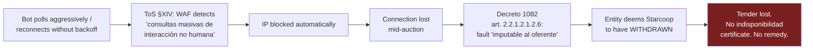
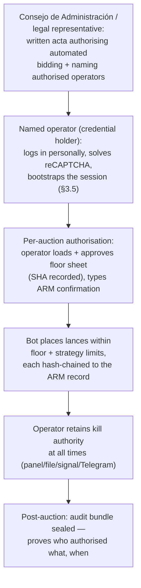
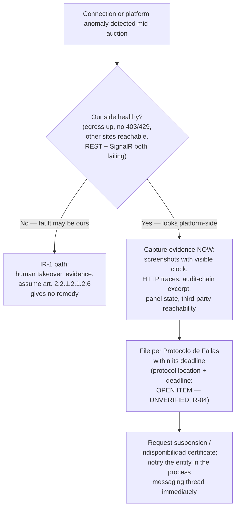

# 05 — Legal, Ethical and Compliance Chapter

*This chapter establishes why `centinela` is lawful to build and operate, where the legal risk actually lives, and which software controls are legally load-bearing rather than merely good engineering.*

**Project:** SECOP II reverse-auction bidding automation for COOPERATIVA DE VIGILANTES STARCOOP CTA. (NIT/company code 700961121)
**Prepared:** 28 July 2026
**Status:** Research complete for the sources reachable from the open web. Items that could not be verified are marked **UNVERIFIED** and are never presented as settled.
**Sibling chapters:** [Context](00-context.md) · [API contract](01-api-contract.md) · [Auction mechanics](02-auction-mechanics.md) · [Client protocol](03-client-protocol.md) · [Strategy engine](04-strategy-engine.md) · [Tender discovery](06-tender-discovery.md) · [Architecture](07-architecture.md) · [Roadmap](08-roadmap.md)

---

## 0. Method, scope, and epistemic status

This chapter was written by reading primary sources directly wherever possible: the consolidated text of Decreto 1082 de 2015, the full 38-page PDF of the SECOP II Terms of Use (extracted and read end-to-end, not summarised from search snippets), the CCE supplier guide for electronic auctions (CCE-SEC-GI-15, extracted and read), Decreto 2153 de 1992, and the CCE platform-terms policy (CCE-GTI-IDI-04). Where a secondary source or a search-engine summary was relied on rather than the primary text, that is said explicitly.

Three explicit non-claims:

1. **This is not legal advice.** It is a compliance engineering analysis. Before the first production auction, a Colombian `abogado de contratación estatal` and a competition-law specialist should review Sections 3, 4 and 9 and sign off in writing. Budget for this; it is cheap relative to an `inhabilidad` of eight years.
2. **No Colombian statute, decree, CCE circular, guide, or Terms-of-Use clause was found that expressly authorises *or* expressly prohibits a supplier from using software to place its own `lances`.** The silence is genuine, and Section 3.3 documents exactly what was searched for and not found. Everything downstream of that silence is risk analysis, not a legal conclusion.
3. **Every source is labelled with how it was obtained — and several central instruments were *not* fetched.** Section 13 separates sources read in primary text from sources known only through search summaries or general legal knowledge. The unfetched set is not peripheral: it includes `Ley 527 de 1999 art. 7` (the statutory basis of the entire electronic-signature analysis, Risk B), `Ley 1474 de 2011 art. 27` / `CP art. 410A` (the criminal red line, §4.2), Ley 80, Ley 1150 arts. 2/3/5, Ley 1340, Ley 1581, D.1070/D.1561 (the floor's legal source, Risk C) and the Supervigilancia tariff resolution. Each is marked **UNVERIFIED** at its point of use as well as in §13, and confirming their exact current text is a named deliverable of the counsel sign-off in point 1.

---

## 1. Executive summary and verdict

**Verdict: the project is lawful in principle, materially risky in execution, and the risk is almost entirely concentrated in three places that have nothing to do with competition law.**

The thing most people would worry about — "is a bidding bot collusion?" — is the *least* of the problems. Colombian competition law defines the prohibited conduct as an **`acuerdo`**, and `Decreto 2153 de 1992, art. 45.1` defines that as *"Todo contrato, convenio, concertación, práctica concertadas o conscientemente paralela entre dos o más empresas."* A single cooperative optimising its own descending bids on its own account is, by construction, one undertaking. There is no `acuerdo`. Unilateral aggressive price competition in a reverse auction is the *purpose* of the mechanism, not an abuse of it.

The real risks, in descending order of how likely they are to actually hurt Starcoop:

**Risk A — the disconnection trap (highest).** `Decreto 1082 de 2015, art. 2.2.1.2.1.2.6` states that when the connection is lost *"por causas imputables al oferente o a su proveedor de soluciones de tecnología de la información y telecomunicaciones... la subasta continuará y la Entidad Estatal entiende que el proveedor que pierde su conexión ha desistido de participar en la misma."* Simultaneously, the SECOP II Terms of Use §XIV state that CCE's perimeter security detects *"desde que IP se generan consultas masivas de interacción no humana"* and that on detecting *"un comportamiento anormal y de uso masivo de solicitudes... automáticamente se bloquea el acceso."* Chain those two clauses together and you get the project's single worst outcome: **the bot polls too hard, CCE's WAF blocks the IP, the connection dies, the fault is imputable to the bidder, the entity deems Starcoop to have withdrawn, and the tender is lost with no remedy** — because CCE will not certify an `indisponibilidad` for a failure that was yours. The bot's rate limiter is therefore not a courtesy. It is the primary contract-winning control.

**Risk B — every automated `lance` is a legally binding electronic signature by a named human.** Terms of Use §VII.A.d: *"La autenticación del SECOP II, es decir, el nombre de Usuario y la contraseña constituyen una firma electrónica en los términos del artículo 7 de la Ley 527 de 1999."* And §VI.c: credentials are *"personales e intransferibles."* *(The ToS text is primary — read directly. The statute it cites, `Ley 527 de 1999 art. 7`, was referenced from general legal knowledge, not fetched — **UNVERIFIED**, §13; counsel to confirm its current text.)* When the bot bids, a named natural person is signing, and §VII.A.a puts responsibility *"única y exclusivamente en el titular."* This is not a technicality — it drives the entire authorisation, audit and kill-switch design, and it means the bot must never be given a credential that its human operator has not knowingly and documentedly delegated to it.

**Risk C — for *this specific client*, the floor price is a regulatory obligation, not a business preference.** Starcoop is a `cooperativa de vigilancia y seguridad privada`. It is bound by the minimum-tariff regime now codified in `Decreto 1070 de 2015` as modified by `Decreto 1561 de 2022`, and updated annually by Supervigilancia circular (the tariff instrument in force at the time of the evidence corpus is cited in the project record as Resolución 20251000059517 — re-verify the current-year instrument before every tender, see §5). Those tariffs exist *precisely* to guarantee guards' minimum wage, overtime, night and holiday surcharges, and social benefits. A runaway bot that bids below the applicable minimum tariff does not merely destroy margin — it commits a regulated violation supervised by Supervigilancia, and separately exposes the offer to rejection under `Decreto 1082, art. 2.2.1.1.2.2.4`, which expressly applies to *"el precio obtenido al final"* of a reverse auction. The reserve price is a legal control with a regulatory source. Treat it accordingly — and be precise about what the software can and cannot guarantee: **the enforcement layers guarantee conformance with the approved floor *sheet*; conformance of that sheet with the statute rests entirely on the humans who compute and approve it** (see §5).

The recommended posture throughout is **conservative**: behave more politely than a human would, log more than anyone asks for, never touch a competitor's identity, and keep a human in the room.

*The disconnection trap: the causal chain the rate limiter exists to break. See §2.5 and §8.*

---

## 2. The legal framework for `subasta inversa electrónica`

### 2.1 Statutory layer

**Ley 80 de 1993** — the `Estatuto General de Contratación de la Administración Pública`. Establishes the general principles (`transparencia`, `economía`, `responsabilidad`, `selección objetiva`) that govern every process the bot will ever touch. Also defines `consorcios` and `uniones temporales` in art. 7 (relevant if Starcoop ever bids as a `Proponente Plural` — see §4.4).

**Ley 1150 de 2007, art. 2** — creates the selection modalities and, critically for this project:

- **art. 2, numeral 2, literal (a)** — `selección abreviada` for the acquisition of *Bienes y Servicios de Características Técnicas Uniformes y de Común Utilización*, for which the reverse auction is the default mechanism and, per the statute, **price is the sole evaluation criterion**. This is the modality behind SASI-001-2026.
- **art. 2, parágrafo (licitación pública)** — an entity may also require the offer to be presented *"de manera dinámica mediante subasta inversa"* in a full `licitación pública`, under conditions set by regulation. This matters for universality: the bot may encounter auctions that are **not** pure price auctions.
- **art. 3** — the statutory basis for SECOP itself and for electronic contracting, read together with Ley 527 de 1999.
- **art. 5** — `selección objetiva`.

### 2.2 Regulatory layer — Decreto 1082 de 2015

The controlling text is **`art. 2.2.1.2.1.2.2` (Procedimiento para la subasta inversa)**, *as substituted by art. 6 of Decreto 1860 de 2021*. Verbatim, the operative numerals:

> **1.** Los pliegos de condiciones deben indicar: a) la fecha y hora de inicio de la subasta; b) la periodicidad de los Lances; y c) el Margen Mínimo para mejorar la oferta durante la subasta inversa.
>
> **4.** Hay subasta inversa siempre que haya como mínimo dos oferentes habilitados cuyos bienes o servicios cumplen con la ficha técnica.
>
> **5.** Si en el Proceso de Contratación se presenta un único oferente [...] la Entidad Estatal puede adjudicarle el contrato al único oferente si el valor de la oferta es igual o inferior a la disponibilidad presupuestal [...] caso en el cual no hay lugar a la subasta inversa.
>
> **6.** La subasta debe iniciar con el precio más bajo indicado por los oferentes y en consecuencia, solamente serán válidos los Lances efectuados durante la subasta inversa en los cuales la oferta sea mejorada en por lo menos el Margen Mínimo establecido.
>
> **7.** Si los oferentes no presentan Lances durante la subasta, la Entidad Estatal debe adjudicar el contrato al oferente que haya presentado el precio inicial más bajo.
>
> **8.** Al terminar la presentación de cada Lance, la Entidad Estatal debe informar el valor del Lance más bajo.
>
> **9.** Si al terminar la subasta inversa hay empate, la Entidad Estatal debe aplicar los criterios del artículo 35 de la Ley 2069 de 2020 [...]

The companion articles:

| Article | Rule (verbatim core) | Consequence for the bot |
|---|---|---|
| **2.2.1.2.1.2.3** | *"La Entidad Estatal debe estructurar la subasta inversa de manera que antes de la adjudicación, los participantes en la subasta no identifiquen las ofertas y los Lances con el oferente que los presenta."* | **Anonymity is a legal requirement of the auction design.** See §6.3 — the observed API appears to return more than this contemplates. |
| **2.2.1.2.1.2.4** | *"La subasta termina cuando los oferentes no hagan Lances adicionales durante un período para la presentación de Lances. La Entidad Estatal debe adjudicar el contrato al oferente que haya presentado el Lance más bajo. En el acto de adjudicación, la Entidad Estatal indicará el nombre de los oferentes y el precio del último Lance presentado por cada uno de ellos."* | Anonymity ends at award. Competitor identity becomes lawfully public **then**, from the award act — not from the API mid-auction. |
| **2.2.1.2.1.2.5** | *"La Entidad Estatal puede escoger si adelanta la subasta inversa electrónica o presencialmente. Si [...] electrónicamente debe fijar en los pliegos de condiciones el sistema que utilizará [...] y los mecanismos de seguridad para el intercambio de mensajes de datos."* | **The `pliego` is the law of the process.** It names the system and the security mechanisms. Pre-flight must read it (see [Tender discovery](06-tender-discovery.md)). Some auctions will not be on SECOP II at all. |
| **2.2.1.2.1.2.6** | *"Si en el curso de una subasta inversa electrónica se presentan fallas técnicas que impidan a los oferentes presentar sus Lances, la subasta debe ser suspendida [...] Si por causas imputables al oferente o a su proveedor de soluciones de tecnología de la información y telecomunicaciones, durante la subasta inversa electrónica la conexión con el sistema se pierde, la subasta continuará y la Entidad Estatal entiende que el proveedor que pierde su conexión ha desistido de participar en la misma."* | **The single most important article in this chapter.** See §2.5. |
| **2.2.1.1.2.2.4** | *"[...] el valor de una oferta parece artificialmente bajo, la Entidad Estatal debe requerir al oferente para que explique las razones que sustentan el valor ofrecido [...] debe recomendar rechazar la oferta o continuar [...] **En la subasta inversa esta disposición es aplicable sobre el precio obtenido al final de la misma.**"* | The floor price has a regulatory sanction: a runaway bot's winning bid can be **rejected outright**. |
| **2.2.1.2.1.1.1** | Dynamic offer formation by reverse auction inside a `licitación pública`. *"En ningún caso el precio será la única variable sometida a conformación dinámica."* | A multi-variable auction exists in law. The bot's universality requirement must not assume price-only. |

### 2.3 The two definitions that govern the bot's arithmetic

From `Decreto 1082 de 2015, art. 2.2.1.1.1.3.1`, verbatim:

> **Lance:** Cada una de las posturas que hacen los oferentes en el marco de una subasta.
>
> **Margen Mínimo:** Valor mínimo en el cual el oferente en una subasta inversa debe reducir el valor del Lance o en una subasta de enajenación debe incrementar el valor del Lance, el cual puede ser expresado en dinero o **en un porcentaje del precio de inicio de la subasta**.

### 2.4 This narrows — but does not resolve — the project's open `margen mínimo` question

The engineering evidence (see [Auction mechanics](02-auction-mechanics.md)) established, for the captured auction: the rejection message quoted `1.156.705,23 COP`, which is exactly 1.00% of the `115.670.523` `startPrice`, with `minimumBidType: "Percentage"` (`1` in `GetAuctionSimple`) and `minBidDifference: 1.0` per price-list item. That the step for **that** auction was 1% of the initial price is **CONFIRMED** by the server's own rejection. What the decree adds is narrower than a confirmation of mechanism:

**The regulation *permits* one of the two bases observed in the wild.** `Margen Mínimo` may lawfully be expressed *"en dinero o en un porcentaje del precio de inicio de la subasta"* — money, or a percentage of the **start price**. The captured auction's behaviour matches the second enumerated option, so the 1%-of-start reading is consistent with the decree. But it is **ASSUMED**, not established, that `minimumBidType: "Percentage"` maps onto the decree's percentage option and that the other enum value maps onto the money option — the platform's configuration semantics were never captured for a second auction, and confirming the mapping requires observing an auction with a different `minimumBidType` (ideally in the Subasta de Prueba, §3.7).

**And the decree's enumeration does not cover everything the wild contains.** A live 2026 pliego — UNP SASI-064-2026, see [Tender discovery](06-tender-discovery.md) §1.4 — specifies its margin as *"2% respecto del último lance válido"*: a percentage of the **last valid lance**, a base the definition quoted in §2.3 does not enumerate. This is **documentary** evidence (a published tender document; that auction had not run and no API behaviour for it was observed — it must never be cited as an API observation). Two readings are possible and neither is safe to assume: either the decree's enumeration is exhaustive, in which case the UNP configuration sits outside it — a potential challenge ground of real commercial value, **flagged for counsel** at the §0 sign-off; or the enumeration is illustrative, in which case the decree "permitting" the observed behaviour proves little about what any given auction will do. Either way the operational rule is unchanged and absolute: **read the step from the server (`GetAuction` + `ValidateBid`), never assume the base from the decree or the pliego.**

**The comparison base is separately unresolved, and CCE's own materials conflict.**

- The CCE supplier guide (CCE-SEC-GI-15, v.1, 22/04/2022) says the platform controls the margin *"con respecto al total del último lance valido"* — the last valid bid **of the event**, and adds *"no existirán empates debido a que un lance es válido si mejora el último lance del evento en por lo menos el margen mínimo."*
- CCE's `base de conocimiento` page, as returned by search, states the margin is controlled against **each bidder's own last bid**, not against the lowest offer. *(This came from a search-result summary of that page, not from reading the page's primary text — **UNVERIFIED**.)*
- The captured `ValidateBid` error asserts **both** conditions: *"tiene que ser inferior al valor de su ultimo lance"* **and** *"inferior al ultimo lance mas la diferencia minima total."*

**Recommendation (conservative):** the bid calculator must compute `min(own_last_bid − margin, global_best_bid − margin)` — satisfy *both* constraints simultaneously — then always run `ValidateBid` and only submit on `isValid: true`. This is safe under every reading. Do **not** hardcode either interpretation. And the derivation must still be empirically confirmed against a second auction with a different `minimumBidType`, ideally in the **Subasta de Prueba** module (§3.7). This matches architecture principle 4 ("the server is the only rule oracle") in [Architecture](07-architecture.md).

Also encode, from `art. 2.2.1.2.1.2.2` numerals 4, 6 and 7: bidding does not always happen (single qualified bidder → direct award, no auction); if nobody bids, the lowest *initial* price wins — which means **the initial offer price is itself a strategic decision the bot does not make and must never be allowed to influence.**

### 2.5 `Art. 2.2.1.2.1.2.6` is simultaneously the project's best justification and its worst hazard

Read it in both directions.

**As justification:** the recording shows `ESTADO: DESCONECTADO`. Under this article, a lost connection attributable to the bidder is treated as **withdrawal from the auction**. A human watching a dead SignalR socket during a 10-minute auction with 3-minute extensions is one dropped WebSocket away from being deemed to have abandoned the tender. Software that detects the drop in milliseconds, reconnects, replays state and resumes is directly mitigating a legal forfeiture risk. This is a legitimate, documentable business justification for the whole project, and it should be written into the project charter in exactly these terms.

**As hazard:** the same article gives Starcoop no remedy when the fault is its own — and a WAF block triggered by the bot's own polling is unambiguously *"imputable al oferente."* Additionally, CCE's `Protocolo de Fallas Generales y Específicas` (the mechanism for certifying an `indisponibilidad`, referenced in Terms of Use §V.b) only covers platform-side failures. **The URL for that protocol given in the Terms of Use returns HTTP 404 as of this research** — the ToS links a dead document. Locating the current protocol and its reporting deadlines is an **open action item (UNVERIFIED)**; it matters because if a genuine platform failure occurs mid-auction, someone must know how to obtain the certificate within the required window.

**Design consequences, non-negotiable** (all enforced in [Client protocol](03-client-protocol.md) and [Architecture](07-architecture.md)):

- Poll intervals must be conservative and jittered; the server-authoritative `auction.ReceiveClock` should drive timing, not aggressive independent polling.
- Reconnect with exponential backoff and a hard cap (the SignalR reconnect budget: ≤ 1 full restart per 20 s, ≤ 6 per auction). Never hammer.
- Treat an HTTP 403/429 or an abrupt connection reset as a **P0 alarm that pages the human immediately**, not as a retryable error — because it may be a WAF block, and the legal clock is running.
- Never run the bot from a shared/NAT'd IP alongside other automation. The ToS blocks *by IP*. One stable, attributable egress IP per the architecture.

---

## 3. Platform rules: SECOP II Terms of Use and CCE guidance

### 3.1 The instruments, and their legal status

| Document | Code | Version / date | Status |
|---|---|---|---|
| Términos y Condiciones de Uso del SECOP II | **CCE-GTI-IDI-05** | V.01, approved 30/09/2021 (file dated 19-11-2021) | **Current.** Read in full for this chapter. |
| Política de Términos y Condiciones de las Plataformas Electrónicas | **CCE-GTI-IDI-04** | V.01, 30/09/2021, in force from 10/11/2021 | Current. Read in full. Contains no automation clause. |
| Guía SECOP II – Participación en Procesos de Contratación: Subasta Electrónica (proveedores) | **CCE-SEC-GI-15** | V.1, 22/04/2022 | Current. Read in full. |
| Guía SECOP II – Selección Abreviada Subasta Inversa (entidades) | **CCE-SEC-GI-25** | 20/04/2022 | Exists; **not read in full** for this chapter. |

The Terms of Use bind by adhesion: §II — *"su uso implica la aceptación de estos"*; §I — they *"vinculan a los Usuarios a cumplirlos y que son aceptados por los mismos por el simple hecho de crear un usuario y/o cuenta."*

Two structural features matter enormously:

**Incorporation by reference.** §IV.2.l: *"Los Usuarios aceptan y deben aplicar los protocolos, lineamientos y procedimientos descritos en el Minisitio de SECOP II, incluidos manuales, conceptos y guías de uso, cualquier actuación que contradiga lo establecido en estos es responsabilidad exclusiva de los Usuarios."* The guides are contractually binding, and any deviation is the user's exclusive responsibility.

**Unilateral amendment without notice.** §III: *"La ANCP-CCE puede modificar unilateralmente y sin previo aviso los Términos y Condiciones de Uso."* §XV adds that continued access is tacit acceptance. **The compliance surface can change under you at any time.** This alone requires a scheduled quarterly re-check of the ToS as a standing operational control (§10.4).

### 3.2 The clauses that actually matter, verbatim

**On non-human interaction — Terms of Use §XIV (Ciberseguridad):**

> A través de dicho mecanismo se identifican desde que IP se generan consultas masivas de interacción no humana que atenta contra este principio de Seguridad de la Información.
>
> Es importante recordar que en los casos que se detecte un comportamiento anormal y de uso masivo de solicitudes, búsquedas, descargas, o a través de otras técnicas que puedan afectar el rendimiento y la disponibilidad del servicio de las plataformas, automáticamente se bloquea el acceso a las mismas.

**On malicious or unauthorised technological access — §IV.2.a and §IV.2.b:**

> (a) Los Usuarios del SECOP II no deben utilizar la tecnología para acceder o intentar acceder al SECOP II de forma maliciosa o no autorizada.
>
> (b) Los Usuarios del SECOP II no deben poner en peligro la seguridad de la red y del SECOP II por el envío o la transmisión de virus, gusanos u otros programas, o a través de otras técnicas que puedan afectar al rendimiento del SECOP II.

**On credentials and electronic signature — §VI.c, §VII.A.a, §VII.A.d, §VII.A.j:**

> La estructura de la plataforma SECOP II maneja para todos los Partícipes una serie de usuarios y contraseñas **personales e intransferibles**, los cuales marcan dentro la plataforma, gracias al sello de tiempo, un registro de cada acción y dato manejado por ese Usuario [...]
>
> Los Usuarios del SECOP II son responsables de cualquier actuación efectuada con su Usuario. En consecuencia, la responsabilidad del manejo y confidencialidad de los usuarios y contraseñas recae única y exclusivamente en el titular de la misma y no en la ANCP-CCE.
>
> Las actuaciones de los Usuarios en el SECOP II comprometen a la Entidad Compradora o al Proveedor del cual son agentes. La autenticación del SECOP II, es decir, el nombre de Usuario y la contraseña **constituyen una firma electrónica** en los términos del artículo 7 de la Ley 527 de 1999 [...]

The CCE supplier guide repeats it at the point of auction entry: *"Ingrese a el SECOP II con usuario y contraseña tenga en cuenta, que su usuario es personal e intransferible."*

**On concurrent sessions — §IV.1.j (a "recommendation", but binding via §IV.2.l):**

> No acceder simultáneamente con el mismo Usuario en navegadores diferentes dentro de la misma Entidad Compradora/Proveedor [...]

**On intellectual property — §XI (Derechos de Autor):**

> Los derechos de autor y la propiedad intelectual sobre la información, infogramas e imágenes contenidas en la SECOP II, son propiedad exclusiva del Estado Colombiano [...]
>
> Queda estrictamente prohibido la utilización de elementos objeto de propiedad industrial e intelectual con cualquier tipo de finalidad, **en especial comercial**, así como su distribución, comunicación pública, modificación, alteración, transformación o **descompilación**, salvo autorización expresa por escrito por parte del titular de los mismos.

**On the licence granted — §VIII:**

> Colombia Compra Eficiente concede temporalmente a los Usuarios una licencia intransferible y no exclusiva de uso del SECOP II, únicamente bajo los términos y condiciones que se indican en el presente documento. La creación de un Usuario en el SECOP II no otorga derecho alguno sobre la plataforma tecnológica.

**On suspension and cancellation — §VII.A.f (fragment; see also §VII.A.g, §VII.A.i, §VII.C.f):**

> f) La ANCP-CCE como administradora de la plataforma puede cancelar de manera definitiva o provisional los Usuarios registrados a solicitud de un tercero que demuestre interés legítimo [...] cuando: [...] Se haga un uso indebido, **de forma preventiva** hasta que la instancia o ente de control competente [...]

In substance: CCE reserves the power to suspend or cancel user accounts — including **preventively**, on a showing of misuse, pending a determination by the competent control authority. An account suspension mid-tender is functionally equivalent to the disconnection trap of §2.5: the auction continues without you. This is why the operating posture (§8) is calibrated to never *look like* misuse, not merely to never *be* misuse.

### 3.3 The silence on automation: what was searched for and not found

The following was searched for and **not found** in any of the four instruments in §3.1, in the SECOP II Minisitio guide index, or via open-web search of CCE materials:

- Any clause using the words `bot`, `robot`, `automatización`, `automatizado`, `software de terceros`, `cliente no oficial`, `API`, or `scraping` in the context of supplier conduct.
- Any clause conditioning participation in a `subasta electrónica` on the use of a browser, on human keystrokes, or on any particular client software.
- Any CCE circular or concepto addressing supplier-side automation of `lances`, in either direction.
- Any published CCE developer terms, API terms of service, or rate-limit policy for `subastas.secop.gov.co`. The `/eauctions.api` surface is, as far as the open web shows, undocumented.

What the instruments regulate instead is *effects and postures*: massive non-human query volume (§XIV), malicious or unauthorised access (§IV.2.a), techniques that degrade performance (§IV.2.b), credential sharing (§VI.c), and decompilation of the platform (§XI). None of these, on their plain text, reaches "a supplier's own software placing the supplier's own bids, politely, on the supplier's own authenticated account."

**This finding is a description of an absence.** An absence cannot be upgraded into a permission. The design treats it as follows: the bot must be defensible under every clause that *does* exist — which is precisely the guardrail set in §11 — and the residual interpretive risk is carried in the risk register (§9, R-05) until Colombian counsel opines.

### 3.4 Reading the silence: the interpretation this project adopts (risk analysis, not law)

Four textual anchors support the position that polite self-bidding automation is not prohibited conduct:

1. **§XIV sanctions a behaviour profile, not a tool.** It targets *"consultas masivas"* that threaten *"el rendimiento y la disponibilidad del servicio."* A client that generates *less* traffic than an anxious human refreshing the auction room (see the politeness budget in [Client protocol](03-client-protocol.md)) does not exhibit the sanctioned profile.
2. **§IV.2.a prohibits access that is "maliciosa o no autorizada."** The bot accesses only the account Starcoop is authorised to use, does only what that account is authorised to do (view its auction, place its `lances`), and does it under a licence (§VIII) that nowhere restricts the user agent.
3. **The electronic-signature clause (§VII.A.d) presupposes attribution, and Ley 527 de 1999 is technology-neutral by design.** Colombian e-commerce law attributes a data message to its originator; it does not require the originator's finger on the key. *(This characterisation of Ley 527 rests on general legal knowledge, not a fetched text — **UNVERIFIED**, §13 — and is one of the specific points counsel must confirm.)* The compliance burden this creates is *internal*: a documented, revocable, named-human authorisation chain (§7), not a prohibition.
4. **The auction mechanism's own purpose.** Every regulatory text in §2 pushes toward more competitive pricing and continuous connectivity. A tool whose two functions are (a) not losing the connection and (b) bidding no lower than the legal floor is aligned with, not contrary to, the mechanism's purpose.

Against this, the honest counter-arguments, which counsel must weigh:

- §XIV's detection language ("interacción no humana") could be read by CCE as evidence that *any* non-human interaction is disfavoured, even if only massive volume is sanctioned.
- §IV.2.l's incorporation-by-reference means a future guide or Minisitio protocol could restrict automation **without notice** (§III). The quarterly re-check (§10.4) is the mitigation, and it must actually happen.
- CCE's preventive-suspension power (§VII.A.f) does not require CCE to be *right* before acting. Even a defensible bot can be suspended first and argued about later. The mitigation is the conservative traffic posture plus the audit trail: if questioned, Starcoop must be able to hand over a complete, hash-chained, timestamped record showing polite cadence and human authorisation of every `lance`.

### 3.5 Credential and session rules → hard design constraints

| ToS rule | Design constraint (enforced — see [Architecture](07-architecture.md)) |
|---|---|
| Credentials `personales e intransferibles` (§VI.c) | The bot runs under a session bootstrapped **by the named credential holder in person** (headful login, human solves reCAPTCHA). Credentials are never embedded in config, never shared between operators, never held by the developer. |
| Every action is timestamped to the user (§VI.c) | The bot's audit log mirrors the platform's attribution: every automated action is chained to the named human who armed it (§7). |
| One user, one browser session (§IV.1.j) | **One session per credential, full stop** — which requires an account-level lock keyed on `companyCode`, not only the per-auction lockfile (see G-06: the per-auction lock alone would permit two concurrent sessions when two auctions overlap; concurrent auctions are out of scope until that lock exists and OQ-08 resolves). The bot and a second human browser session on the same user must never run concurrently — the panel's TOMAR CONTROL flow hands over the *existing* browser (noVNC) rather than opening a new login. |
| User actions bind the Proveedor (§VII.A.d) | The mode ladder: no `armed` mode without a typed confirmation by the authorised human; `copilot` mode has zero write capability. |
| Titular exclusively responsible (§VII.A.a) | The kill switch is reachable by the credential holder at all times (panel, file, signal, Telegram `/kill`), and remote control can only ever make the bot *less* active. |

### 3.6 The §XI intellectual-property clause vs. this project's reverse engineering

§XI prohibits, among other things, `descompilación` of the platform and commercial use of protected elements. The evidence corpus for this project was built by **observing our own account's network traffic** (HAR captures of the operator's own browser sessions, plus a screen recording of our own participation). Nothing was decompiled: no platform binary, no server code, no obfuscated JavaScript was transformed or disassembled. Observing one's own HTTP traffic to interoperate with a service one is licensed to use is materially different from decompiling the platform, and the localization bundle strings cited in [API contract](01-api-contract.md) were served to our own browser in the ordinary course of use.

Two disciplines keep it that way:

1. **No redistribution of platform assets.** The docs and codebase must not embed SECOP II images, infogramas, or copied guide text beyond short verbatim quotes for compliance analysis (as in this chapter). The platform's assets are *"propiedad exclusiva del Estado Colombiano."*
2. **No decompilation, ever.** If a future protocol question cannot be answered from observed traffic or public documents, the answer is a support ticket to CCE or a test in the Subasta de Prueba module — not disassembly.

Residual risk: a maximalist reading of §XI ("utilización ... con cualquier tipo de finalidad, en especial comercial") could be stretched toward any commercial interoperation. This is carried as R-06 in §9 for counsel's review; it was **not** found applied that way in any CCE material reviewed.

### 3.7 The `Subasta de Prueba` as the lawful verification venue

The platform's data model carries a `testAuction` flag (observed `false` on the real auction — see [API contract](01-api-contract.md)), and CCE materials contemplate practice auctions for suppliers. Every open protocol question that would otherwise cost a permanent, NIT-attributed entry in a real entity's audit log — the exact `SubmitBid` contract (open question O2), the `minimumBidType` semantics (§2.4), the margin comparison base — should be resolved against test auctions wherever CCE makes them available, before the bot is ever armed in a real tender. The two-`ValidateBid`-rejections-per-auction budget in the [Architecture](07-architecture.md) exists because the alternative venue for experimentation is a *procuring entity's evidentiary record*.

**Action item (UNVERIFIED):** confirm with CCE the current mechanism for supplier-side test auctions (whether self-service or on request), and whether test-auction traffic is subject to the same §XIV monitoring. Until confirmed, treat test auctions with the same politeness budget as real ones.

**The outreach itself is a risk decision, not a free move.** This section and [03 §8](03-client-protocol.md) Step 1 both recommend formally asking Vortal and CCE for documentation and test access. Sending that query in writing **puts CCE on notice** that STARCOOP contemplates supplier-side automation — and §VII.A.f (documented in §3.2, carried as R-05) lets CCE suspend preventively first and discuss later. The query can therefore *create* the exposure it is meant to close. Binding rules:

1. **Counsel-gated.** The query is drafted or reviewed by counsel as part of SC-067 — never sent informally by an operator or engineer.
2. **Framed narrowly.** It requests the documented things — the supplier test-auction mechanism and supplier-facing API documentation — and does not ask CCE to bless automation in the abstract. There is no benefit in soliciting a policy that does not exist (§3.3).
3. **Sequenced.** Not sent before IR-4 is closed and the politeness/audit posture is operational: if the question draws scrutiny, the record it examines must already be clean.
4. **Decision criterion.** Send only if counsel judges that converting §3.3/§3.4's silence into an explicit answer is worth more than the ambiguity — noting the asymmetry: silence is interpretable; **an explicit "no" is binding, and there is no un-asking.**
5. **Fallback if the answer is negative, adverse, or never comes.** The project does not die — it retreats permanently to `copilot`/`assisted` (zero-write decision support; the human personally places every lance), which needs no automation posture at all. This fallback is why co-pilot is the Phase-1 *product* and not merely a stepping stone ([08](08-roadmap.md)).

---

## 4. Competition law

### 4.1 Why unilateral bidding automation is not an `acuerdo`

`Decreto 2153 de 1992, art. 45.1` (read directly) defines `acuerdo` as *"Todo contrato, convenio, concertación, práctica concertadas o conscientemente paralela entre dos o más empresas."* Every collusive-tender theory under Colombian law — including the classic `acuerdos anticompetitivos` in public procurement — requires **two or more undertakings**. One cooperative, one account, one bot, optimising its own price against a legal floor, is one undertaking making unilateral decisions. There is no counterparty, no concertation, and no exchange of competitively sensitive information. The bot's aggression is price competition, which is the mechanism working as intended.

The `práctica conscientemente paralela` limb deserves one careful note: it still requires parallelism *between undertakings* that is consciously coordinated in effect. A bot that reacts to the anonymous best visible price — exactly as a human bidder is invited to do by `art. 2.2.1.2.1.2.2` num. 8 (the entity must announce the lowest lance) — is responding to the auction, not coordinating with a rival. No design change is needed; the design already never identifies who it is reacting to (§6).

### 4.2 The criminal red line, stated precisely so it is never approached

Collusion in public tenders is not just an administrative infraction; it is a crime. `Ley 1474 de 2011, art. 27` added art. 410A to the Código Penal (`Acuerdos restrictivos de la competencia` in procurement processes), criminalising concerting to alter the competitive bidding process, with prison, fines and `inhabilidad` to contract with the State. *(**UNVERIFIED** — statute referenced from general legal knowledge and secondary confirmation; the codified text was not fetched during this research — counsel to confirm the current wording and penalties as part of the §0 sign-off.)* Administratively, the SIC (under `Ley 1340 de 2009`, likewise to be confirmed by counsel) sanctions collusive tender conduct heavily and operates a leniency programme — which means a counterpart approached for collusion has a standing incentive to report it.

Hard prohibitions for this project, enforced as policy and, where possible, as code:

1. **The bot, its floor sheets, its strategy configuration, and its telemetry are never shared with, sold to, or operated for any other bidder.** A single instance operated across two competing vigilancia cooperatives in the same tender would create exactly the `acuerdo` that art. 45.1 defines — potentially a criminal one. If the software is ever commercialised, that is a new legal analysis requiring counsel *before* the first external user, with tender-exclusion controls (two clients never armed in the same process).
2. **No signalling.** Bid values must never be used to encode messages to rivals (e.g., trailing-digit signalling). The strategy engine ([Strategy engine](04-strategy-engine.md)) emits only `min(own_last − δ, best − δ)`-style minimal legal improvements and floor stops; it has no channel by which a human could inject pattern-encoded values, and the audit trail would show it if one were attempted.
3. **No use of competitor identity.** See §6. The roster the API leaks must not inform strategy.
4. **The probe-bid defense is unilateral, not retaliatory.** Filtering rivals' 1,00/0,00 COP placeholder bids out of the serious-price view is defensive arithmetic on public auction data, and must remain exactly that.

### 4.3 Information handling rules that keep §4.1 true

The `acuerdo` analysis holds only while Starcoop's competitive decisions are made unilaterally. Three standing rules preserve that:

- Floor prices and strategy parameters are internal, access-controlled, and never disclosed pre-award (they are also commercially fatal to disclose).
- Rival `companyCode`s observed via the API are HMAC-pseudonymised in the audit log with a per-auction salt discarded at close (see [Architecture](07-architecture.md) §4.7) — Starcoop's own records cannot become a competitor dossier.
- Employees are instructed in writing that any inbound approach proposing bid coordination is reported to management and counsel immediately.

### 4.4 `Proponente Plural` (consorcios / uniones temporales)

If Starcoop ever bids as part of a `consorcio` or `unión temporal` (Ley 80 de 1993, art. 7), the single-undertaking analysis changes shape but not conclusion: members of a lawfully constituted plural bidder submit **one** joint offer, and coordinating *that offer's* price internally is the point of the figure, not collusion. Two constraints follow for the bot:

1. The bot may operate for a plural bidder only on the plural bidder's own SECOP II account/process participation, with the authorisation chain (§7) extended to cover the plural bidder's designated representative.
2. The bot must never be simultaneously armed for a plural bidder **and** for any of its members bidding separately in the same process, and members of the plural bidder must not compete against it in that process — that pattern is precisely where lawful joint bidding shades into unlawful coordination. Pre-flight must check this (§10.2).

---

## 5. Sector regulation: the statutory floor for a vigilancia cooperative

Starcoop is supervised by the Superintendencia de Vigilancia y Seguridad Privada. The minimum-tariff regime — codified in `Decreto 1070 de 2015` as modified by `Decreto 1561 de 2022`, with values updated annually by Supervigilancia administrative act (the instrument cited in this project's record for the current cycle is `Resolución 20251000059517`; **the applicable current-year instrument must be re-verified before every tender**) — sets minimum prices for vigilancia services calculated to cover guards' minimum wage, surcharges, and social benefits, plus the administration and supervision margin.

Consequences, in order of severity:

1. **A below-tariff bid is a regulatory violation** by a supervised entity, independent of whether the contract is won. This is Risk C of §1: the floor is not a business preference.
2. **A below-tariff winning price invites rejection** under `Decreto 1082, art. 2.2.1.1.2.2.4` (artificially low offer, expressly applicable to *"el precio obtenido al final"* of the auction). Winning the auction with an illegal price wins nothing.
3. **The floor must be computed per tender**, from the pliego's service composition (number of posts, shift patterns, armed/unarmed, canine, urban/rural, applicable year) — not copied from a previous auction. The floor sheet is a legal document: it must record its regulatory inputs (instrument, article, values), its arithmetic, its author, and its approver, and its SHA-256 is displayed on the operator panel and embedded in the audit chain ([Architecture](07-architecture.md) §6, §4.8).

This is why floor enforcement is five layers with a latched kill, and why the strategy layer *cannot represent* a below-floor bid (type-level clamp). The engineering detail lives in [Architecture](07-architecture.md) and [Strategy engine](04-strategy-engine.md).

**What the layers do and do not guarantee — stated plainly, because the distinction is the whole risk.** All five layers enforce the *configured, signed floor sheet*. They are implemented in different code, but they share one common input — the sheet — and nothing in the runtime validates that the sheet's own arithmetic is correct or lawful. [Roadmap](08-roadmap.md) OQ-07 says it exactly: **"a wrong FloorSheet defeats all five guard layers from above."** And the sheet's single largest error source — mapping a pliego's staffing schedule to 24h/30-day-equivalent posts under the current tariff resolution — is **UNVERIFIED**, pending client input ([Tender discovery](06-tender-discovery.md) §5.4). So the honest statement is: *the software guarantees floor-sheet conformance; statutory conformance rests entirely on the L0 human gate that authors and approves the sheet.* A floor-violation near-miss is still a legal incident (§12, IR-3), not a bug ticket — but so is a wrong sheet, and no layer catches the latter.

Two consequences, both binding:

1. **OQ-07 / gate D2 is a blocking precondition for `armed` mode.** Until the pliego-staffing → tariff mapping is validated by Starcoop's costing staff and back-tested against past awarded contracts (OQ-07's stated resolution path), the bot must not be armed on any tender — `copilot` mode only. This is added to the pre-flight checklist (§10.2).
2. **The missing control is an independent second computation of the floor**: a second person, using a different method (e.g., manual computation from the tariff resolution vs. the tariff-engine output), must arrive at the same floor before the sheet is signed. Sign-off on someone else's arithmetic is review; two independent computations that agree is a control. This is stronger than the dual sign-off previously recorded in R-02 and replaces it (§9, §10.2).

3. **The floor-number validation protocol** — because the five layers validate the *plumbing*, these three checks validate the *number*, and all three must pass before a sheet is signed:
   - **Independent second computation** (consequence 2 above): different person, different method, agreement to the centavo.
   - **Back-test against reality**: before the tariff engine's first armed use — and again whenever the tariff instrument or the `post_24h30d_equivalence` mapping changes — recompute floors for a sample of **past awarded vigilancia contracts** (post-award open data, [06 §3](06-tender-discovery.md)) and compare with actual award prices. Any lawful award materially *below* our computed floor for the same service mix means our mapping is wrong (too high loses auctions; the same error inverted signs unlawful sheets). This is OQ-07's stated resolution path, made a concrete, repeatable procedure with its results archived alongside the sheet.
   - **Sanity band against the tender's own budget**: the sheet loader flags — and the signers must explicitly justify in writing — any floor outside a configured band of the tender's `precio_base` / official budget (default: flag `F < 60%` or `F ≥ 100%` of base). A floor at 20% of the official budget is almost certainly a mapping error, not a competitive advantage; a floor above the budget means the tender is unwinnable and should be a "do not enter". The band is a tripwire on the *number*, deliberately independent of the tariff arithmetic that produced it.

---

## 6. Auction anonymity and data protection

### 6.1 Anonymity is the entity's legal duty — and the bot must not undermine it

`Art. 2.2.1.2.1.2.3` obliges the entity to structure the auction so that *before award*, participants cannot link offers and `lances` to bidders. `Art. 2.2.1.2.1.2.4` makes identities public only *at award, in the award act*.

### 6.2 What the observed API actually returns

The evidence corpus (see [API contract](01-api-contract.md)) shows that mid-auction:

- `GetSupplierBids` returns per-lot and per-item ranking arrays including rivals' **`companyCode`**, position and values;
- the SignalR `chat.onConnected` / `onNewUserConnected` / `onUserDisconnected` messages expose a live roster of connected companies by `companyCode`.

### 6.3 The gap, and the posture

The API therefore appears to expose more linkage than `art. 2.2.1.2.1.2.3` contemplates the participants having before award. Whether this is a deliberate design decision by CCE (e.g., codes considered sufficiently pseudonymous), a configuration artifact of this auction (`showBidderNameForOtherBidders: false` was set, yet codes still appear), or an oversight, **cannot be determined from the outside — UNVERIFIED**. The bot's posture does not depend on resolving it:

1. **Receive, don't retrieve.** The bot consumes only what the platform pushes to any authenticated participant. It performs no additional lookups to resolve `companyCode` → company identity during an auction, and the discovery module's rival-roster analytics (Socrata `hgi6-6wh3`, see [Tender discovery](06-tender-discovery.md)) operate exclusively on *post-award public data*, which `art. 2.2.1.2.1.2.4` makes lawfully public.
2. **Pseudonymise at rest.** Rival `companyCode`s are HMAC-pseudonymised in the audit log with a per-auction salt discarded at close.
3. **Never strategise on identity.** The strategy engine's `AuctionView` deliberately contains no rival identifiers — only anonymous serious-price aggregates. This is enforced by the view schema, not by convention.
4. **Personal data.** Rival company data is juridical-person data, generally outside `Ley 1581 de 2012` (habeas data); but chat messages and any user display names the platform exposes may contain personal data of natural persons. The bot stores chat only as received-and-redacted audit evidence, uses it for nothing, and grants no analytics over it. *(Ley 1581 referenced from general legal knowledge; scope confirmation for the chat corpus is part of the counsel sign-off.)*

### 6.4 Retention, deletion, and custody of evidence

[Architecture §11](07-architecture.md) says audit chains and floor sheets "are retained per 05-compliance" — this section is that policy. It exists because the audit bundle is the dispute package (§12 IR-5) and the price-sustainability defence (§5): here, **premature deletion is the only unrecoverable error**.

| Data class | Where it lives | Retention | Deletion |
|---|---|---|---|
| Sealed audit bundle (hash-chained JSONL + redacted `raw/` + `OUTCOME`/`AWARD` records, [07 §5.8](07-architecture.md)) | Sealed at close on the VPS; **moved within 30 days** to STARCOOP-controlled encrypted storage (the same access-controlled store as the evidence bundle, IR-4 rule 3), primary + offline copy; bundle SHA-256 recorded in a retained index. The VPS — the most exposed machine (07 §7.4) — keeps nothing older than 30 days | **Deletion-frozen**: retain for the longer of (life of the resulting contract + 10 years) or the applicable liability/disciplinary/fiscal prescription periods — the exact statutory periods are **UNVERIFIED** and their confirmation is added to the SC-067 counsel memo. Until counsel fixes shorter periods in writing, nothing is deleted | Only after counsel-confirmed expiry; logged in the retention index (what, when, why, who); never while any inquiry, incident, or challenge is open |
| Floor sheets, acta de autorización, ARM/HANDOVER records | With the audit bundle (they are legal documents, §5, §7) | Same as the bundle | Same as the bundle |
| **Per-auction HMAC salt** (D-09 pseudonymisation) | Generated at ARM; held **only** in runner memory + one OS-keychain entry `centinela/<auctionId>/salt`. Never in config, never in the audit directory — the chain must not carry the key to its own pseudonyms | Until close | **Destroyed at close** (§10.3): keychain entry deleted + a `SALT_DESTROYED` record appended to the chain. Afterwards the pseudonyms are permanently unlinkable *even to us* — that irreversibility is the point of D-09, and this row is where the salt "lives" and "dies" |
| Latency/clock SQLite, structured logs | VPS working data | 90 days (SQLite) / 12 months (logs) | Rotated freely; no approval needed |
| Chat corpus | Received-and-redacted inside the audit bundle only (§6.3.4) | With the bundle | Never extracted for analytics; deleted with the bundle |
| Raw evidence bundle (HARs, recording) | Access-controlled storage per IR-4 | Until superseded by redacted derivatives + counsel OK | Per IR-4 rules 3–4 |

---

## 7. Electronic signature and the authorisation chain

Under ToS §VII.A.d and `Ley 527 de 1999, art. 7` (statute referenced from general legal knowledge, not fetched — **UNVERIFIED**, §13), every `lance` the bot places is an electronic signature of a named natural person, binding the cooperative. The project therefore maintains an explicit, documented delegation chain, designed so that at any moment one can answer: *which human authorised this bid, when, and with what limits?*

Required artifacts, each a precondition for arming (checked in §10):

| Artifact | Content | Legal function |
|---|---|---|
| **Acta de autorización** (one-time, revocable) | Board/legal-representative authorisation of automated bidding; named operators; scope and limits | Establishes that the `titular`'s delegation to the software was knowing and documented (answers §VII.A.a) |
| **Floor sheet** (per auction) | Regulatory inputs (§5), arithmetic, author, approver, SHA-256 | Ties every possible bid to a lawful minimum with provenance |
| **ARM record** (per auction) | Operator identity, typed confirmation text, timestamp, floor-sheet SHA, strategy name + version | The signature-equivalent moment: a named human knowingly activated bidding under stated limits |
| **Hash-chained audit log** (continuous, `fsync` on bid path) | Every decision, validation, submission, reconciliation, kill event | Evidentiary record under Ley 527 (data-message integrity) and the ToS timestamping regime |

The `copilot` mode ([Architecture](07-architecture.md) §4.8) is the compliance-gentlest rung of the ladder: the human personally clicks every bid while the software only computes; the signature question does not even arise. It is deliberately the Phase-1 product (see [Roadmap](08-roadmap.md)).

### 7.1 Operator continuity — unbounded auctions, finite humans

§10.2 requires a named operator "available for the full auction window + extensions" — but extensions are unbounded while `extraTimeMaximumBids` is null ([02 §7.2](02-auction-mechanics.md)): a scheduled 10-minute auction can run 90 minutes or more. A single human with an appointment is therefore not a plan. Binding rules:

1. **Two named humans per armed auction.** Every armed auction has a **primary and a backup operator**, both named in the acta (§7), both with a provisioned WireGuard peer (panel) and verified Telegram `/kill` access at pre-flight. One available human ⇒ ARM is refused by checklist (§10.2).
2. **Handover is an audited act.** The incoming operator, on their own WireGuard peer, types a `HANDOVER` confirmation on the panel — identity and timestamp chained to the ARM record. Kill authority and the alert route transfer. Handover **never** touches the platform session: the browser session belongs to the credential holder and is never re-authenticated mid-auction. No handover during ENDGAME except for incapacitation.
3. **The credential holder is a separate constraint.** TOMAR CONTROL (rung 3) and any manual platform action require the credential holder personally (§3.5, ToS §VI.c). If the credential holder becomes unavailable mid-auction, rung 3 is lost: the panel marks the human rung DOWN, and the auction continues **inside the Bracket envelope** — which is precisely the pre-authorized exposure bound that makes an unattended stretch survivable ([04 §6.5](04-strategy-engine.md)). Logged as an incident for post-auction review; never a reason to exceed the envelope.
4. **Incapacitation does not auto-disarm.** If both operators go unreachable while ARMED, the deadman alarm escalates ([07 §4.8](07-architecture.md)) but the bot does **not** self-disarm — a mid-auction self-disarm is a self-inflicted withdrawal, the same logic as DL-11. The envelope plus the floor layers are the bound; the staffing failure is a P0 incident. Kill remains one Telegram message away from either operator's phone.
5. **Shift arithmetic.** Pre-flight staffs for `scheduled window + 2 h`. A Telegram alert at scheduled-end + 45 min ("auction still running") triggers backup call-up, so a long extension tail is met by a fresh human, not a tired one.

---

## 8. Rate limiting, egress identity and platform integrity as legal controls

Everything in this section restates engineering decisions from [Client protocol](03-client-protocol.md) and [Architecture](07-architecture.md) in their legal role:

| Control | Engineering description | Legal function |
|---|---|---|
| Global politeness budget | All REST cadences (IDLE 60 s / ARMED 10 s / ENDGAME 2.5 s), debounced `newData` refetch, jitter | Keeps the traffic profile below any plausible §XIV "consultas masivas" threshold; the bot must generate *less* load than an anxious human with F5 |
| SignalR reconnect budget | ≤ 1 full restart per 20 s, ≤ 6 per auction, then park DOWN and let REST carry | Prevents a degraded socket from turning into hammering — the exact §XIV trigger — while preserving §2.5's connectivity duty via the REST leg |
| Single stable attributable egress IP | One VPS, one IP, no shared NAT, no rotating proxies | §XIV blocks by IP; a stable single IP (a) isolates Starcoop from others' behaviour, (b) makes Starcoop's own politeness demonstrable, (c) avoids any appearance of block evasion. **IP rotation to evade a block is categorically prohibited** — it converts a traffic incident into deliberate circumvention (§IV.2.a territory) |
| 403/429/reset → P0 alarm, never auto-retry | Human paged immediately; TOMAR CONTROL surfaced | The legal clock of `art. 2.2.1.2.1.2.6` starts at disconnection; a human must decide, on the record, what happens next (§12, IR-1) |
| ValidateBid budget: ≤ 2 rejections per auction | Calibration then silence | Every rejection is a permanent NIT-and-IP-attributed entry in the entity's audit log; the budget keeps Starcoop's evidentiary footprint clean |
| Clean SignalR `abort` on shutdown | `MessengerLogout` in entity's event log | Leaves an orderly record — the entity's own log shows a tidy exit, not an unexplained drop |
| Kill switch strictly one-directional | Remote commands can only reduce activity | No remote channel can escalate the bot; misuse of the notification channel cannot cause bidding |

---

## 9. Risk register

Likelihood/impact: L/M/H. "Owner" is the role accountable for the mitigation staying real.

| ID | Risk | Legal source | L | I | Mitigation | Residual | Owner |
|---|---|---|---|---|---|---|---|
| R-01 | WAF block mid-auction → deemed withdrawal (the disconnection trap) | ToS §XIV + D.1082 art. 2.2.1.2.1.2.6 | M | **H** | Politeness budget; reconnect budget; single egress IP; 403/429 P0 alarm; human fallback in ≤ 2 s (TOMAR CONTROL); REST leg independence | Low, but non-zero — CCE thresholds are unpublished | Ops |
| R-02 | Below-floor bid (regulatory violation + offer rejection) | D.1070/2015 as mod. D.1561/2022; D.1082 art. 2.2.1.1.2.2.4 | L | **H** (unrecoverable — a lance cannot be retracted) | Five-layer floor-sheet enforcement incl. type-level clamp + byte-level pre-submit re-check + latched auto-kill; per-tender floor sheet with regulatory provenance; **independent second computation of the floor (different person, different method) before signing (§5); OQ-07/D2 blocks `armed` mode until the tariff mapping is validated** | The layers only guarantee sheet conformance; residual is a wrong *sheet* — carried by the L0 human controls, not the software | Compliance |
| R-03 | Wrong margin arithmetic → invalid lance at the decisive moment, or an over-aggressive valid one | D.1082 art. 2.2.1.1.1.3.1; conflicting CCE guidance (§2.4) | M | M | Satisfy both margin readings simultaneously; ValidateBid-gated submission always; empirical confirmation in test auctions before reliance | Low after O-margin closes | Eng |
| R-04 | Genuine platform failure but no `indisponibilidad` certificate obtained in time | ToS §V.b; protocol document URL is 404 — **UNVERIFIED** | M | H | Open action item: locate current Protocolo de Fallas + deadlines; evidence-capture runbook (IR-2); audit bundle as fallback evidence | Medium **until the protocol is located** | Compliance |
| R-05 | CCE reads automation as ToS breach; preventive account suspension | ToS §XIV, §IV.2.a, §VII.A.f; the documented silence (§3.3) | L–M | **H** | Conservative traffic posture; complete audit trail demonstrating polite, authorised, self-account use; counsel opinion before production; quarterly ToS re-check | Medium — CCE can act first and argue later | Legal |
| R-06 | §XI IP clause stretched against API interoperation | ToS §XI | L | M | No decompilation ever; no platform-asset redistribution; interoperation limited to own-account traffic; counsel review | Low | Legal |
| R-07 | Credential/signature attribution failure (unauthorised person arms the bot; disputed lance) | ToS §VI.c, §VII.A; Ley 527/1999 art. 7 | L | H | Authorisation chain of §7; typed ARM confirmations; hash-chained audit; credentials never in config; personal bootstrap only | Low | Compliance |
| R-08 | Collusion exposure if tool is ever shared/commercialised across competitors | D.2153/1992 art. 45.1; CP art. 410A (via Ley 1474/2011 art. 27 — counsel to confirm text) | L (currently N/A) | **H (criminal)** | Hard policy: single-client operation; any commercialisation requires prior competition-counsel design incl. same-tender exclusion | N/A while single-client | Legal |
| R-09 | Anonymity/data misuse via the API's rival roster | D.1082 art. 2.2.1.2.1.2.3; Ley 1581/2012 (scope TBC) | L | M | Receive-don't-retrieve; HMAC pseudonymisation; identity-free strategy view; post-award-only rival analytics | Low | Eng |
| R-10 | Artificially-low final price challenged even *above* the tariff floor | D.1082 art. 2.2.1.1.2.2.4 | L | M | Floor sheet doubles as the prepared justification of price sustainability; strategy stops at floor rather than approaching it asymptotically without margin analysis | Low | Commercial |
| R-11 | ToS changes without notice invalidate an assumption here | ToS §III, §XV | M | M | Quarterly ToS/guide re-check as a calendared control (§10.4); diff against archived copies | Low if the control runs | Compliance |
| R-12 | Auction is multi-variable or off-SECOP II; bot assumptions do not hold | Ley 1150 art. 2 parágrafo; D.1082 arts. 2.2.1.2.1.1.1, 2.2.1.2.1.2.5 | M | M | Pre-flight pliego read (§10.2) classifies the process; bot refuses to arm on unsupported types — mechanically enforced by the arming whitelist [02 RULE V-3](02-auction-mechanics.md) (`Forward`, non-`BestPrice`, non-null `scoreCalcFormula`, non-empty `evaluationRules`, unknown shapes all fail closed) | Low | Ops |
| R-13 | Leaked JWT / session cookies in the evidence bundle are abused | ToS §VI.c, §VII.A.a | L (token expired) | H (account = signature) | IR-4 executed **now**: password rotation, session invalidation, bundle access restriction, permanent redaction discipline | Low after IR-4 | Security |

---

## 10. Compliance checklist

### 10.1 One-time, before any production use

- [ ] Written sign-off on Sections 3, 4 and 9 by a Colombian `abogado de contratación estatal` and a competition-law specialist (§0).
- [ ] `Acta de autorización` executed: board/legal representative authorises automated bidding, names the authorised operators, states limits (§7).
- [ ] IR-4 executed for the evidence-bundle credential leak (§12) — password rotated, confirmation recorded.
- [ ] Current `Protocolo de Fallas Generales y Específicas` located; reporting deadlines documented in the IR-2 runbook (**open — UNVERIFIED**, R-04).
- [ ] Test-auction venue confirmed with CCE (§3.7, **UNVERIFIED**); O2 (SubmitBid contract) and margin semantics pinned there, not in a live tender.
- [ ] Current-year Supervigilancia tariff instrument identified and loaded into the floor-sheet template (§5).
- [ ] Egress IP provisioned: single, stable, exclusive, attributable to Starcoop (§8).
- [ ] Employee notice on collusion approaches issued (§4.3).

### 10.2 Per tender, before arming (pre-flight)

- [ ] Pliego read: confirm process is a SECOP II electronic reverse auction; extract `Margen Mínimo` (form and value), lance periodicity, schedule, and any `mecanismos de seguridad` clauses (D.1082 art. 2.2.1.2.1.2.5); refuse unsupported process types (R-12).
- [ ] Floor sheet built **for this tender** from the pliego's service composition + current tariff instrument; **floor independently recomputed by a second person using a different method, results agree**; SHA recorded (§5, §7).
- [ ] **`armed` mode blocked unless OQ-07/D2 is resolved**: the pliego-staffing → tariff mapping validated by Starcoop's costing staff for this tender type ([Roadmap](08-roadmap.md) OQ-07; §5). Until then `copilot` only.
- [ ] No `Proponente Plural` conflict: Starcoop (or its plural bidder) appears exactly once in this process; no member-vs-consortium overlap (§4.4).
- [ ] **Primary and backup operators** available for the full auction window + extensions per the §7.1 continuity rules (staffing planned for scheduled window + 2 h), kill access verified for both, TOMAR CONTROL tested with the credential holder.
- [ ] Session bootstrapped personally by the credential holder; no concurrent second browser session on the same user; **no other auction armed or active on this credential** — overlapping auction windows on one credential are out of scope until the account-level lock exists and OQ-08 resolves (§3.5, G-06).
- [ ] Initial offer price decided by humans; confirm the bot has no influence on it (§2.4, last paragraph).

### 10.3 During and immediately after each auction

- [ ] ARM only via typed confirmation; ARM record written (§7).
- [ ] Any 403/429/reset treated as P0 (IR-1); any suspected platform failure triggers evidence capture (IR-2).
- [ ] After close: audit bundle sealed (hash chain verified), per-auction HMAC salt destroyed (§6.3), reconciliation record confirms the server's view of Starcoop's final lance.
- [ ] Any floor near-miss, kill trip, or `AMBIGUOUS` submit outcome escalated as an incident (§12) before the bot is re-armed for any tender.

### 10.4 Standing controls (calendared)

- [ ] **Quarterly:** re-fetch ToS (CCE-GTI-IDI-05), CCE-GTI-IDI-04, CCE-SEC-GI-15/25 and the Minisitio protocol index; diff against archived copies; reassess §3.3's silence (R-11).
- [ ] **Annually (and on publication):** update the Supervigilancia tariff instrument in the floor-sheet template; re-verify D.1070/D.1561 status (§5).
- [ ] **Annually:** counsel re-confirmation that no new CCE circular, SIC decision, or statute has addressed supplier-side automation.

---

## 11. Software guardrails: mapping legal duties to enforced controls

Every row below is a control that exists in the codebase or deployment because of a legal source — not as generic hygiene. Engineering detail: [Architecture](07-architecture.md); protocol detail: [Client protocol](03-client-protocol.md).

| # | Legal duty | Source | Enforced control |
|---|---|---|---|
| G-01 | Do not generate massive non-human query volume | ToS §XIV | Global politeness budget across all pools; phase-based cadences; jitter; single-flight debounced refetch |
| G-02 | Do not lose the connection through own fault | D.1082 art. 2.2.1.2.1.2.6 | Independent REST leg that can win alone; reconnect budgets; watchdog + deadman alarms; human fallback rung ≤ 2 s |
| G-03 | Never bid below the lawful floor | D.1070/D.1561 + D.1082 art. 2.2.1.1.2.2.4 | Two distinct mechanisms, honestly separated. **(a) Floor-*sheet* conformance — mechanical:** five floor layers (guard package L1, type-level clamp making below-sheet unrepresentable L2, gateway byte-level re-check L3, floor-sheet provenance, latched auto-kill on violation) guarantee no bid below the *signed sheet*; they share the sheet as a common input and cannot detect a wrong sheet. **(b) *Statutory* conformance — human:** the L0 gate — independent second computation of the floor (different person, different method) that must agree before signing, plus the OQ-07/D2 block on `armed` mode until the tariff mapping is validated (§5) |
| G-04 | Every lance attributable to a knowing named human | ToS §VII.A.d; Ley 527/1999 art. 7 | Personal headful bootstrap; acta + ARM record; typed confirmations; mode ladder; hash-chained `fsync`'d audit before any submit leaves the machine |
| G-05 | Credentials personal and non-transferable | ToS §VI.c | No credentials in config/code; OS keychain / Docker secret for the sniffed token; JWT-redacting log processor on every handler; company code read from the JWT claim, never from config |
| G-06 | One user session at a time | ToS §IV.1.j | **Account-level exclusive lock keyed on `companyCode` alone**: at most one runner per credential, regardless of auction. The per-auction `(auctionId, companyCode)` lockfile in [Architecture](07-architecture.md) §4.3/§11 does *not* implement this duty — it permits N runners for N auctions on one `personal e intransferible` user, i.e. N concurrent sessions. Until the account-level lock exists and OQ-08 (session semantics) resolves, **concurrent auctions on the same credential are out of scope: the bot refuses to arm a second auction while one is active**. Takeover uses the existing browser, never a second login |
| G-07 | Minimal evidentiary footprint on the entity's log | ToS timestamping; prudence | ≤ 2 ValidateBid rejections per auction; ValidateBid always precedes submit; clean SignalR abort on shutdown |
| G-08 | Do not identify rival bidders pre-award | D.1082 art. 2.2.1.2.1.2.3 | Identity-free `AuctionView`; HMAC pseudonymisation at rest; rival analytics restricted to post-award open data |
| G-09 | No collusion channel | D.2153/1992 art. 45.1; CP art. 410A | Single-client policy; deterministic strategy with no operator-injectable bid values (no signalling channel); floor/strategy data access-controlled |
| G-10 | Remote control must not escalate | ToS §VII.A.a (titular's responsibility) | Telegram accepts exactly one inbound command, `/kill`, shared-secret authenticated; panel ARM requires typed confirmation on an authenticated local/WireGuard channel |
| G-11 | Survive unilateral ToS change | ToS §III | Quarterly re-check control (§10.4) with archived-copy diffing; compliance assumptions in this chapter carry source + date |
| G-12 | No decompilation / asset misuse | ToS §XI | Policy: interoperation from own-traffic observation only; no platform assets in repo; CI has no dependency on `*.secop.gov.co` (also principle 10 of the architecture) |

---

## 12. Incident response

Every incident below produces a written, timestamped incident record appended to the audit chain. The bot is never re-armed after a safety-relevant incident until a human review closes it.

### IR-1 — Suspected WAF block or throttling (403 / 429 / abrupt resets)

1. Bot: raises P0 alarm on all channels, surfaces TOMAR CONTROL, freezes automated submission on the affected path. It does **not** retry aggressively and it does **not** change IP — block evasion is prohibited (§8).
2. Human: takes over in the already-authenticated browser (rung 3). If the browser session is also blocked, the named credential holder may log in from another machine/network *as themselves* — same user, personally — which respects §VI.c.
3. Record: exact timestamps, response codes, and the politeness-budget telemetry proving the bot's cadence at the time. If the block appears wrongful, this is the evidence for a CCE support case; if it was ours, it feeds the post-mortem and the budget is tightened before any re-arm.

### IR-2 — Suspected platform-side failure (`indisponibilidad`)

Until the current protocol document is located (R-04), the default is: capture everything, notify the procuring entity through the process's official messaging immediately, and contact CCE support the same day. The `fsync`'d hash-chained audit log is the fallback evidentiary instrument.

### IR-3 — Floor violation attempt (any layer trips)

Latched kill fires automatically (the one auto-kill the architecture permits). No re-arm on any tender until: root cause identified, the failing layer's independence re-verified, floor sheet re-approved, and the incident record countersigned by the compliance owner. A near-miss here is a legal incident because the thing almost signed was an unlawful, irrevocable offer (§5).

### IR-4 — Credential compromise, including the leaked JWT in the evidence bundle (**execute now**)

**The evidence corpus itself is an open incident.** The HAR captures and the screen recording used to reverse-engineer the API contain, by their nature: a live-at-capture RS256 JWT (24-hour lifetime, bound to company 700961121 and a named `LoggedInUserId`), the `token=` query parameters of every SignalR call, and approximately 2.5 KB of session cookies for the portal. The token has long since expired, but **expiry is not remediation**: the captures prove the credential holder's session material left the security boundary of the browser, and anything derived from that session — and above all the account password, which the recording's login flow may also expose — **must be treated as compromised**.

Mandatory actions, in order, before any other project work touches the account:

1. **Rotate the SECOP II account password** for user "Starcoopcta2017" immediately, from a clean machine, and record the rotation (date, actor) in the audit chain.
2. **Invalidate active sessions** to the extent the platform allows (log out all sessions; if no such control exists, the password rotation plus token expiry closes the window — note this in the record).
3. **Restrict the evidence bundle**: HARs and the recording move to access-controlled storage; enumerate who has held copies; delete stray copies.
4. **Redact before derivative use**: any excerpt of the HARs that enters the repo, the docs, a ticket, or a chat must have JWTs, cookies, `token=` parameters and `Set-Cookie` headers stripped first. This chapter and all sibling chapters contain **no** live credential material, and the `structlog` redaction processor (G-05) enforces the same rule at runtime — but the redaction discipline applies to *humans handling the corpus*, not only to the bot.
5. **Standing rule**: future captures are made only with a redaction pipeline in place, and never shared unredacted — a leaked session is a leaked *signature* (§VII.A.d), which is why this is an incident class and not a housekeeping note.

### IR-5 — CCE inquiry, suspension notice, or third-party complaint

All automation stops immediately (kill, all tenders). Counsel engaged before any response. The response package is the audit chain: politeness telemetry, authorisation chain artifacts, floor sheets, and this chapter — the demonstration that the automation was polite, authorised, self-account, floor-bounded, and human-supervised.

---

## 13. Sources and verification status

No URLs are reproduced here; platform and government URLs churn (the ToS itself links a 404 document, §2.5), so each source is identified by its official designation. The living source list with fetch dates and archived copies is maintained alongside the compliance file set; re-verification cadence is defined in §10.4.

**Read directly (primary text) during this research:**

| Source | What was read |
|---|---|
| Decreto 1082 de 2015 (consolidated) | Arts. 2.2.1.1.1.3.1; 2.2.1.1.2.2.4; 2.2.1.2.1.1.1; 2.2.1.2.1.2.2 (as substituted by Decreto 1860 de 2021, art. 6); 2.2.1.2.1.2.3–2.2.1.2.1.2.6 |
| SECOP II Términos y Condiciones de Uso (CCE-GTI-IDI-05, V.01) | Full 38-page PDF, end-to-end |
| Política de Términos y Condiciones de las Plataformas Electrónicas (CCE-GTI-IDI-04, V.01) | Full document |
| Guía CCE-SEC-GI-15 (proveedores, subasta electrónica, v.1 22/04/2022) | Full document |
| Decreto 2153 de 1992 | Art. 45 (definitions), incl. art. 45.1 `acuerdo` |

**Known to exist; not read in full:** Guía CCE-SEC-GI-25 (entidades, 20/04/2022).

**Relied on via search summary only — UNVERIFIED:** the CCE `base de conocimiento` page on the margin comparison base (§2.4).

**Referenced from general legal knowledge / secondary confirmation — counsel to confirm exact current text during the §0 sign-off:** Ley 80 de 1993 (arts. 7, principles); Ley 1150 de 2007 art. 2, 3, 5; Ley 527 de 1999 art. 7; Ley 2069 de 2020 art. 35 (as cited inside D.1082); Ley 1474 de 2011 art. 27 / Código Penal art. 410A; Ley 1340 de 2009; Ley 1581 de 2012; Decreto 1070 de 2015 as modified by Decreto 1561 de 2022; Supervigilancia Resolución 20251000059517 (current-cycle tariff instrument per the project record — re-verify each year).

**Dead link found:** the `Protocolo de Fallas Generales y Específicas` URL given in the ToS returns HTTP 404 — locating the current protocol is the open action item R-04 (**UNVERIFIED**).

**Evidence corpus (project-internal):** 5 HAR captures and a 65-minute screen recording of tender SASI-001-2026 (2026-03-02), digested in [API contract](01-api-contract.md) — handled under IR-4's redaction and access rules.
