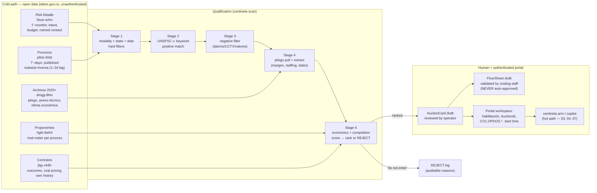
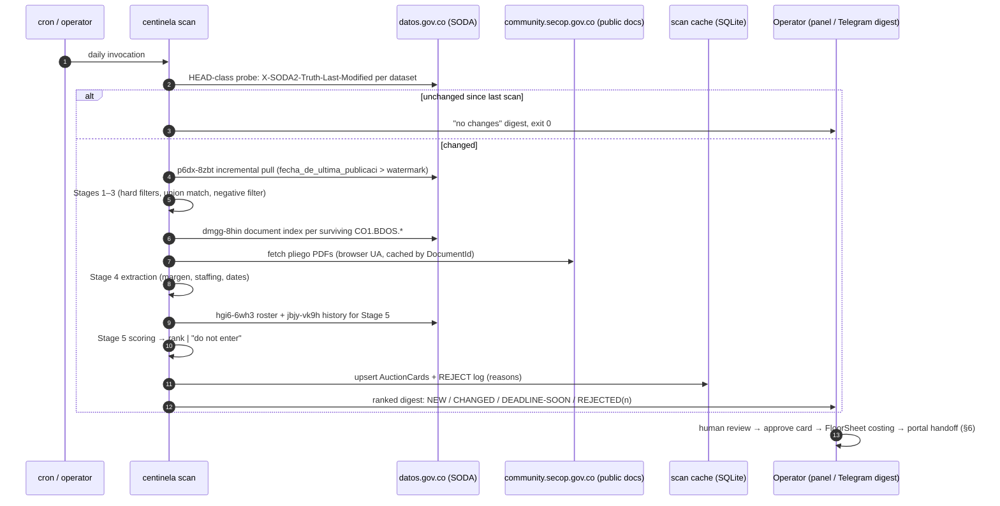
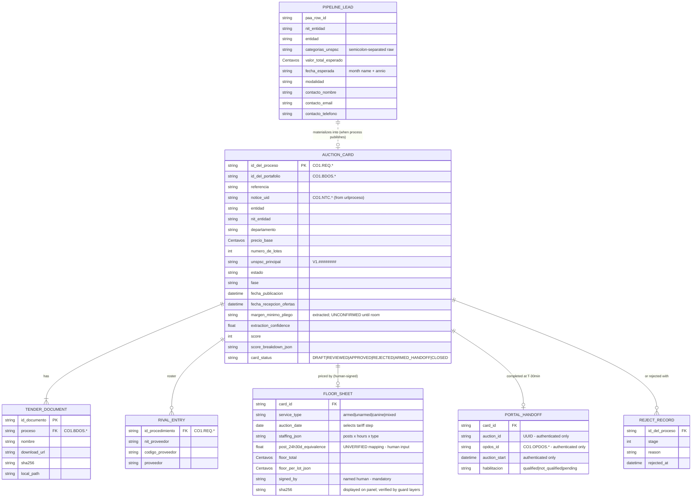

# 06 — Tender Discovery and Qualification

*How `centinela scan` finds every subasta inversa STARCOOP should consider — days to months before the auction room opens — qualifies it against the cooperative's real service lines and the Supervigilancia legal floor, and hands the architecture a reviewed `AuctionCard` instead of a surprise.*

> **Position in the system:** this chapter is the **cold path** — everything upstream of the auction room. It corresponds to the `discovery/` component of the [Architecture](07-architecture.md) (§4.2): a CLI subcommand (`centinela scan`) of the one binary, optionally run from cron/launchd, **never a daemon and never an auction-day trigger**. The hot path (clock, legs, guard, submit) is specified in [Client Protocol](03-client-protocol.md) and [Strategy Engine](04-strategy-engine.md); the legal framing of the floor it feeds is in [Compliance](05-compliance.md); the auction rules the pliego foreshadows are in [Auction Mechanics](02-auction-mechanics.md).

**Verification standard inherited from the research corpus:** every dataset ID, endpoint, column name and query in this chapter was executed live against production APIs on 2026-07-28, unless explicitly marked **UNVERIFIED**. Anything marked UNVERIFIED must not be built on without resolution (see §9).

---

## 1. Why discovery is a first-class subsystem

Three verified facts shape the whole design:

1. **Open data lags 1–2 days.** The primary discovery table (`p6dx-8zbt`) was refreshed 2026-07-28 13:57 UTC but its newest publication date was 2026-07-27. Discovery is therefore a **planning channel**. The only real-time legs are the authenticated portal workspace and the auction invitation email (§6). A bot that "watches open data for auctions starting today" will systematically miss them.
2. **The auction room is unreachable from open data alone.** Open data yields `CO1.REQ.*`, `CO1.BDOS.*` and `CO1.NTC.*` identifiers — none of which is the `AuctionId` UUID the room URL requires. The `AuctionId` and the supplier-side `CO1.OPDOS.*` work-area identifier exist **only behind login** (§6). Discovery's terminal act is always a human-verified handoff into the authenticated portal.
3. **On many tenders the most valuable output is "do not enter."** The observed real auction (SASI-001-2026, see [Context](00-context.md)) drew 44 rival companies. A funnel that ranks and *rejects* opportunities — on competition density, staffing economics, and floor-versus-startPrice headroom — saves more money than any bidding tactic wins.

And one negative finding that governs how discovery output may be used at runtime:

4. **The margen mínimo read from a pliego is a *planning estimate*, never a runtime rule.** Decreto 1082 art. 2.2.1.2.1.2.2 allows the Margen Mínimo to be expressed "en dinero o en un porcentaje del **precio de inicio de la subasta**" — which is consistent with the 1%-of-startPrice observation in the captured auction — but a live 2026 pliego (UNP SASI-064-2026) instead specifies "**2% respecto del último lance válido**". Both configurations exist in the wild. The only authoritative runtime sources are `GetAuction` + `ValidateBid`'s returned `minBid` ([Auction Mechanics](02-auction-mechanics.md)). Discovery records the pliego's stated margen in the `AuctionCard` for planning and cross-checking, flagged as *unconfirmed until the room opens*.

---

## 2. The funnel at a glance



Timeline view (what signal exists when):

```
                 T−6 months          T−12 days          T−2 days      T−0       auction
                      │                  │                  │           │          │
PAA (9sue-ezhx) ──────┤ intent+budget    │                  │           │          │
Procesos (p6dx-8zbt) ────────────────────┤ published (1–2d lag)         │          │
Documentos (dmgg-8hin) ──────────────────┤ pliego PDF / oferta económica│          │
Proponentes (hgi6-6wh3) ────────────────────────────────────┤ rivals    │          │
AUTHENTICATED PORTAL ───────────────────────────────────────────────────┤ AuctionId, start time
INVITATION EMAIL ───────────────────────────────────────────────────────┤ admitted suppliers only
```

---

## 3. SECOP open data — the Socrata/SODA layer

**Host:** `https://www.datos.gov.co` · **Publisher:** Agencia Nacional de Contratación Pública – Colombia Compra Eficiente
**Access pattern:** `https://www.datos.gov.co/resource/{dataset_id}.{json|csv|geojson}?{soql}`

All access is unauthenticated and public. Politeness rules from [Architecture](07-architecture.md) principle 7 still apply: the scanner draws from the same global rate-limit discipline as everything else, and uses change-detection probes (§3.7) before pulling data.

### 3.1 Verified dataset inventory

| Dataset | ID | Rows (2026-07-28) | Last refresh (UTC) | Role in the funnel |
|---|---|---|---|---|
| **SECOP II – Procesos de Contratación** | `p6dx-8zbt` | 8,897,747 | 2026-07-28 13:57 | **Primary discovery table** |
| SECOP II – Contratos Electrónicos | `jbjy-vk9h` | — | 2026-07-27 09:32 | Outcomes, competitor pricing, own history |
| **SECOP II – Archivos Descarga Desde 2025** | `dmgg-8hin` | — | 2026-07-28 13:51 | **Pliego/document index** (margen mínimo lives here) |
| **SECOPII – PAA Detalle** | `9sue-ezhx` | — | 2026-07-17 12:11 | **Forward-looking pipeline** |
| SECOP II – PAA Encabezado | `b6m4-qgqv` | — | — | Entity budget envelope |
| **Proponentes por Proceso SECOP II** | `hgi6-6wh3` | 2,261,214 | 2026-07-28 06:22 | **Competitor roster per process** |
| SECOP II – Proveedores Registrados | `qmzu-gj57` | — | — | Rival profiling |
| SECOP II – Adiciones | `cb9c-h8sn` | — | — | Contract-extension signals |
| SECOP II – Archivos Histórico 2023 / 2022 / ≤2021 | `3skv-9na7` / `kgcd-kt7i` / `f8va-cf4m` | — | — | Historic pliegos |
| ~~SECOP II – Modificaciones a Procesos~~ | `e2u2-swiw` | — | **2021-02-15** | ⛔ **STALE — do not use** |

> **Trap:** the frequently-cited "SECOP II - Procesos - 2019Q4" (`7jbx-7ain`), "SECOP II - Contratos - 202212" (`p64x-zujq`) and similar are **period-sliced snapshots**, not live tables. Only the consolidated IDs above may appear in code — and per the layer rules in [Architecture](07-architecture.md) §2, dataset IDs live in `adapters/` configuration, not in `domain/`.

### 3.2 `p6dx-8zbt` — the discovery table schema

Full column list verified via the metadata endpoint `/api/views/p6dx-8zbt.json`.

**Identity and join keys**

| Column | Form | Joins to |
|---|---|---|
| `id_del_proceso` | `CO1.REQ.*` | `hgi6-6wh3.id_procedimiento` (rival roster) |
| `id_del_portafolio` | `CO1.BDOS.*` | `dmgg-8hin.proceso` (documents) |
| `referencia_del_proceso` | human ref, e.g. `SASI-UNP-064-2026` | display / dedup |
| `ppi`, `codigo_entidad`, `nit_entidad` | entity keys | `9sue-ezhx`, `b6m4-qgqv`, `jbjy-vk9h` |

**Entity:** `entidad` · `departamento_entidad` · `ciudad_entidad` · `ordenentidad` · `codigo_pci` · `nombre_de_la_unidad_de` · `ciudad_de_la_unidad_de`

**Subject:** `nombre_del_procedimiento` · `descripci_n_del_procedimiento` · `codigo_principal_de_categoria` (`V1.` + 8-digit UNSPSC) · `categorias_adicionales` · `tipo_de_contrato` · `subtipo_de_contrato`

**Commercials:** `precio_base` · `duracion` + `unidad_de_duracion` · `numero_de_lotes` · `valor_total_adjudicacion`

**Modality and state:** `modalidad_de_contratacion` · `justificaci_n_modalidad_de` · `fase` · `estado_del_procedimiento` · `id_estado_del_procedimiento` · `estado_de_apertura_del_proceso` · `estado_resumen` · `adjudicado` · `id_adjudicacion`

**Dates:** `fecha_de_publicacion_del` · `fecha_de_ultima_publicaci` · `fecha_de_recepcion_de` (offer deadline) · `fecha_de_apertura_de_respuesta` · `fecha_de_apertura_efectiva` · `fecha_adjudicacion` · plus five phase-specific publication dates (`fecha_de_publicacion_fase`, `_fase_1`, `_fase_2`, `_fase_3`, `fecha_de_publicacion`). **There is no auction datetime column anywhere in open data** — the auction start timestamp is authenticated-only (§6).

**Competition telemetry:** `proveedores_invitados` · `proveedores_con_invitacion` · `visualizaciones_del` · `proveedores_que_manifestaron` · `respuestas_al_procedimiento` · `respuestas_externas` · `conteo_de_respuestas_a_ofertas` · `proveedores_unicos_con`

**Award:** `nombre_del_proveedor` · `nit_del_proveedor_adjudicado` · `codigoproveedor` · `departamento_proveedor` · `ciudad_proveedor` · `nombre_del_adjudicador`

**Link:** `urlproceso` — deserializes as a URL **object** `{"url": "..."}`, not a plain string. The adapter's pydantic model must reflect this or fail loudly.

### 3.3 Controlled vocabularies (verified by aggregation over all 8.9M rows)

**`modalidad_de_contratacion`** — the target value is exactly **`Selección abreviada subasta inversa`** (205,106 rows). Accents are significant; URL-encode properly.

| Rows | Value |
|---|---|
| 4,003,932 | Contratación directa |
| 3,477,693 | Contratación régimen especial |
| 417,277 | Mínima cuantía |
| 223,455 | Selección Abreviada de Menor Cuantía |
| **205,106** | **Selección abreviada subasta inversa** ← target |
| 61,795 | Licitación pública |
| 4,694 | Subasta de prueba ← test auctions; **exclude** |
| 852 | Enajenación de bienes con subasta |

**`fase`** (within subasta inversa): `Presentación de oferta` (147,476) · `Presentación de observaciones` (47,594) · `Fase de ofertas` (4,833) · `Clarification submission` (3,660) · `None` (1,543). Note the vocabulary is bilingual and inconsistent — treat `fase` as informational, not as a state machine.

**`estado_del_procedimiento`**: `Seleccionado` (137,263) · `Evaluación` (50,794) · **`Abierto`** (9,729) · `Cancelado` (5,665) · **`Publicado`** (938) · `Borrador` (684) · `En aprobación` (19) · `Suspendido` (10) · `Aprobado` (4)

> ⚠️ **The table contains drafts and copies** (`Borrador`, references ending in `" copia"`, `"Modelo copia"`). Stage-1 hard filters must include `estado_del_procedimiento IN ('Abierto','Publicado')` and reject `referencia_del_proceso` matching `/copia|modelo|prueba/i`, plus `modalidad != 'Subasta de prueba'`.

### 3.4 Working query recipes (all executed successfully on 2026-07-28)

**A. The core discovery query — live vigilancia subasta inversa**

```bash
curl -sG "https://www.datos.gov.co/resource/p6dx-8zbt.json" \
 --data-urlencode '$select=id_del_proceso,id_del_portafolio,referencia_del_proceso,entidad,
   departamento_entidad,precio_base,fase,estado_del_procedimiento,fecha_de_publicacion_del,
   fecha_de_recepcion_de,numero_de_lotes,codigo_principal_de_categoria,urlproceso' \
 --data-urlencode "\$where=modalidad_de_contratacion='Selección abreviada subasta inversa'
   AND starts_with(codigo_principal_de_categoria,'V1.9212')
   AND estado_del_procedimiento in('Abierto','Publicado')
   AND fecha_de_publicacion_del > '2026-01-01T00:00:00'" \
 --data-urlencode '$order=fecha_de_publicacion_del DESC' \
 --data-urlencode '$limit=200'
```

Live result on 2026-07-28 — a genuine open opportunity:

```json
{"id_del_proceso":"CO1.REQ.10715229","id_del_portafolio":"CO1.BDOS.10529762",
 "referencia_del_proceso":"SASI-UNP-064-2026","entidad":"UNP",
 "precio_base":"462000000","fase":"Clarification submission",
 "estado_del_procedimiento":"Publicado","fecha_de_publicacion_del":"2026-07-23T00:00:00.000",
 "fecha_de_recepcion_de":"2026-08-12T00:00:00.000","numero_de_lotes":"0",
 "codigo_principal_de_categoria":"V1.92121700",
 "urlproceso":{"url":"https://community.secop.gov.co/Public/Tendering/OpportunityDetail/Index?noticeUID=CO1.NTC.10570839"}}
```

**B. Filter dimensions — all verified**

| Dimension | SoQL fragment |
|---|---|
| UNSPSC exact | `codigo_principal_de_categoria in('V1.92121500','V1.92121504')` |
| UNSPSC prefix | `starts_with(codigo_principal_de_categoria,'V1.9212')` |
| Entity by NIT | `nit_entidad='899999027'` |
| Entity by name | `upper(entidad) like '%ALCALDIA%'` |
| Value band | `precio_base between 200000000 and 5000000000` |
| Department | `departamento_entidad='Distrito Capital de Bogotá'` |
| Modality | `modalidad_de_contratacion='Selección abreviada subasta inversa'` |
| Keyword rescue | `upper(descripci_n_del_procedimiento) like '%VIGILANCIA%'` |
| Deadline window | `fecha_de_recepcion_de between '2026-08-01' and '2026-09-01'` |

**C. Documents / pliegos** — join `id_del_portafolio` → `dmgg-8hin.proceso`:

```bash
curl -sG "https://www.datos.gov.co/resource/dmgg-8hin.json" \
 --data-urlencode "\$where=proceso='CO1.BDOS.10529762'" --data-urlencode '$limit=100'
```

Returned 9 documents for SASI-UNP-064-2026, including `PROYECTO PLIEGO DE CONDICIONES`, `ANEXO TECNICO`, `AVISO DE CONVOCATORIA`, `ANALISIS_DEL_SECTOR`, `MATRIZ DE RIESGOS`, `CDP`, `FORMATO DE OFERTA ECONÓMICA.xlsx`, `Formatos.zip`. Download URL form:

```
https://community.secop.gov.co/Public/Archive/RetrieveFile/Index?DocumentId={id_documento}&InCommunity=False&InPaymentGateway=False&DocUniqueIdentifier=
```

> 🔴 **Operational gotcha (verified):** an Azure Application Gateway WAF returns **403 Forbidden** to default `curl`. A browser `User-Agent` returns the real PDF (750 KB, 54 pages). The downloader **must** set a realistic UA. This is WAF-compatibility, not evasion — the documents are public and unauthenticated — and it stays within the politeness contract of [Compliance](05-compliance.md): low volume, cached, attributable egress IP.

**D. Competitor roster** — `hgi6-6wh3`, keyed on `id_procedimiento` (`CO1.REQ.*`); returns `proveedor`, `nit_proveedor`, `codigo_proveedor` per process. 2.26M rows. This is the input for the competition-density score in Stage 5, and (joined against `jbjy-vk9h` awards) for rival win-rate and pricing profiles.

**E. Forward pipeline (PAA)** — `9sue-ezhx`. The earliest signal in the funnel: what each entity *intends* to buy, published months ahead, with `valor_total_esperado`, `fecha_esperada_de_inicio` (a Spanish **month name**, e.g. `"Mayo"` — not a date), `modalidad`, `annio`, `url_proceso`, and a **named contact** (`nombre_del_contacto`, `telefono_del_contacto`, `correo_del_contacto`). ⚠️ `categorias_unspsc` is a **semicolon-separated string** (e.g. `"80101600;80101602"`), so match with `like '%92121500%'` — never equality. PAA rows enable pre-positioning (capacity planning, habilitación paperwork, entity relationship work) rather than reactive bidding. Contact data is used for legitimate commercial outreach only — see the anti-collusion boundary in [Compliance](05-compliance.md).

**F. Own history and outcomes** — `jbjy-vk9h` with `upper(proveedor_adjudicado) like '%STARCOOP%'` returns the cooperative's own award record (§4.3), and per-entity award history reveals what winning prices have looked like — a sanity input to the Stage-5 headroom estimate.

### 3.5 SODA API operational notes (verified)

- **`$limit=50000` succeeds** (1.9 MB response). `$offset` paging works past 1,000,000 rows. Always pair `$offset` with a stable `$order`.
- **No app token is required.** ⚠️ But an **invalid** `X-App-Token` returns **403** — either register a real token at `https://data.datos.gov.co/profile/edit/developer_settings` or omit the header entirely. **Never send a placeholder.**
- Formats: `.json`, `.csv`, `.geojson`.
- Response headers expose `X-SODA2-Fields`, `X-SODA2-Types`, `X-SODA2-Truth-Last-Modified` — use the last as a **cheap change-detection probe** before pulling data (a HEAD-class request per dataset per scan, instead of re-downloading).
- Aggregation requires an explicit alias: `$select=col,count(*) AS cnt&$group=col&$order=cnt DESC`. Bare `count(*)` with `$order=count_1` **fails**.
- `urlproceso` deserializes as an object `{"url": "..."}`.
- Metadata endpoint: `https://www.datos.gov.co/api/views/{id}.json` (name, description, `rowsUpdatedAt`, full column schema) — the scanner asserts the column schema on startup and fails loudly on drift, mirroring the frozen-pydantic posture of the runtime adapters.
- Catalog search: `https://api.us.socrata.com/api/catalog/v1?domains=www.datos.gov.co&q={terms}` — used only by humans/maintenance to find replacement datasets if an ID is ever retired.

---

## 4. Qualifying for a security-guard cooperative

### 4.1 UNSPSC codes — verified against real SECOP II usage

Colombia Compra Eficiente uses **UNSPSC v UNv260801** (Spanish translation, current as of 2025-03-18), 8 digits: Segmento → Familia → Clase → Producto. SECOP II stores it prefixed `V1.`.

Family **9212 — Seguridad y protección personal**, with observed SECOP II row volumes:

| Code | Official description | Rows | Relevance |
|---|---|---|---|
| **92121500** | Servicios de guardias | **5,593** | 🟢 **Core** |
| **92121504** | Servicios de guardias de seguridad | **5,213** | 🟢 **Core** |
| 92121502 | Servicios de protección contra robo | 183 | 🟡 Adjacent |
| 92121503 | Alquiler de perros guardianes | 48 | 🟡 Canine line |
| **92121700** | Servicios de sistemas de seguridad *(class)* | **2,307** | 🟠 **Mixed — see below** |
| 92121701 | Servicios de monitoreo de alarmas | 1,292 | 🔴 Usually not guards |
| 92121702 / 92121704 | (systems services) | 181 / 275 | 🔴 Low |
| 92121600 / 92121604 | Servicios de detectives | 89 / 50 | ⚪ Out of scope |
| 92121800 / 92121801 | Carros blindados y transporte de valores | 307 / 227 | ⚪ Out of scope |
| 92121900 | Servicios de seguridad marina | 3 | ⚪ Out of scope |

**Entities systematically misclassify.** Empirical sampling of `nombre_del_procedimiento` per code proves it:

- `V1.92121500` → "SERVICIO DE VIGILANCIA FRENTES DE OBRA", "VIGILANCIA" ✅
- `V1.92121504` → "Prestación de servicios de vigilancia privada" ✅
- `V1.92121700` → "SERVICIO DE VIGILANCIA CON ARMA Y OTROS ADICIONALES COMPLEMENTARIOS" ✅ **but also** "MONITOREO DE ALARMA…" ❌
- `V1.92101501` → "LICITACION PUBLICA VIGILANCIA Y SEGURIDAD" ❌ *(92101501 is a fire-protection code — yet Starcoop actually holds a contract under it)*

### 4.2 The qualification filter is a union, not an intersection

Because misclassification is routine, UNSPSC filtering alone loses real opportunities. The candidate predicate:

```
CANDIDATE  ⟸  codigo_principal_de_categoria ∈ CORE_SET
           ∨  categorias_adicionales    contains CORE_SET member
           ∨  regex(nombre ‖ descripción, /VIGILANCIA|SEGURIDAD PRIVADA|GUARDA|
                                            CELADUR[ÍI]A|ESCOLTA|MEDIO (HUMANO|CANINO)/i)
```

…followed by a **negative filter** that drops pure alarm-monitoring, CCTV-installation and armored-transport (transporte de valores) work, and finally a human or LLM relevance score. Precision is enforced last, not first: an over-eager first-stage filter silently discards contracts the cooperative could win, and nobody ever finds out.

The filter stages, in order, each auditable (every rejection is logged with the stage and reason — the REJECT log is reviewed periodically to recalibrate):

| Stage | Predicate | Type |
|---|---|---|
| 1 | modality = subasta inversa; state ∈ {Abierto, Publicado}; not copia/modelo/prueba; deadline in the future | Hard filter |
| 2 | UNSPSC ∪ keyword union (above) | Positive match |
| 3 | Negative keyword filter (alarms/CCTV/valores/detectives/marina) unless guard keywords also present | Negative filter |
| 4 | Pliego retrieved and parsed: margen mínimo, staffing schedule, habilitación requirements, key dates | Enrichment |
| 5 | Economics (floor vs `precio_base` headroom, §5) + competition density (`hgi6-6wh3`, telemetry columns) + geography + capacity | Score → rank or **"do not enter"** |

### 4.3 Starcoop's own verified footprint — the filter's lower bound

From `jbjy-vk9h` (`upper(proveedor_adjudicado) like '%STARCOOP%'`) — 8 contracts, `codigo_proveedor` **700961121** (matches the `LoggedInCompanyCode` JWT claim in [API Contract](01-api-contract.md) ✅), NIT **830101476**:

| Firma | Valor COP | UNSPSC | Modalidad | Entidad |
|---|---|---|---|---|
| — | 23,380,914,945 | V1.92121701 | Licitación pública | Secretaría de Educación del Distrito |
| 2025-12-11 | 35,089,214 | V1.92121500 | Mínima cuantía | Parques Nacionales Naturales |
| 2025-08-04 | 324,706,732 | UNSPECIFIED | Sel. Abreviada Menor Cuantía | Armada Nacional – Base Naval ARC Bolívar |
| 2024-02-27 | 132,334,260 | V1.92121504 | Mínima cuantía | Contraloría General |
| 2023-12-28 | 99,449,926 | UNSPECIFIED | Sel. Abreviada Menor Cuantía | Parques Nacionales Naturales |
| **2023-05-31** | **426,144,265** | **V1.92121500** | **Selección abreviada subasta inversa** | **Alcaldía Local de Teusaquillo** |
| 2023-01-13 | 129,763,624 | V1.92121504 | Mínima cuantía | Contraloría General |
| — | 275,144 | V1.92101501 | Mínima cuantía | Parques Nacionales Naturales |

The code spread includes `92121701`, `UNSPECIFIED` and `92101501`. **Design rule: the discovery filter must never be narrower than the company's own demonstrated history.** The Teusaquillo row also confirms the cooperative has already won a subasta inversa — the bot automates a proven capability, not a speculative one.

---

## 5. The regulated tariff — where discovery feeds the floor

This section is the discovery-side origin of the floor price that [Strategy Engine](04-strategy-engine.md) treats as unrepresentable-to-violate and [Compliance](05-compliance.md) treats as law. Five enforcement layers exist at runtime; **this is Layer 0 — computing the number correctly in the first place.**

### 5.1 Legal chain (verified from the resolution's own text)

- **Decreto Ley 356 de 1994, art. 92** — tariffs must guarantee at minimum the SMMLV, overtime, night and holiday surcharges, social benefits and operating costs: *"los costos y gastos de los servicios prestados por las empresas y cooperativas de vigilancia y seguridad privada no pueden estar por debajo de una tarifa mínima, fijada en salarios mínimos."*
- **Ley 2101 de 2021** — 48 → 42 h working week, gradual, completing **2026-07-15**.
- **Ley 2466 de 2025 (reforma laboral), arts. 10, 14 and 70 ¶** — night hours extended to 19:00–06:00 from 2025-12-25; holiday surcharge 80% (2025-07-01) → **90% (2026-07-01)** → 100% (2027-07-01); and *orders* Supervigilancia to update the regulated tariff.
- **Resolución 20251000059517 CS de 2025** (Superintendente de Vigilancia y Seguridad Privada, agosto 2025) — the operative act. **ARTÍCULO PRIMERO** sets minimum tariffs per post covering **24 hours, 30 days a month**.

### 5.2 Verified tariff schedule (SMMLV 2026 = $1,750,905 COP, Decreto 1469 de 2025)

| Effective from | SMMLV | Base COP | Armada +10% | Sin armas +8% | Humano+canino +11% |
|---|---|---|---|---|---|
| 2025-07-01 | 9.24 | 16,178,362 | 17,796,198 | 17,472,631 | 17,957,982 |
| 2025-07-15 | 9.53 | 16,686,125 | 18,354,737 | 18,021,015 | 18,521,598 |
| 2025-12-25 | 9.77 | 17,106,342 | 18,816,976 | 18,474,849 | 18,988,039 |
| 2026-07-01 | 9.85 | 17,246,414 | 18,971,056 | 18,626,127 | 19,143,520 |
| **2026-07-15 ← current** | **10.21** | **17,876,740** | **19,664,414** | **19,306,879** | **19,843,181** |
| 2027-07-01 | 10.38 | 18,174,394 | 19,991,833 | 19,628,345 | 20,173,577 |

Admin/supervision uplift by service type (ARTÍCULO PRIMERO): **10%** armed with human means · **8%** unarmed with human means · **11%** unarmed human + canine · **10%** residential strata 4/5/6 (parágrafo).

### 5.3 Why this is a hard constraint, not a guideline

1. Bidding below the regulated tariff is a **regulatory violation** exposing the cooperative to Supervigilancia sanction — the resolution's entire purpose is that costs "no pueden estar por debajo de una tarifa mínima."
2. It is independently an **"oferta artificialmente baja"** under Decreto 1082 art. 2.2.1.1.2.2.4. The UNP pliego states it explicitly: *"En ningún caso la herramienta virtual SECOP II determinará precios artificialmente bajos; este proceso lo determinará la entidad una vez culminado el evento de subasta."* **The platform will happily accept a suicidal lance and the entity disqualifies you afterwards.** SECOP II provides zero protection — the floor must live entirely in our code ([Strategy Engine](04-strategy-engine.md) L1–L5).
3. The tariff is **step-dated**. A floor computed in June 2026 is wrong on 2026-07-15. The floor engine must be a pure function of `(service_type, auction_date, SMMLV_year)`, never a stored constant — and the *auction date*, not the scan date, selects the row.

### 5.4 From tariff to FloorSheet — the discovery deliverable

`centinela scan` Stage 4 extracts the pliego's staffing schedule (posts, hours, armed/unarmed/canine, Sunday/holiday coverage, contract duration) and produces a **FloorSheet draft**:

```
floor_total = Σ over posts (
    tariff(service_type, effective_date_of_service) × post_24h30d_equivalence × months
) → rounded UP (ROUND_CEILING, Centavos)
```

The draft is *advisory until a human signs it*. Its SHA-256 is what the panel displays and what the guard layers verify at runtime ([Architecture](07-architecture.md) §6).

**⚠️ UNVERIFIED / requires client input:** the mapping from a pliego's staffing schedule to a count of "24h/30-day equivalent posts" (the `post_24h30d_equivalence` factor). This is the **single largest source of floor-price error** and must be validated by Starcoop's costing staff per tender — which is why FloorSheet approval is a mandatory human gate, never automatic.

**⚠️ UNVERIFIED:** whether a subsequent Supervigilancia **circular** (the resolution says circulars will be issued per vigencia) has adjusted the 2026 figures. The pipeline needs a monitored source for tariff circulars; until one exists, a manual monthly check of the Supervigilancia normativity page is a runbook item (see [Roadmap](08-roadmap.md)).

---

## 6. What the authenticated portal adds — and why discovery cannot replace it

Open data yields `CO1.REQ.*`, `CO1.BDOS.*` and `CO1.NTC.*`. **None of these is the `AuctionId`.** The auction room ([API Contract](01-api-contract.md)) requires:

```
https://www.secop.gov.co/CO1ExternalIntegration/TenderingSupport/AuctionsIntegration/Index
  ?LanguageCode=es-CO&MarketCode=GovCO
  &AuctionId=<uuid>                                   ← authenticated only
  &OpportunityWorkAreaUniqueIdentifier=CO1.OPDOS.<id> ← authenticated only
```

Note the **fifth identifier namespace**: `CO1.OPDOS.*` is the *supplier-side* work area, distinct from the buyer-side `CO1.BDOS.*` in open data. There is no published crosswalk between them — **UNVERIFIED** whether one can be derived from the other; empirically it must be read from the authenticated workspace.

### 6.1 Identifier namespaces — the full crosswalk

| Namespace | Example | Meaning | Source | Joins |
|---|---|---|---|---|
| `CO1.REQ.*` | `CO1.REQ.10715229` | Contracting process | open data (`p6dx-8zbt`) | → `hgi6-6wh3` |
| `CO1.BDOS.*` | `CO1.BDOS.10529762` | Buyer-side dossier/portfolio | open data | → `dmgg-8hin` |
| `CO1.NTC.*` | `CO1.NTC.10570839` | Public notice (in `urlproceso`) | open data | public detail page |
| `CO1.OPDOS.*` | `CO1.OPDOS.<id>` | **Supplier-side** work area | **authenticated portal only** | → auction room URL |
| `AuctionId` | UUID | The auction engine's key | **authenticated portal only** | → all `/eauctions.api` calls |
| `CO1.OTLN.*` | `CO1.OTLN.<id>` | Lot within an auction | runtime (`GetAuction`) | bid `items[]` |

### 6.2 Portal endpoints that carry the handoff (from the HAR corpus, [API Contract](01-api-contract.md) §6)

| Endpoint | Hits | What it gives us |
|---|---|---|
| `GET /CO1BusinessLine/Tendering/OpportunityWorkArea/Index` | 3 | Work-area shell; source of `CO1.OPDOS.*` |
| **`GET .../OpportunityWorkAreaSpecificAreaGrids/EAuctionBlock`** | **57** | **The auction widget — AuctionId + scheduled start** |
| `GET /CO1BusinessLine/Tendering/WidgetAuction/RedirectToEAuctionIFrame` | 1 | Builds the actual room URL incl. `AuctionId` |
| `GET .../OpportunityWorkAreaSpecificAreaGrids/RepliesWidgetBlock` | 57 | Our submitted offer state |
| `GET .../OpportunityWorkAreaSpecificAreaGrids/ContractsBlock` | 57 | Resulting contract linkage |
| `GET /CO1BusinessLine/Tendering/OpportunityDossierWorkspace/Index` | 5 | Dossier listing = **our** live tender portfolio |
| `GET .../OpportunityDossierWorkspaceDetail/RedirectToWorkArea` | 2 | Dossier → work-area hop |
| `GET /CO1BusinessLine/Tendering/ProcedureReplyEdit/View` | 1 | Offer-editing surface |
| `GET /CO1Marketplace/Common/RecentOpportunities/IndexByContentZone` | 2 | Portal's own opportunity feed |
| `GET /CO1BusinessLine/Common/NextGlobalActions/UpdateNotificationCounters` | 60 | Notification/invitation counter |

### 6.3 Authenticated-only information (not in open data)

1. **`AuctionId`** (UUID) and **`OpportunityWorkAreaUniqueIdentifier`** — without these the bot cannot enter the room.
2. The **habilitación** result — whether *we* were qualified to bid at all (Decreto 1082 requires ≥ 2 qualified bidders for the auction to occur at all).
3. The auction **invitation email**, sent automatically to admitted suppliers (per the UNP pliego, §c) — the real-time trigger open data cannot provide.
4. The exact auction **start timestamp** — open data has no auction datetime column at all.
5. Live runtime config via `GetAuctionSimple`: `minimumBidType`, `startPrice`, `extraTime*`, `decimalNum`, `allowBidsBellowBestBid` ([Auction Mechanics](02-auction-mechanics.md)).
6. `ValidateBid` → the authoritative minimum decrement (`minBid`) — the only runtime rule oracle, per [Architecture](07-architecture.md) principle 4.

Because retrieving 1–5 requires the human-assisted authenticated session ([Client Protocol](03-client-protocol.md) session bootstrap), the discovery→runtime handoff is deliberately a **human step**: the operator opens the work area from the `AuctionCard`'s link, and the card is completed with `AuctionId`, `CO1.OPDOS.*` and start time from the `EAuctionBlock` widget during the T−30 min readiness check.

---

## 7. Pipeline design — `centinela scan`

**Form factor (per [Architecture](07-architecture.md) §4.2):** a CLI subcommand of the single binary. Idempotent, stateless between runs except for its SQLite scan cache. Recommended cadence: daily via cron/launchd; the 1–2 day data lag makes anything faster pointless, and politeness (principle 7) makes it undesirable.



**Design rules:**

- **Incremental with a watermark.** Track `fecha_de_ultima_publicaci` high-water per scan; re-pull a trailing 30-day window to catch late edits (processes are amended). Dedup on `id_del_proceso`; a changed row produces a `CHANGED` digest entry with a field diff.
- **Change-detection first.** `X-SODA2-Truth-Last-Modified` before any bulk pull. One conditional probe per dataset per run.
- **Document cache keyed on `id_documento`.** Pliegos are immutable per version; never re-download. Store raw PDFs alongside extraction output so extraction bugs are re-runnable offline — consistent with the "what is not tested offline does not exist" principle.
- **Every drop is explained.** The REJECT log carries `(id_del_proceso, stage, reason, timestamp)` and is included in the audit posture of [Compliance](05-compliance.md). Periodic human review of the REJECT log is the recalibration loop for Stages 2–3.
- **PAA runs as a separate monthly sub-scan** (`centinela scan --paa`), producing `PipelineLead` records, not `AuctionCard`s — they lack a process to bid on yet.
- **No auction-day role.** `scan` never triggers `arm`. The runtime is armed by a human against a card whose `AuctionId` was read from the portal (§6.3). This is a deliberate firebreak: a discovery bug can waste attention, never place a bid.
- **Schema drift fails loudly.** On startup, assert the `/api/views/{id}.json` column schema against the pinned expectation; on mismatch, emit an alarm and exit non-zero rather than silently mis-parsing.

**Extraction (Stage 4) specifics:** the margen mínimo, the auction schedule and the staffing table live in the `PLIEGO DE CONDICIONES` and `ANEXO TECNICO` PDFs and the `FORMATO DE OFERTA ECONÓMICA` spreadsheet. Extraction is heuristic (regex + table extraction, optionally LLM-assisted) and therefore **everything extracted is marked with a confidence and shown to the human on the card**; nothing extracted from a PDF ever bypasses the human FloorSheet gate or substitutes for `GetAuction`/`ValidateBid` at runtime (§1.4).

---

## 8. Data model

The discovery vocabulary, as frozen pydantic models in `domain/discovery.py` (money as `Centavos`, per the [Architecture](07-architecture.md) stack table):



**Lifecycle:** `PipelineLead` (PAA, T−months) → `AuctionCard DRAFT` (process published) → `REVIEWED` (operator) → `APPROVED` + signed `FloorSheet` (costing staff) → `ARMED_HANDOFF` (portal fields filled at readiness check) → hot path takes over ([Client Protocol](03-client-protocol.md)) → `CLOSED` (outcome written back from `jbjy-vk9h` when the award lands in open data, closing the learning loop for Stage-5 scoring).

**Invariants:**

- An `AuctionCard` without a **signed** `FloorSheet` can never reach `ARMED_HANDOFF`. Mechanically enforced: `centinela arm` refuses to start without `floor_sheet.signed_by` and a matching SHA.
- `PORTAL_HANDOFF.auction_id` is the *only* place a UUID enters the system, and it is typed manually or pasted by the operator from the portal — discovery code has no write path to it.
- Rival NITs in `RIVAL_ENTRY` are public open-data facts used for competition scoring only; at runtime, rival identifiers follow the HMAC-pseudonymisation rule of the audit subsystem ([Compliance](05-compliance.md)).

---

## 9. Open questions owned by this chapter

Numbered `D*` to avoid clashing with the runtime `O*` questions in [Architecture](07-architecture.md) §12; resolutions flow through this document.

| # | Question | Status | Consequence while open |
|---|---|---|---|
| D1 | Can `CO1.OPDOS.*` be derived from `CO1.BDOS.*` / `CO1.REQ.*`, or must it always be read from the authenticated workspace? | **UNVERIFIED** | Portal handoff stays a manual step (acceptable; it is a firebreak anyway) |
| D2 | The pliego-staffing → "24h/30-day equivalent posts" mapping (`post_24h30d_equivalence`) | **UNVERIFIED — requires client input** | FloorSheet approval is a mandatory human gate; no floor is trusted without Starcoop costing staff sign-off |
| D3 | Has a Supervigilancia *circular* adjusted the 2026 tariff figures after Resolución 20251000059517? | **UNVERIFIED** | Manual monthly check of Supervigilancia normativity page (runbook item, [Roadmap](08-roadmap.md)); tariff table above carries an as-of date |
| D4 | Long-term stability of the consolidated dataset IDs (`p6dx-8zbt` et al.) — Socrata IDs have been retired before (`e2u2-swiw` went stale in 2021) | Monitored | Startup schema assertion + `Truth-Last-Modified` staleness alarm (> 7 days ⇒ treat dataset as suspect) |
| D5 | Whether the invitation email's metadata (sender, subject shape) is stable enough to parse as a readiness signal | **UNVERIFIED** | T−30 min readiness check relies on the portal `EAuctionBlock`, with email as a human-read backup |

---

*Sibling chapters: [00-context](00-context.md) · [01-api-contract](01-api-contract.md) · [02-auction-mechanics](02-auction-mechanics.md) · [03-client-protocol](03-client-protocol.md) · [04-strategy-engine](04-strategy-engine.md) · [05-compliance](05-compliance.md) · [07-architecture](07-architecture.md) · [08-roadmap](08-roadmap.md)*
