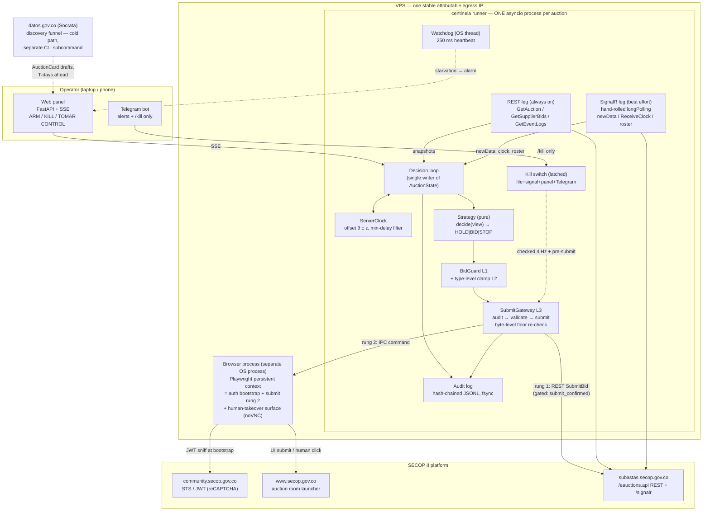

# 07 — Architecture

*The definitive system design for `centinela`, the STARCOOP SECOP II bidding bot: every structural decision, the reasoning that fixed it, and the register of unknowns that could reopen one.*

**Codename:** `centinela`
**Status:** Source of Truth — architecture chapter. Decisions here are final unless an Open Question (§12) resolves against an assumption, in which case the affected decision is revisited through this document, never in code alone.
**Lineage:** base = the "robust" proposal (judge winner); grafted with the judged-best ideas from "pragmatic" (timing arithmetic, byte-level guard, clipboard co-pilot, enforced hot-path latency test, probe-bid defense) and "platform" (offline simulator + property tests, type-level floor clamp, mechanical layer enforcement, egress-IP-as-legal-requirement). Every fatal flaw named by the judge panel is fixed, and each fix is called out inline with the tag **[FLAW-FIX]**.

**Sibling chapters:** [Context](00-context.md) · [API contract](01-api-contract.md) · [Auction mechanics](02-auction-mechanics.md) · [Client protocol](03-client-protocol.md) · [Strategy engine](04-strategy-engine.md) · [Compliance](05-compliance.md) · [Tender discovery](06-tender-discovery.md) · [Roadmap](08-roadmap.md)

| Section | Contents |
|---|---|
| §1 | Guiding principles — the tie-breakers for every future design argument |
| §2 | Tech stack, rejected alternatives, timing adequacy |
| §3 | System topology: diagram, network, process isolation, deployment shape |
| §4 | Component specifications |
| §5 | The auction runtime — concurrency, state, clock, legs, decision loop, endgame |
| §6 | Floor enforcement — five independent layers |
| §7 | Cross-cutting controls — politeness, security, evidence |
| §8 | Repository layout |
| §9 | Configuration — one YAML per auction |
| §10 | Test strategy |
| §11 | Deployment and operations |
| §12 | Open questions register |

---

## 1. Guiding principles

Each principle is tied to a measured fact from the evidence corpus (HARs, recording, statute — see [00-context.md](00-context.md) and [01-api-contract.md](01-api-contract.md)). These are the tie-breakers for every future design argument.

1. **Availability is the product; speed is not.** REST p50 835–941 ms, p90 6.9 s, max 10.1 s. `ValidateBid` alone took 4.6 s. Our runtime latency is noise three orders of magnitude below the platform's own variance. Every observed failure in the real auction — dead SignalR socket ("ESTADO: DESCONECTADO"), two failed human `ValidateBid` attempts, 100 disconnects across 44 companies in ten minutes — is an *availability* failure. We build a disciplined, reconnecting, floor-obeying persistence engine, not a trading system.
2. **The extension rule abolishes sniping.** Any qualifying bid in the last `extraTimeLastMinutesStartPeriod` (observed: 1 min) extends the auction by `extraTimePeriod` (observed: 3 min), unlimited times ([02-auction-mechanics.md](02-auction-mechanics.md)). The requirement is "react correctly within seconds, indefinitely" — so we bid **early** (T−45 s target, §5.6), never late, and long polling or even degraded REST-only mode is sufficient.
3. **A dropped socket must never cost a bid.** Bidding is plain REST on an independent path. The REST leg alone can win the auction; SignalR is a latency optimization and the clock source. Every capability sits on a degradation ladder whose bottom rung is a human in an already-authenticated browser within 2 seconds.
4. **The server is the only rule oracle — and it bills us for questions.** `ValidateBid` failures are written permanently to the procuring entity's audit log with our NIT and public IP (confirmed: two of two attempts). δ (minimum decrement) is read from `GetAuction.minBidDifference` + `minimumBidType`, calibrated against at most **two** `ValidateBid` rejections per auction, and never computed from the 1%-of-startPrice hypothesis — a documented counter-configuration exists (the UNP SASI-064-2026 pliego specifies 2% of the last valid lance; see [02-auction-mechanics.md](02-auction-mechanics.md) and O-M1 in §12).
5. **The floor is law, in both senses.** For a vigilancia cooperative the Supervigilancia minimum tariff is a statutory floor (Resolución 20251000059517; [05-compliance.md](05-compliance.md)); below it a bid is illegal, not merely unprofitable. Floor enforcement is five independent layers with different code, different data sources, and a latched kill on violation (§6). One wrong bid is unrecoverable — a lance cannot be retracted.
6. **The local clock is a liar.** The operator's PC was +13.15 s wrong against the auction server, and `GetAuctionSimple` serves reads that go *backwards* (`Started → ReadyToStart → Started`, observed). All deadlines derive from a disciplined server-clock estimate on its pessimistic edge; all state carries regression guards. When the clock is unreliable (ε > 2 s or estimate > 60 s old), bidding freezes — we HOLD and alarm, never guess.
7. **Polite traffic is a contract-winning control, not a courtesy.** SECOP's WAF blocks IPs generating "consultas masivas de interacción no humana"; a blocked IP means a lost connection "imputable al oferente", which Decreto 1082 art. 2.2.1.2.1.2.6 deems **withdrawal from the auction** ([05-compliance.md](05-compliance.md)). Rate limiting, a single stable attributable egress IP, and cadence discipline are correctness requirements.
8. **A named human signs every lance.** SECOP credentials constitute an electronic signature under Ley 527/1999 art. 7 (Terms of Use §VII.A.d). The hash-chained audit trail, the mode ladder requiring typed confirmations, and the latched kill switch exist so that a specific person knowingly authorized every automated bid and can prove it.
9. **Operable by a security cooperative, not an SRE team.** One binary, one process per auction, one YAML per auction, a web panel with three actions and one red button, runbooks in Spanish. **[FLAW-FIX: operational weight]** — the multi-daemon + automated-HA topology of the base proposal is deleted (§3.5, §11).
10. **What is not tested offline does not exist.** CI never touches `*.secop.gov.co`. Every behavior — including the platform's pathologies (backwards reads, 13 s skew, `T:1` reconnects, es-CO `minBid` strings, mid-auction 401) — is reproduced in the in-repo simulator, and safety invariants are property-tested under adversarial event orderings (§10).

---

## 2. Tech stack — decided

**Python 3.12, single asyncio process per auction, strictly typed (`mypy --strict`), uvloop on Linux.**

| Concern | Choice | Rationale |
|---|---|---|
| HTTP | `httpx` (async) | Explicit per-purpose connection pools: `pool_poll` (125 s SignalR long poll), `pool_rest` (cadence polling), `pool_bid` (reserved, pre-warmed TLS). A hung poll can never starve a submit. |
| SignalR 1.x/2.x | **Hand-rolled**, ~600 lines over httpx | Non-negotiable in any language: byte-identical `connectionData`, percent-encoded `connectionToken`, JWT as `token` query param, cursor `C` stored before `M` dispatch, `G` persisted, exactly one poll in flight, `T:1`/`D:1` handling, reconnect budget ([03-client-protocol.md](03-client-protocol.md)). No packaged client exposes these knobs; the only semi-maintained one (`Microsoft.AspNet.SignalR.Client`, C#) hides all of them. |
| Browser | Playwright (Python), headful, persistent context, **separate OS process** | reCAPTCHA-gated login is human-assisted by design; Playwright is also the Phase-1/2 submit driver. Process isolation per §3.4 **[FLAW-FIX: shared fate]**. |
| Money | `decimal.Decimal` at boundaries, **`Centavos = NewType("Centavos", int)`** internally; `PyICU` for es-CO parse/format; `ROUND_CEILING` only | A float slip is a company-destroying event. `ruff` custom rules ban the tokens `float` and `time.time()` in `domain/`, `guard/`, `strategy/`, `submit/`. |
| Models | `pydantic` v2, frozen | Immutable snapshots; wire-shape drift fails loudly at the adapter boundary. |
| Layer enforcement | `import-linter` contracts + `ruff` custom rules | Mechanically enforces: `domain` imports nothing from adapters; `strategy` cannot import `guard` internals or floor files; SECOP base URLs may appear only in `adapters/secop/` and deploy config. *(grafted from platform)* |
| Logging | `structlog` with a JWT/`token=`-redacting processor on every handler | |
| Persistence | Append-only hash-chained JSONL (audit, `fsync` on bid path) + SQLite WAL (latency stats, clock samples). No DB server. | |
| Operator UI | FastAPI + SSE + plain HTML, localhost/WireGuard only | Big countdown, leaderboard, floor, ARM/KILL. No build step. |
| CLI | `typer` — `centinela login \| scan \| arm \| watch \| copilot \| kill \| replay` | |
| Tests | `pytest`, `pytest-asyncio`, `hypothesis`, `respx`, in-repo `vortal-sim` | §10 |
| Packaging | `uv` for the laptop; multi-arch Docker image for the VPS | |

### 2.1 Rejected alternatives, and why (final)

- **C#/.NET 8.** The only strong argument — a native classic-SignalR client — evaporates because we must hand-roll the client anyway for wire-level control (and the official client is in security-fix-only maintenance). Playwright-for-.NET is a second-tier port; every existing evidence tool in this repo (`digest_har.py`, `analyze_timing.py`, `build_replay_fixture.py`) is Python and is reused directly by the replay test suite. Iteration speed matters more than a runtime ceiling we will never hit while the platform's median round trip is ~900 ms.
- **Node/TypeScript.** Playwright's home, but IEEE-754 `number` is the default type in exactly the code path where a rounding error wins a contract at a loss. "The unsafe type is the default" is the wrong posture; an enforceable no-`float` lint in Python is strictly stronger than opt-in `decimal.js` discipline.
- **Go.** Single-binary deployment is attractive, but `playwright-go` is a community wrapper that lags and still shells out to Node; no stdlib decimal; and Go's concurrency advantage is worthless in an I/O-bound system with ~8 concurrent tasks.
- **Rust.** Latency headroom we cannot use, at 5–10× development cost, while two protocol unknowns (O1, O2 — §12) remain open.

### 2.2 Timing adequacy check — closes the loop on "is Python fast enough"

Required deadline precision ≈ ±250 ms (the endgame arithmetic in §5.6 works in whole seconds against a clock disciplined to ±0.05 s). A warm asyncio loop schedules timers with 1–5 ms jitter; we `gc.freeze()` after warmup and `gc.disable()` during ENDGAME. Margin: ~100×. Enforced, not assumed: `test_hotpath_latency.py` runs decide → guard → serialize 10 000 times over the replay fixture and **fails the build if p99 > 5 ms** *(grafted from pragmatic)*.

---

## 3. System topology

### 3.1 The diagram



### 3.2 How to read the diagram

Five commitments are drawn into the topology itself:

- **One writer.** The decision loop is the only task that mutates decision-relevant state and the only caller of the SubmitGateway (§5.1). Everything else posts events.
- **The REST leg can win alone.** SignalR feeds it `newData` and the clock, but if the socket dies the REST cadence (ENDGAME: 2.5 s) carries the auction (§5.4). Principle 3.
- **The browser has two jobs and its own process.** It bootstraps the reCAPTCHA-gated session and serves as submit rung 2 and the human-takeover surface. It shares no fate with the runner (§3.4).
- **Remote control can only make the bot less active.** The Telegram channel accepts exactly one inbound command, `/kill <auction>` (§4.8). Escalation always requires the panel and a typed confirmation.
- **Discovery is a cold path.** `datos.gov.co` feeds planning days ahead ([06-tender-discovery.md](06-tender-discovery.md)); it never triggers anything on auction day.

### 3.3 Network topology and egress

- **One VPS, one stable, attributable egress IP.** No shared NAT, no rotating proxies, no CDN fronting. The IP is part of the legal posture: it isolates STARCOOP from other tenants' behavior, makes our own politeness demonstrable from the entity's logs, and forecloses any appearance of block evasion. **IP rotation to evade a WAF block is categorically prohibited** — it converts a traffic incident into deliberate circumvention ([05-compliance.md](05-compliance.md)).
- The operator panel binds to localhost and is reached over **WireGuard** from the operator's laptop/phone. Nothing operator-facing is exposed to the public internet.
- All traffic to `*.secop.gov.co` flows through the politeness budget (§7.1). The three named hosts appear in code only inside `adapters/secop/` (mechanically enforced, §2).

### 3.4 Process isolation — the browser is a separate OS process **[FLAW-FIX: shared fate]**

The Playwright browser runs as a **separate OS process** supervised by the runner over a small JSON-IPC pipe. Commands: `bootstrap`, `snapshot_dom`, `canary`, `prefill`, `submit`, `focus` — every command has a hard timeout and a watchdog. A wedged browser can stall a browser-rung submit attempt — never the decision loop, the REST leg, or the clock. The base proposal's in-process `browser_leg` is deleted.

The browser process also exports its screen via **noVNC**, which is what makes rung 3 (§4.6) real: the panel's TOMAR CONTROL button focuses a live, already-authenticated auction room in front of the operator in ≤ 2 s.

### 3.5 Deployment topology — one VPS, one operator, no automated HA **[FLAW-FIX: operational weight]**

One runner process per auction, spawned from one binary, on one VPS. There is **no** standby daemon, no leader election, no automated failover — the judged failure mode of that topology (split-brain double-bidding against ourselves) is strictly worse than the failure it prevents. Resilience comes instead from:

- the degradation ladder inside the process (REST-only mode, driver rungs, §4.6);
- the human rung: an authenticated browser and an operator, reachable in ≤ 2 s;
- a documented **manual** cold-standby procedure (§11) — a human decision, never a race.

Operational details, sizing, and runbooks are in §11.

---

## 4. Component specifications

Import direction is mechanically enforced: `domain` ← `strategy` ← `app` ← `adapters`; `guard` is imported only by `app`, never by `strategy` (§2, §8).

### 4.1 `session/` — auth lifecycle

Owns the Playwright persistent context (in the **browser process**, §3.4) and the JWT. Wire-level detail: [03-client-protocol.md](03-client-protocol.md).

```python
class TokenState(Enum): FRESH = "fresh"; STALE = "stale"; EXPIRED = "expired"

class SessionPort(Protocol):
    async def bootstrap(self, auction_url: str) -> Session: ...   # headful, human solves reCAPTCHA
    def token(self) -> SecretStr: ...
    def company_code(self) -> str: ...        # from JWT LoggedInCompanyCode claim — NEVER config
    def state(self) -> TokenState: ...        # FRESH until exp-600s; 401/403 => EXPIRED instantly
    async def refresh(self) -> RefreshOutcome: ...   # silent re-navigation; O11
```

Rules: the token is sniffed from the `token=` query param of the first `/signalr/negotiate`; full `storage_state` is exported (captures show ~2.5 KB of stripped cookies — assume REST needs the browser session until O1 resolves); the token lives in the OS keychain / a Docker secret; refresh is attempted at `exp − 600 s`; if refresh hits reCAPTCHA, alarm the operator loudly (Telegram + panel + bell) — never fail silently; any 401/403 → `EXPIRED` immediately, no retry loops. A three-strategy REST-auth self-test runs at startup and **fails closed** (O1; procedure in [03-client-protocol.md](03-client-protocol.md)).

### 4.2 `discovery/` — the upstream funnel (cold path)

**[FLAW-FIX: operational weight]** Not a daemon. A CLI subcommand (`centinela scan`) of the same binary, optionally installed as a daily cron/launchd entry. Queries Socrata (`p6dx-8zbt` processes, `9sue-ezhx` PAA, `dmgg-8hin` pliego index, `hgi6-6wh3` rival rosters), ORs UNSPSC `V1.92121700` with description keywords (entities misclassify), extracts the margen mínimo from pliegos, and emits ranked `AuctionCard` drafts for human review. Open data lags 1–2 days: discovery is planning, never an auction-day trigger. On many tenders the most valuable output is "**do not enter**" (44 rivals fought the observed contract). Full funnel specification: [06-tender-discovery.md](06-tender-discovery.md).

### 4.3 The runner — one process per auction

Exclusive lockfile on `(auctionId, companyCode)`. Contains the REST leg, SignalR leg, ServerClock, decision loop, watchdog, gateway, and panel server. Fully specified in §5.

### 4.4 `strategy/` — pure decision core

The strategy library itself (min_step, patient_endgame, adaptive, bracket, shadow — composition and selection) is specified in [04-strategy-engine.md](04-strategy-engine.md); this section fixes the *architectural* contract.

```python
@dataclass(frozen=True)
class AuctionView:                 # read-only, floor-clamped projection — strategies cannot see raw floors' provenance, cannot mutate anything
    ruleset: Ruleset
    now: ServerInstant             # pessimistic edge, injected — strategy has no clock access
    end_at: ServerInstant          # always the READ endDate, never computed from extensions
    my_last_bid: Centavos | None
    my_rank: int | None            # rank among SERIOUS bids only (probe-filtered, below)
    best_serious_visible: Centavos | None
    min_step: Centavos             # server-resolved δ
    floor: Centavos                # visible; unchangeable
    phase: Phase                   # IDLE | ARMED | ENDGAME | CLOSED

class Strategy(Protocol):
    name: str
    def decide(self, view: AuctionView) -> Decision: ...   # deterministic, no I/O, no RNG (seeded RNG in policy if jitter is ever wanted)
```

Determinism is load-bearing: it makes replay tests exact and makes any operator-side "what would it do" preview trustworthy. Built-ins: `minimal_step` (default: while `my_rank > 1` and a legal bid ≥ floor exists, propose the smallest legal improvement; at floor, `STOP` + alarm), `shadow` (always HOLD). Hard invariants (property-tested, §10): never emits `BID` when `my_rank == 1`; never emits a total < floor — and the latter is *unrepresentable*, see §6 layer L2. The authoritative field-by-field `AuctionView` contract is in [04-strategy-engine.md](04-strategy-engine.md).

**Probe-bid defense** *(grafted from pragmatic)*: rivals posted 1,00 and 0,00 COP placeholder bids in the capture. A bid is **serious** only if `bid ≥ max(floor_legal_estimate, max_undercut_pct × start_price)`; non-serious bids are excluded from `my_rank` and `best_serious_visible`, so the bot never chases a nonsense number below its own floor. This closes the gap the judges found in the bare `rank == 1` invariant.

### 4.5 `guard/` — floor enforcement package

Independently packaged, separately code-reviewed, version-pinned apart from strategy. Implements layers L1 and L2 of the five-layer floor defense. Detailed in §6.

### 4.6 `submit/` — the submit gateway

The **only** code permitted to call `SetStartBiddingAudit`, `ValidateBid`, or either submit driver. Non-reentrant (holds an `asyncio.Lock` across the full cycle).

```python
class SubmitDriver(Protocol):
    name: str                                       # "rest" | "browser"
    async def preflight(self) -> DriverHealth: ...  # rest: auth self-test; browser: DOM selector canary
    async def submit(self, vb: ValidatedBid) -> SubmitOutcome: ...   # OK | REJECTED | AMBIGUOUS

class SubmitGateway:
    async def run(self, decision: Bid) -> CycleOutcome:
        """SetStartBiddingAudit -> ValidateBid -> driver.submit -> reconcile.
        Enforces: ValidatedBid TTL 5 s, byte-identical body reuse, <=2 ValidateBid
        rejections per auction, kill-check immediately pre-submit, L3 byte-level
        floor re-verification, AMBIGUOUS -> reconcile (never blind retry)."""
```

**Submit ladder** (the base proposal's strongest idea, retained):

| Rung | Driver | Condition |
|---|---|---|
| 1 | REST `SubmitBid` | Gated by `submit.confirmed: false` until O2 is pinned from a real captured successful bid |
| 2 | Playwright UI driver in the browser process | Default for `armed` mode while `submit.confirmed` is false; selector canary must be green |
| 3 | Human clicks in the live, already-authenticated browser | Panel button **TOMAR CONTROL** focuses it via noVNC in ≤ 2 s; the bot latches to shadow but keeps clock, state, and alarms running |

An `AMBIGUOUS` outcome (timeout, unparseable response) is never blind-retried: with 10-second platform tails a timeout does not mean the bid failed. The gateway reconciles against `GetSupplierBids` + `GetEventLogs` first (§5.4), or it risks bidding against our own lance.

**[FLAW-FIX: DOM fragility of the browser driver]** The browser driver carries a **selector canary**: at ARM time (and again on every phase transition into ENDGAME) it verifies, against the live auction-room DOM, that every selector it depends on (bid input, *Presentar lance* button, confirmation dialog) resolves to exactly one visible element, and that the page's build fingerprint (script asset hashes) matches the last known-good fingerprint. Canary failure blocks ARM (or downgrades to ASSISTED with a loud alarm) *before* the auction, instead of a mid-auction surprise. Selectors live in one versioned YAML (`adapters/secop/selectors.yaml`) so a front-end update is a config fix, not a release.

### 4.7 `audit/` — hash-chained evidence

Append-only JSONL; every record carries `prev_sha256`; bid-path records `fsync` before any submit leaves the machine (~2 ms, negligible vs 835 ms p50, legally load-bearing under Terms of Use §VII — [05-compliance.md](05-compliance.md)). Doubles as the crash-recovery journal: on restart the runner replays it, invalidates any outstanding `ValidatedBid`, and reconciles against `GetSupplierBids` + `GetEventLogs` before doing anything else (§5.7). Rival `companyCode`s are HMAC-pseudonymised with a per-auction salt discarded at close — STARCOOP's own records cannot become a competitor dossier (decision D-09 in [SOT](../SOT.md)). Raw bid-path request/response bodies are stored redacted under `raw/` — this is how O2 gets pinned and how a dispute is defended.

### 4.8 `console/` + `notify/` — panel, alerts, and the mode ladder

**Panel** (FastAPI + SSE + plain HTML, localhost/WireGuard only): phase, disciplined clock ± ε, **both** state machines, `endDate` vs `originalEndDate`, leaderboard with serious/probe marking, leg health (green/amber/red per rung), floor sheet (read-only, SHA-256 displayed), next legal bid, ARM/DISARM (typed confirmation), latched KILL, TOMAR CONTROL.

**Telegram**: T−30 min readiness check, ARMED, every bid (ours and rivals'), rank change, extension, leg degradation, `SKIP_NO_TIME`, kill trip, deadman ("runner silent 10 s while ARMED"). The Telegram channel accepts exactly one inbound command, `/kill <auction>`, shared-secret authenticated — **remote control can only ever make the bot less active, never more.**

**The mode ladder.** Four modes, escalated one rung at a time via typed confirmation on the panel, de-escalated by anything (panel, Telegram `/kill`, kill file, signal):

| Mode | Reads | Writes | Human role |
|---|---|---|---|
| `shadow` | full stack live | none — decisions logged only | observes what the bot *would* do |
| `copilot` | full stack live | none | human personally places every lance |
| `assisted` | full stack live | browser `prefill` only — the form is filled, never clicked | human reviews and clicks each submit |
| `armed` | full stack live | full submit ladder (§4.6) | supervises; TOMAR CONTROL always available |

Arming requires: floor file signed by a second person (§6 L0), driver preflight green (canary for rung 2), clock reliable, REST auth self-test passed, and the typed confirmation naming the auction. See [05-compliance.md](05-compliance.md) for why the ladder is also the signature-law answer.

**Co-pilot mode** *(grafted from pragmatic)*: `centinela copilot <auctionId>` runs the full read stack (clock, state, guard, strategy) with zero write capability and renders the **next legal, floor-clamped bid** with a one-key copy-to-clipboard. This is the Phase-1 product ([08-roadmap.md](08-roadmap.md)): it delivers value at the very next real auction, builds operator trust, and exercises clock/state/guard code live before any driver is armed.

---

## 5. The auction runtime — exhaustive

### 5.1 Concurrency topology

One asyncio event loop. Long-lived tasks: `rest_leg`, `signalr_poll`, `signalr_send`, `clock_pump`, `panel_sse`, `killswitch_poll` (4 Hz), and the **decision loop** — the only task that mutates decision-relevant state and the only caller of the SubmitGateway. All legs post typed events to one `asyncio.Queue`; the loop is single-writer CSP — **no locks in decision logic**.

**[FLAW-FIX: browser shared fate]** The Playwright browser is a separate OS process (§3.4); the base proposal's in-process `browser_leg` is deleted.

Three `httpx` pools: `pool_poll` (the 125 s long poll — dedicated, nothing else may use it), `pool_rest` (cadence polling, event logs), `pool_bid` (reserved, TLS pre-established, kept warm by a 60 s no-op HEAD-equivalent within the politeness budget).

**Watchdog**: a plain **OS thread** (immune to a blocked loop) receiving a heartbeat each loop iteration (≤ 250 ms). Three missed beats (> 1 s) → all-channel alarm. **[FLAW-FIX: watchdog-trips-kill]** Sustained starvation (> 5 s) **alarms and surfaces TOMAR CONTROL — it does not trip the latched kill.** The base/pragmatic behavior (auto-kill on starvation) converted a transient OS pause into unilateral disarm; the judges correctly called this "the cure can lose the auction the disease might not have." A stalled bot must become visibly stalled; disarming stays a human decision, except for floor violations (§6) where auto-kill remains mandatory.

**Kill switch**: latched; tripped by file, OS signal, panel button, or Telegram `/kill`; polled at 4 Hz and checked again immediately pre-submit inside the gateway; the trip **survives restart** and requires a named human to investigate and explicitly re-arm.

### 5.2 The state store and regression guards

`AuctionState` holds a monotonic-versioned, immutable `StateSnapshot`. Confirmed pathology: the read path is eventually consistent and goes backwards (`Started → ReadyToStart → Started` observed live; `endDate` mutates on every extension — [02-auction-mechanics.md](02-auction-mechanics.md)).

- `StateHighWater` tracks lifecycle rank (`ReadyToStart < Started < Finished`; `Paused`/`Canceled`/`Deprecated` = sticky-untradeable) and the `end_epoch` high-water mark. A snapshot moving either backwards is recorded in history but does **not** lower the mark unless corroborated by two consecutive reads from two different sources (REST + event log).
- Any *unrecognized* state string ⇒ not tradeable (fail closed). String comparison case-insensitive (`Canceled`, single l).
- The event log (`GetEventLogs`) is the transition authority: `Logs_Search_AuctionStart` / `AuctionFinished` / `AuctionSuspense` / `AuctionResumed` / `AuctionCanceled` / `AuctionDeprecated` rows override stale REST reads.
- Bidding requires **both** machines: lifecycle == `Started` (high-water-confirmed) AND `auctionExecutionStateCode == Running`, from a snapshot ≤ 5 s old (ENDGAME: ≤ 2.5 s).
- `Forward` auctions are refused outright at load — every arithmetic sign in the system assumes descending prices.

### 5.3 Clock discipline

Confirmed: the operator's PC was +13.15 s off, stable ±0.05 s ([02-auction-mechanics.md](02-auction-mechanics.md) §3). Design:

- Samples: `auction.ReceiveClock` payloads correlated with the **`/send` round trip, never the long poll** (the poll's open duration poisons RTT — decision D-13). One outstanding `RequestClock` at a time, only while a poll is open.
- Parser handles 7-fractional-digit ISO timestamps (stdlib `fromisoformat` pre-3.11-style truncation is banned; explicit parser in `codec.py`).
- Estimator: minimum-delay filter over the sample window → offset θ and half-width ε; step on first fix, slew thereafter. Internally everything is monotonic time + θ; `time.time()` is lint-banned outside logging.
- `now_latest()` — the **pessimistic edge** (θ + ε) — is used for every deadline.
- Gate: bidding blocked when ε > 2 s or estimate age > 60 s. A frozen clock fails safe to HOLD + alarm, never to a guessed deadline. Phase computation freezes (does not regress) while the clock is unreliable.
- Degradation ladder: `ReceiveClock` → HTTP `Date`-header coarse estimate (ε floor 1.5 s — enough to keep the phase display honest, not enough to bid on its own) → freeze + alarm.

### 5.4 The two state legs and reconciliation

**REST leg — always on, can win alone.** Cadence by phase: IDLE 60 s · ARMED 10 s · ENDGAME 2.5 s · after `newData` an immediate single-flight refetch with 300 ms debounce. Fetches `GetAuction` (full, for `endDate`/δ/state — never `GetAuctionSimple`, decision D-10) and `GetSupplierBids` (leaderboard; paginate until empty per O12). All cadences draw from the global politeness budget (§7.1).

**SignalR leg — best effort.** Hand-rolled longPolling: negotiate → connect → start → poll (125 s read timeout) → send → abort. Exactly one poll in flight; cursor `C` persisted **before** dispatching contained `M` messages; groups token `G` persisted; idempotent handlers. `T:1` → `/reconnect` (50 s window); `D:1` → full restart. Budget: ≤ 1 full restart per 20 s, ≤ 6 per auction; past budget the leg parks itself DOWN and the REST leg's ENDGAME cadence carries the auction. `newData` (fires 60–130 ms after each rival bid — confirmed) is the low-latency edge; its arrival timestamp is also a rival-activity clock. Clean shutdown always issues `POST /signalr/abort` (a clean `MessengerLogout` in the entity's log). Full wire specification: [03-client-protocol.md](03-client-protocol.md).

**Reconciliation — the invariant that makes reconnection safe.** After (a) any SignalR restart, (b) any ≥ 10 s unhealthy period, (c) process restart, (d) every submit (any outcome), (e) standby/manual promotion: re-read `GetAuction` + `GetSupplierBids` + `GetEventLogs`, adopt the **server's** view of "my last lance" and `endDate`, bump the snapshot version, and only then allow the strategy to run. A `RECONCILE` audit record is written every time.

### 5.5 The decision loop

```python
while phase is not CLOSED and not kill.tripped():
    ev = await events.get(timeout=0.25)            # newData | rest refresh | clock | tick | panel
    heartbeat.bump()

    if session.state() is not FRESH: await session.refresh()      # alarm on captcha
    phase = compute_phase(state, clock)            # frozen (not regressed) if clock unreliable
    rest_leg.set_cadence(phase, signalr.health)
    clock.set_cadence(phase)

    if not (state.tradeable() and clock.reliable() and guard.armed and mode.allows_bidding()):
        continue

    view = make_view(state.snapshot(), clock.now_latest(), floors)   # floor-clamped, probe-filtered
    d = strategy.decide(view)
    if d.kind is STOP:  notify("FLOOR_REACHED", d.reason); continue
    if d.kind is HOLD:  continue

    # d.kind is BID
    bid = guard.clamp(d.bid, floors)               # L1: clamp; None if the clamped bid no longer improves
    if bid is None: continue
    if clock.now_latest() >= state.end_at - ABORT_MARGIN:          # §5.6: never start a cycle past abort_after
        notify("SKIP_NO_TIME"); continue
    outcome = await gateway.run(bid)               # §4.6: audit → validate → L3 → submit (non-reentrant)
    await reconcile(outcome)                       # §5.4(d): adopt the server's view before deciding again
```

Notes:

- The loop wakes at least every 250 ms (queue timeout), so phase transitions and the heartbeat never depend on event arrival.
- An **in-flight submit is never cancelled** — not by phase change, not by kill (kill blocks the *next* write, checked pre-submit inside the gateway). Its outcome is always reconciled.
- Panel events (ARM/DISARM/mode changes) travel through the same queue, so mode transitions are serialized with decisions — there is no window where a disarm races a submit.

### 5.6 Endgame timing arithmetic *(grafted from pragmatic)*

All deadline math is done in **whole seconds** against `now_latest()` — the pessimistic edge (θ + ε) of a clock disciplined to ±0.05 s. Required precision is ±250 ms; the loop delivers 1–5 ms timer jitter (`gc.freeze()` after warmup, `gc.disable()` during ENDGAME). Margin ≈ 100×, enforced by the hot-path CI gate (§2.2, §10).

The budget, from the measured platform latencies ([02-auction-mechanics.md](02-auction-mechanics.md) §3.1):

```
T_submit_deadline = endDate
                  − RTT_p99(ValidateBid)      # budget ≥ 6 s
                  − RTT_p99(SubmitBid)        # budget ≥ 6 s — endpoint unconfirmed (O2), assume worst
                  − clock_uncertainty         # ≥ 2 s
                  − safety_margin             # ≥ 5 s
```

| Parameter | Default | Rationale |
|---|---|---|
| `fire_at` | `end_at − 45 s` | inside the closing window W = 60 s, so the lance both scores and extends; 45 s absorbs the platform's own p90 ≈ 6.9 s REST latency plus a failed validate + one retry |
| `revalidate_by` | `end_at − 20 s` | if `ValidateBid` has not returned by here, escalate the driver rung and alarm |
| `abort_after` | `end_at − 8 s` | past this point a new submit cycle is not started: emit `SKIP_NO_TIME` + alarm instead of risking a lance that lands after close; an in-flight submit is never cancelled — its outcome is reconciled |
| ENDGAME snapshot freshness | ≤ 2.5 s | stale state must not drive an endgame lance |

The gateway additionally maintains a **live latency budget** — a running estimate of the current validate+submit round trip (SQLite latency stats, §2) — and commits the final bid while at least the p90 of that budget remains (decision D-11). `SKIP_NO_TIME` is loud by design: it means our margins were consumed and a human should be watching the TOMAR CONTROL button. Strategy-level rationale (why T−45 s, why never snipe): [04-strategy-engine.md](04-strategy-engine.md) §7.

### 5.7 Crash recovery and restart semantics

On start, the runner: (1) takes the exclusive lockfile on `(auctionId, companyCode)` or refuses to run; (2) replays the hash-chained audit journal (§4.7) and verifies the chain; (3) invalidates any outstanding `ValidatedBid` (TTL is 5 s; a restart always exceeds it); (4) restores the kill latch if it was tripped — a kill survives restart; (5) runs the full reconciliation of §5.4 against `GetAuction` + `GetSupplierBids` + `GetEventLogs`; (6) starts in the mode recorded before the crash **capped at `copilot`** — re-entering `assisted`/`armed` always requires a fresh typed confirmation. The server's record, not our intent, is the ground truth for what happened while we were down.

---

## 6. Floor enforcement — five independent layers

The floor is expressed **per item, per lot, and per total**, in integer centavos, in a signed config file (the floor sheet — a legal document whose regulatory inputs, arithmetic, author, and approver are recorded; [05-compliance.md](05-compliance.md)). The layers are *independent*: different code, different data sources, separately reviewed — each would stop a below-floor lance even if all the others were deleted. How the floor number itself is computed is [04-strategy-engine.md](04-strategy-engine.md) §4; this section is the enforcement architecture.

| Layer | Where | What it does |
|---|---|---|
| **L0 — config time** | floor file loader, before the auction | Schema-validated, signed floor file; SHA-256 + second-person approval required to ARM; consistency checks (Σ item floors ⇄ lot ⇄ total under platform rounding); sanity checks (0 < F < startPrice; F ≥ regulatory tariff or signed waiver). Loaded once, frozen; **no runtime mutation API exists**. |
| **L1 — BidGuard** | `guard/` package, on every `Decision` | Independent runtime clamp: raw target < F ⇒ clamp to F; if the clamped target no longer satisfies the improvement rule ⇒ HOLD — never "bid floor anyway". |
| **L2 — type-level clamp** | the bid constructor (`guard/`) | A below-floor total is **unrepresentable**: `FloorClampedTotal` has exactly one constructor — a checked factory asserting item ≥ Fᵢ ∀i, lot ≥ Fₗ ∀l, total ≥ F, integer `Centavos` only, Σ(item×qty) == total under platform rounding. The `ValidatedBid` handed to the gateway *contains* a `FloorClampedTotal`. *(grafted from platform)* |
| **L3 — submit gateway** | `submit/`, immediately pre-write | The only code with submit capability trusts nothing upstream: it independently **re-reads the raw floor file bytes**, re-verifies hash + signature, re-parses, and re-asserts every L2 invariant from scratch; shares no mutable state with strategy; kill-check immediately pre-submit; `ValidateBid` must return `isValid` and its `minBid` must agree with the local δ model — mismatch ⇒ FREEZE. *(byte-level re-check grafted from pragmatic)* |
| **L4 — post-submit detection** | reconciliation path | After every submit (any outcome): reconcile against `GetSupplierBids` + `GetEventLogs`; if our recorded lance < F ever appears ⇒ **LATCHED KILL** + all-channel alarm. Detection of the "impossible" — the server's record, not our intent, is ground truth. |

What makes the layers genuinely independent:

- **L0 is dual-controlled.** The engine refuses to ARM automated bidding without the second-person signature on the floor file. There is deliberately no API, panel button, or CLI flag that mutates a floor at runtime — lowering a floor mid-auction requires stopping the runner, which is the intended friction. The floor sheet's SHA-256 is displayed on the panel and embedded in the audit chain.
- **L1+L2 live in `guard/`** — separately packaged, separately code-reviewed, version-pinned apart from strategy. `strategy/` cannot even import it (`import-linter` contract), so no strategy bug can weaken it. `ruff` custom rules ban `float` and `time.time()` in `domain/`, `guard/`, `strategy/`, `submit/`.
- **L3 trusts nothing** — not the frozen config object, not the guard, not the type system. It goes back to the raw bytes on disk. It also enforces the `ValidatedBid` TTL (5 s) and byte-identical body reuse between `ValidateBid` and `SubmitBid`, so the thing submitted is provably the thing validated. Note the server cross-check's limit: SECOP does not know our floor — `ValidateBid` verifies *mechanism* rules (δ, improvement), so it complements but can never replace the floor layers.
- **L4 closes the loop with reality.** `roundTypeCode: "Up"` conveniently rounds toward the floor's safe side, but the engine still recomputes rounded values itself and compares post-rounding.

**Latched kill semantics.** A floor violation detected at any layer trips the latched kill switch (§5.1): bidding capability is revoked process-wide, the trip survives restart, and a named human must investigate and explicitly re-arm. Floor violations are the **only** condition that auto-kills; every other pathology alarms and waits for a human. A floor near-miss is a legal incident, not a bug ticket ([05-compliance.md](05-compliance.md) IR-3).

---

## 7. Cross-cutting controls — politeness, security, evidence

### 7.1 The politeness budget

One global token bucket governs all traffic to `*.secop.gov.co`: **capacity 10, refill 2 req/s**, covering REST cadences, SignalR control calls, and the pool-warming no-ops. The bid path (`pool_bid`: audit → validate → submit) draws from a **reserved lane** never blocked by cadence traffic — a leaderboard poll must never delay a lance. Cadences by phase (IDLE 60 s / ARMED 10 s / ENDGAME 2.5 s), single-flight debounced `newData` refetch, jitter on every timer, SignalR restart budget ≤ 1/20 s and ≤ 6/auction, clock sampling never below ~2 s. The design target: the bot must generate *less* load than an anxious human with F5. Numbers and rationale: [03-client-protocol.md](03-client-protocol.md) §6; the legal stakes (ToS §XIV, WAF-block-as-withdrawal): [05-compliance.md](05-compliance.md).

### 7.2 Secrets and redaction

- The JWT and `storage_state` live in the OS keychain / Docker secrets; never in config, never in git (`.gitignore` blocks `*.har`, `TOKEN*.txt`, browser storage, `.env`).
- Every `structlog` handler carries a JWT/`token=`-redacting processor; audit `raw/` bodies are stored redacted.
- The leaked evidence-bundle credentials are treated as compromised; the account password must be rotated before go-live ([SOT](../SOT.md) §3).

### 7.3 Evidence posture

The hash-chained audit log (§4.7), the politeness telemetry, the floor sheets with their signatures, and the mode-ladder confirmations together form the dispute package: proof that the automation was polite, authorized, self-account, floor-bounded, and human-supervised ([05-compliance.md](05-compliance.md) §12). Rival identities are never resolved (`companyCode` → NIT lookups are prohibited, decision D-09) and are HMAC-pseudonymised in our own records.

---

## 8. Repository layout

The monorepo carries the evidence tooling, the documentation, and the `centinela` implementation. Layering is mechanically enforced (`import-linter` + `ruff`, §2): `domain` ← `strategy` ← `app` ← `adapters`; `guard/` is imported only by `app/`; SECOP base URLs may appear only in `adapters/secop/` and deploy config.

```
starcoop/
  SOT.md                        Source of Truth — read this first
  README.md
  docs/                         chapters 00–09 + adr/ (this file is docs/07-architecture.md)
  tools/
    digest_har.py               HAR captures → docs/01-api-contract.md (redacting)
    extract_vocabulary.py       platform string table → docs/09-platform-vocabulary.md
    build_replay_fixture.py     HAR captures → fixtures/ replay trace
    analyze_timing.py           latency + connection-churn measurements
  fixtures/
    auction-sasi-001-2026.json  replayable trace of the real auction
    bid-validation-vectors.json bid-legality conformance vectors
  centinela/
    domain/                     money (Centavos), Ruleset, StateSnapshot, Phase — imports nothing above it
    strategy/                   pure decide(view) → Decision; cannot import guard/ or floor files
    guard/                      L1 BidGuard + L2 FloorClampedTotal — separately reviewed, version-pinned
    submit/                     SubmitGateway (L3) + drivers: rest.py, browser.py
    session/                    TokenState, SessionPort, bootstrap/refresh flows
    app/                        the runner: decision loop, AuctionState, ServerClock, legs, reconciliation
    adapters/
      secop/                    REST codec (codec.py), SignalR wire client, selectors.yaml — the ONLY
                                place platform URLs and wire shapes may appear
      soda/                     Socrata client for discovery
    discovery/                  centinela scan — AuctionCard funnel (cold path)
    audit/                      hash-chained JSONL writer + chain verifier + replay
    console/                    FastAPI panel + SSE (no build step)
    notify/                     Telegram alerts + /kill listener
    cli.py                      typer: login | scan | arm | watch | copilot | kill | replay
  vortal-sim/                   offline SECOP II simulator: REST + SignalR + pathology injection (§10)
  tests/
    unit/  property/  replay/   including test_hotpath_latency.py (p99 ≤ 5 ms CI gate)
  floors/                       signed floor sheets, one per auction (L0 artifacts)
  config/                       one YAML per auction (§9)
  deploy/
    Dockerfile  compose.yaml    multi-arch image for the VPS
    runbooks/es/                auction-day checklists, kill drill, standby procedure — Spanish
```

---

## 9. Configuration — one YAML per auction

Principle 9 made concrete: the operator touches exactly one file per auction, plus the separately signed floor sheet. Nothing in it can weaken a floor — floors are **not** in this file, and no runtime path mutates them. Strategy keys are specified in [04-strategy-engine.md](04-strategy-engine.md) §10; they are reproduced here unchanged.

```yaml
# config/example-auction.yaml — one file per auction. No credentials live here.
auction_id: "00000000-0000-0000-0000-000000000000"        # the AuctionId UUID from the room URL
auction_url: "https://www.secop.gov.co/CO1ExternalIntegration/TenderingSupport/AuctionsIntegration/Index?LanguageCode=es-CO&MarketCode=GovCO&AuctionId=<uuid>&OpportunityWorkAreaUniqueIdentifier=CO1.OPDOS.<id>"
locale: es-CO

mode: copilot                     # shadow | copilot | assisted | armed  (§4.8 — escalation is typed, on the panel)

floors_file: "floors/<auctionId>.signed.yaml"   # L0 artifact — SHA-256 + second-person signature (§6)

strategy:
  composition: bracket            # bracket ⊃ adaptive(patient_endgame) | min_step | shadow
  bracket: { max_steps: 12, max_total_decrement_cop: "8_000_000.00" }
  timing:  { fire_margin_s: 45, revalidate_margin_s: 20, abort_margin_s: 8 }   # §5.6 defaults
  serious: { max_undercut_pct: 0.50 }           # probe-bid filter sanity floor (§4.4)
  jumps:   { enabled: false, j_max_steps: 3, g_threshold: 0.15 }
  adaptive: { prior_sigma: 0.25 }

submit:
  confirmed: false                # rung 1 (REST SubmitBid) stays gated until O2 is pinned (§4.6, §12)
  driver_order: [browser, human]  # rung order while unconfirmed; [rest, browser, human] after O2

politeness:                       # global ceiling — per-auction values may only be MORE polite (§7.1)
  bucket: { capacity: 10, refill_per_s: 2 }
  cadence_s: { idle: 60, armed: 10, endgame: 2.5 }

session:
  keychain_entry: "centinela/<auctionId>"       # OS keychain / Docker secret name — never a literal token

notify:
  telegram:
    chat_id: "CHANGE_ME"
    secret_env: CENTINELA_TG_SECRET             # shared secret for /kill, injected via environment

panel:
  bind: "127.0.0.1:8787"          # reached over WireGuard only (§3.3)

audit:
  dir: "audit/<auctionId>/"       # hash-chained JSONL + redacted raw/ (§4.7)
```

Load-time validation is strict and fail-closed: unknown keys are errors, `mode: armed` in the file is refused (arming is a runtime act with a typed confirmation, never a config default), and `company_code` is deliberately absent — it comes only from the JWT's `LoggedInCompanyCode` claim (§4.1).

---

## 10. Test strategy — what is not tested offline does not exist

CI never touches `*.secop.gov.co` (principle 10). The test estate, bottom-up:

| Tier | Tooling | What it proves |
|---|---|---|
| Static | `mypy --strict`, `ruff` custom rules, `import-linter` | Layer contracts hold; `float`/`time.time()` absent from money/guard/strategy/submit code; platform URLs confined to `adapters/secop/` |
| Unit | `pytest`, `respx` | Codec round-trips (es-CO money strings, 7-digit ISO timestamps), SignalR frame parsing, guard clamps, gateway state machine |
| Property | `hypothesis` | Safety invariants under adversarial event orderings: no generated history ever emits a below-floor total; the L2 constructor rejects every adversarially built below-floor payload; no `BID` at serious rank 1; clock gate and state gate fail closed; reconnect budgets never exceeded |
| Replay | `vortal-sim` + `fixtures/auction-sasi-001-2026.json` | The full runner, driven by the real captured auction (built by `tools/build_replay_fixture.py`); deterministic strategies make expectations exact. `fixtures/bid-validation-vectors.json` is the bid-legality conformance suite |
| Pathology | `vortal-sim` injection | Every confirmed platform pathology on demand: backwards state reads, +13.15 s skew, `T:1` reconnect storms, `D:1`, mid-auction 401, long-poll holds to 110 s, es-CO `minBid` rejection strings, `newData` bursts, probe bids at 1,00 and 0,00 COP |
| Adversary | `vortal-sim` personas | Simulated rival populations (snipers, grinders, probe-bidders, floor-racers) driving the strategy library end-to-end ([04-strategy-engine.md](04-strategy-engine.md) §9.4) |
| Performance | `test_hotpath_latency.py` | decide → guard → serialize, 10 000 iterations over the replay fixture; **build fails if p99 > 5 ms** (§2.2) |

`vortal-sim` is an in-repo simulator speaking the platform's own wire shapes (REST + classic SignalR over longPolling), so the production adapter code runs unmodified against it. Every open-question resolution (§12) lands as a fixture or pathology first, then as code.

---

## 11. Deployment and operations

**Topology (final, per §3.5):** one small VPS + the operator's laptop. No orchestrator, no fleet, no automated failover.

- **VPS:** any reliable provider; the requirements are a **stable public IP** (§3.3, §7.1 — the IP is part of the legal posture), Docker, and WireGuard. Latency to SECOP is irrelevant (principle 1). The multi-arch image runs the runner, the browser process, and noVNC; `systemd` (or compose `restart: on-failure`) supervises — restart semantics are safe by §5.7.
- **Laptop:** `uv`-installed CLI for `centinela login` (the human solves reCAPTCHA in the headful browser via noVNC or locally), `scan`, `copilot`, and the panel over WireGuard.
- **Host clock:** ordinary NTP is fine — the runner never trusts it for auction deadlines (§5.3); it matters only for TLS validity and log timestamps.
- **Cold standby (manual, deliberate):** a second machine may hold the image and config. Promotion is a human runbook step — never automatic — and starts with §5.4's reconciliation; the `(auctionId, companyCode)` lockfile plus the mode cap on restart (§5.7) make accidental dual-running inert.
- **Runbooks (Spanish, in `deploy/runbooks/es/`):** auction-day checklist (T−4 h bootstrap so the 24 h token covers the auction plus extensions; T−30 min readiness check with Telegram confirmation; ARM with typed confirmation; ENDGAME watch posture with TOMAR CONTROL ready; post-auction reconciliation and audit-chain export), the kill drill (practiced, timed), the WAF-block response ([05-compliance.md](05-compliance.md) §11), and the standby promotion procedure.
- **Retention:** audit chains and floor sheets are retained per [05-compliance.md](05-compliance.md); latency/clock SQLite databases are working data, rotated freely.
- **Before first live run:** rotate the SECOP II account password ([SOT](../SOT.md) §3 — the evidence bundle leaked live credentials).

---

## 12. Open questions register

The global `O` numbering is owned by the roadmap's register ([08-roadmap.md](08-roadmap.md)); the architecture-relevant subset is consolidated here. **Resolution discipline:** every answer is written to the owning chapter first, code second; if an answer contradicts an assumption in this document, the affected decision is revisited *here* before any implementation changes. Wherever possible, answers are bought passively — from captures, published fields of other auctions, or CCE test auctions ([05-compliance.md](05-compliance.md) §3.7) — never with billed `ValidateBid` rejections (≤ 2 per auction, hard budget).

### 12.1 Protocol-level unknowns (global numbering)

| ID | Question | What it blocks | Resolution path |
|---|---|---|---|
| **O1** | REST auth: cookies, bearer, or both? (captures were sanitised — a constant ~2.5 KB of headers stripped) | The REST rung only — never copilot | Startup three-strategy self-test, fails closed ([03-client-protocol.md](03-client-protocol.md) §2.5); confirmed as a by-product of the O2 capture |
| **O2** | `SubmitBid` path / verb / body schema / success response (plus the non-zero `itemQuantityUnitPrice` encoding, and the first-bid-must-equal-base-price caveat) | Rung 1 (`submit.confirmed` stays `false`; `armed` uses rung 2) | Read-only observation of a live auction (decision D-04) and/or a CCE test auction; capture plan in [03-client-protocol.md](03-client-protocol.md) §8 |
| **O10** | Does the leader's own lance extend the auction (`activateExtraTimeWinner` semantics)? | Endgame-length prediction only | `endDate` before/after diffs correlated with the bidder; same capture as O2 (cross-listed as O-M4 / O-SE3) |
| **O11** | Does silent JWT refresh work without reCAPTCHA? | > 24 h unattended operation only; auction days start with a human-present bootstrap at T−4 h regardless | Clear the auction-site token, re-navigate the launcher, observe ([03-client-protocol.md](03-client-protocol.md) §2.3) |
| **O12** | `GetSupplierBids` pagination terminator | Nothing — conservative page-until-empty covers it | A multi-page auction ([03-client-protocol.md](03-client-protocol.md) §3.4) |
| **O13** | Does `/reconnect` skip the `MessengerLogin` audit-log row? | Nothing — the restart budget doubles as log hygiene | Diff `GetEventLogs` around a forced reconnect in a test auction |

### 12.2 Chapter-owned registers

| Register | Where | Scope |
|---|---|---|
| **O-M1 … O-M9** | [02-auction-mechanics.md](02-auction-mechanics.md) §11 | Mechanics: δ base selection (the 1%-of-start vs 2%-of-last-lance contradiction, O-M1), `minimumBidType` enum values, reference rule, extension trigger and arithmetic, execution-state value space, state-string spellings, quantitative items and rounding at Q ≠ 1, partial bids |
| **O-SE1 … O-SE4** | [04-strategy-engine.md](04-strategy-engine.md) §11 | Strategy: own-last-lance vs best-bid improvement basis, δ basis cross-check model, leader-extension, `newData` boolean semantics |
| **D1** | [06-tender-discovery.md](06-tender-discovery.md) | Whether `CO1.OPDOS.*` can be derived from open-data identifiers, or must always be read from the authenticated workspace (interim: the portal handoff stays a deliberate manual step) |

### 12.3 What an answer changes here

- **O1** → if REST accepts the bare JWT, the session model simplifies (storage-state export becomes optional) — §4.1 revisited.
- **O2** → `submit.confirmed` flips to `true` per-deployment after the captured success is replayed in `vortal-sim`; rung 1 becomes the default `armed` driver — §4.6 revisited, browser driver demoted to fallback.
- **O11** → if silent refresh is reliable, multi-day unattended `watch` mode becomes permissible — §4.1 and the runbooks revisited.
- **O-M1/O-SE2** → if δ's base is keyed by `minimumBidType`, the local cross-check model in L3 gains a second formula; the server remains the only authority either way (principle 4) — no architectural change, by design.

Everything else in this chapter is decided.
